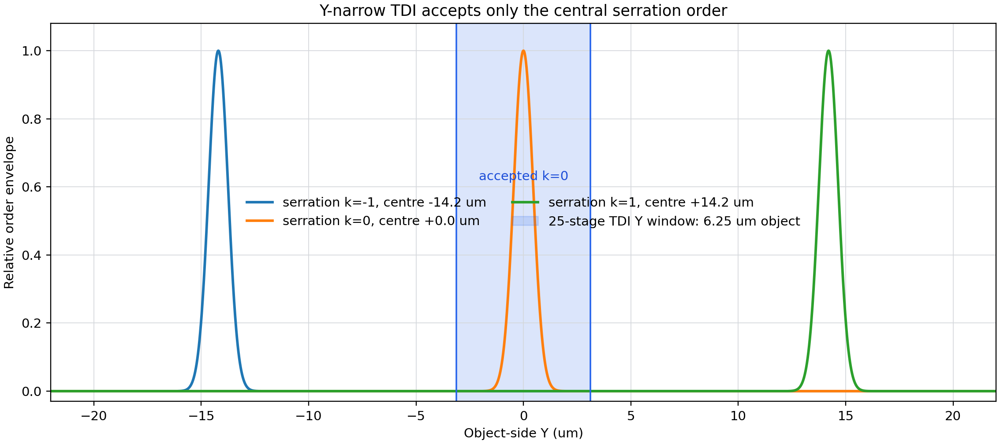
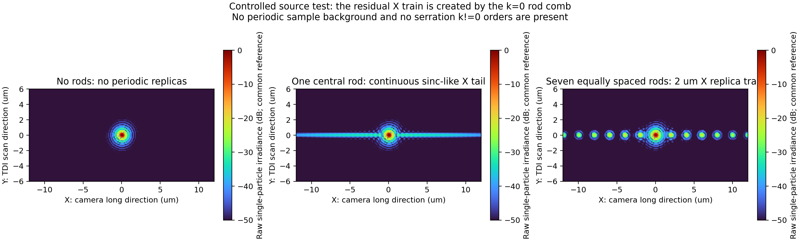

# TDI 与面阵：更新坐标下的档杆衍射级次选择

> 修订日期：2026-09-02。最终坐标为：相机长边与照明线沿 X，TDI扫描、电荷转移及有效窄积分方向沿 Y；档杆长轴和锯齿周期沿傅里叶面 $Y_F$，各档杆沿 $X_F$ 独立定位。旧版相反的X/Y标注全部撤销。

## 1. 直接结论

1. 档杆必须先沿 $X_F$ 与目标周期的频谱峰逐根对准；没有对准时，讨论TDI能否排除档杆衍射没有意义。
2. 锯齿沿 $Y_F$ 周期重复，所以锯齿的 $k\ne0$ 复制像沿像面Y分离。25级TDI可以在满足接收宽度条件时只接收 $k=0$。
3. 档杆主体沿 $X_F$ 的窄宽度以及多根档杆沿 $X_F$ 的排列，会产生沿像面X的连续振铃和梳状副峰。相机长边正是X，因此TDI的Y向窄窗口不能消除这部分响应。
4. 理想速度匹配TDI只增加同一物点的积分信号，不把图像卷积成N行宽，也不会自动相消衍射级次。

## 2. 最终坐标与三种光学效应

| 项目 | 最终方向 | 像面后果 |
|---|---|---|
| 相机长边、照明线 | X | 一条相机线同时接收整条X范围 |
| TDI扫描、电荷转移、窄积分宽度 | Y | 只能排除沿Y偏移的光学复制像 |
| 档杆长轴、锯齿周期 | $Y_F$ | 锯齿 $k\ne0$ 沿像面Y分开 |
| 各档杆中心位置 | $X_F$ | 单杆振铃及多杆梳状副峰沿像面X展开 |

必须区分以下三个“级次/零级”：

| 来源 | 本设计如何处理 |
|---|---|
| 物体周期频谱的离散峰 | 由沿 $X_F$ 独立移动的档杆逐峰遮挡 |
| 锯齿的 $k=0$ | 保留，形成锯齿零级等效软边透过率 |
| 锯齿的 $k=\pm1,\pm2,\ldots$ | 设计为沿像面Y落在TDI有效积分宽度之外 |

## 3. 频谱峰与档杆的对准条件

对Ch3中路接收，二维周期图案的X向第 $m$ 级在机械滤杆面上的坐标为

$$
X_{F,m}=X_{F,c}+M_{FX}f_{FF}\frac{m\lambda}{p_x}.
$$

相邻级次和档杆中心的目标间距为

$$
\boxed{
\Delta X_F=M_{FX}\frac{f_{FF}\lambda}{p_x}
}.
$$

当前 $M_{FX}=2.8169$、$f_{FF}=30$ mm、$\lambda=355$ nm时：

| 物体周期 | 相邻档杆目标间距 |
|---:|---:|
| 2 µm | 15.0 mm |
| 3 µm | 10.0 mm |
| 4 µm | 7.5 mm |
| 5 µm | 6.0 mm |
| 20 µm | 1.5 mm |

因此1.0～1.5 mm间距不能用于遮挡2 µm周期的相邻峰。它对应的是当前中继下约20～30 µm的物体周期。档杆可独立移动的目的，就是针对不同周期重新计算并对准这些坐标，而不是保持固定机械等间距。

有限视野使理想δ峰展宽。若物方有效视野为 $W_x$，频谱峰第一零点量级为

$$
W_{\mathrm{peak},F}\approx
M_{FX}\frac{f_{FF}\lambda}{W_x}.
$$

逐杆验收条件应写为

$$
\boxed{
|X_{F,\mathrm{rod},m}-X_{F,m}|
+\frac{W_{\mathrm{peak},F}}{2}
+\varepsilon_{\mathrm{pos}}
<\frac{w_{\mathrm{core}}}{2}
}.
$$

这里 $\varepsilon_{\mathrm{pos}}$ 包含正弦映射残差、机构定位误差和周期漂移换算量。

## 4. 锯齿为什么沿TDI的Y方向产生级次

锯齿沿档杆长轴 $Y_F$ 周期重复。其复振幅透过率可展开为

$$
T(X_F,Y_F)
=\sum_{k=-\infty}^{\infty}
c_k(X_F)
\exp\left(i2\pi k\frac{Y_F}{p_s}\right).
$$

傅里叶面上的Y向线性相位在像面表现为Y向平移，因此

$$
E_i(x_i,y_i)
=\sum_k E_k(x_i,y_i-k\Delta y_i),
$$

其中

$$
\Delta y_o=\frac{\lambda f_{FF}}{p_s},
\qquad
\Delta y_i=|M|\Delta y_o.
$$

当前参数为

$$
\lambda=0.000355\ \mathrm{mm},\quad
f_{FF}=30\ \mathrm{mm},\quad
p_s=0.75\ \mathrm{mm},\quad
|M|=20,
$$

所以

$$
\boxed{
\Delta y_o=14.2\ \mu\mathrm m,
\qquad
\Delta y_i=284\ \mu\mathrm m.
}
$$

这两个数与沿 $X_F$ 的物体频谱峰间距无关。物体周期决定档杆放在哪里，锯齿周期决定档杆自身的非零级在Y方向移多远。

## 5. TDI积分宽度的正确判据

设：

- $H_Y=Np_Y$：TDI在像面Y方向真正参与积分的有效全宽；
- $W_{P,Y}$：照明线及单个锯齿级次在Y方向按中央能量比例 $P$ 定义的有效全宽；
- $\varepsilon_Y$：离焦、PSF尾部、装调、速度失配、杂散光及电荷扩散的单侧余量。

中央 $k=0$ 接收区与最近的 $k=\pm1$ 有效包络完全不相交，需要

$$
\boxed{
\Delta y_i>\frac{H_Y+W_{P,Y}}{2}+\varepsilon_Y
}.
$$

等价地，允许的最大TDI积分宽度为

$$
\boxed{
H_{Y,\max}=2(\Delta y_i-\varepsilon_Y)-W_{P,Y}.
}
$$

若采用有限支持近似，并且照明线宽与TDI宽度相等，即 $W_Y=H_Y=Np_Y$，则条件简化为

$$
\boxed{
Np_Y<\Delta y_i-\varepsilon_Y.
}
$$

在不加余量的理想硬窗口模型中，$p_Y=5\ \mu$m、$\Delta y_i=284\ \mu$m给出 $N<56.8$。25级满足，256级不满足。

### 5.1 当前125 µm FWHM照明的严格能量宽度

当前25级TDI宽度为

$$
H_{Y,25}=25\times5=125\ \mu\mathrm m,
$$

并按20×倍率匹配物方6.25 µm照明宽度。若像方Y向照明强度为125 µm FWHM高斯，中央能量比例 $P$ 的有效全宽为

$$
W_{P,Y}
=\frac{125}{\sqrt{\ln2}}\operatorname{erf}^{-1}(P).
$$

| 中央能量比例 | $W_{P,Y}$ | 无余量 $H_{Y,\max}$ | 加10 µm单侧余量后的 $H_{Y,\max}$ | 5 µm行数上限 |
|---:|---:|---:|---:|---:|
| 99% | 273.46 µm | 294.54 µm | 274.54 µm | 54 |
| 99.9% | 349.34 µm | 218.66 µm | 198.66 µm | 39 |
| 99.99% | 413.05 µm | 154.95 µm | 134.95 µm | 26 |

因此，在“排除±1级99.99%中央能量并保留10 µm单侧余量”的严格定义下，25级通过，但256级的

$$
H_{Y,256}=256\times5=1280\ \mu\mathrm m
$$

明显不通过。高斯和Airy尾部没有严格有限支持，所以“只有0级”必须始终附带泄漏阈值，而不能声称数学上绝对为零。

## 6. TDI不能消除沿X的多档杆副峰

档杆主体在 $X_F$ 方向具有有限宽度，多根档杆又沿 $X_F$ 放在各频谱峰上，因此像面响应沿X展开。等间距档杆的有限梳状和为

$$
D_N(x)=\sum_m\exp(i2\pi f_mx).
$$

当档杆与周期峰对准、$f_m=m/p_x$ 时，它在 $x=lp_x$ 处相干增强。所有这些副峰与主像具有相同的Y坐标，所以会在同一TDI扫描时刻进入整条X相机线。无论 $H_Y$ 多窄，都不能用Y向TDI窗口将其排除。

锯齿软边可以降低单杆衍射包络，但不能消除频谱完全对准时的多杆阵列因子。当前同包络对比中，锯齿把最强X副峰从约-16.11 dB降至-19.36 dB，仍需作为缺陷串扰评价。

## 7. TDI同步积分不产生扫描拖尾

速度完全匹配时，第 $r$ 级电荷与同一物点同步移动：

$$
Q_j=\sum_{r=0}^{N-1}I_{\mathrm{opt}}(x_j,y_j)\Delta t
=NI_{\mathrm{opt}}(x_j,y_j)\Delta t.
$$

归一化后仍为原光学图像。照明线宽与TDI积分宽度决定曝光和级次接收，不应再次作为空间卷积核。真实速度失配、电荷转移效率不足和电荷扩散属于另一类误差，需要用相机实测参数另行加入。

## 8. 当前验收顺序

1. 根据物体周期、入射角和通道姿态计算每个可传播频谱峰。
2. 用真实Zemax正弦映射把峰换算为各通道局部机械傅里叶面坐标。
3. 将每根档杆沿 $X_F$ 对准目标峰，并检查峰宽、定位及正弦残差裕量。
4. 再使用Y向关系检查锯齿 $k=\pm1$ 是否落在TDI积分区之外。
5. 最后分别评价：周期背景抑制、particle能量保留、沿X的档杆振铃、相邻缺陷串扰和TDI级次泄漏。

当前坐标、频谱和同亮度仿真汇总见[更新相机坐标后的Ch3倾斜照明仿真](更新相机坐标_Ch3倾斜照明仿真.md)。
