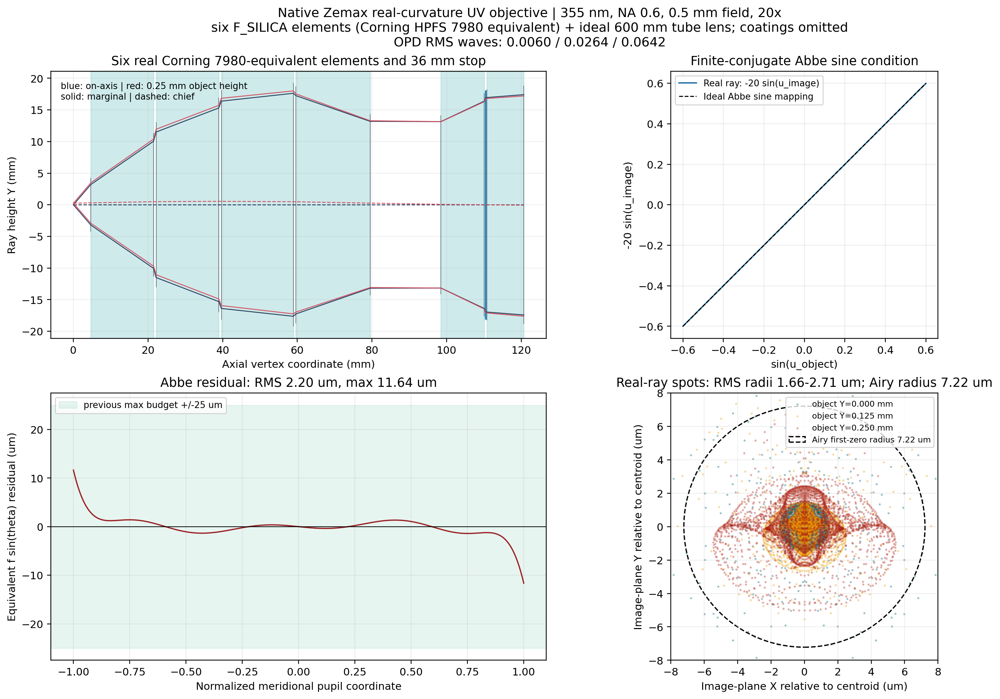
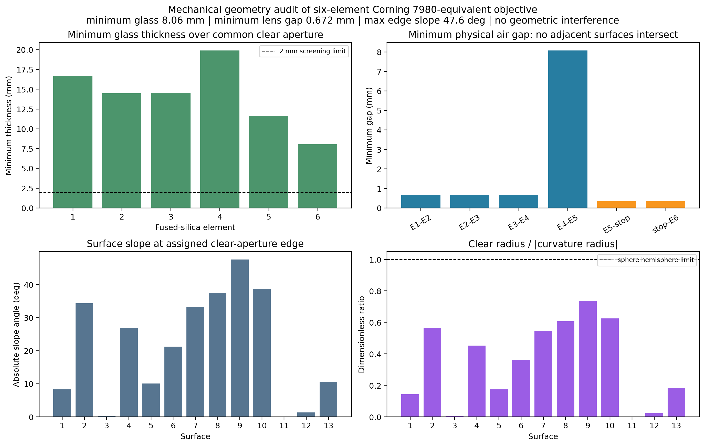

# Zemax 355 nm Corning 7980真实物镜设计与阿贝正弦验证

> 最终计算日期：2026-09-02。计算引擎为本机OpticStudio 2022 R2.02。物镜使用真实材料、真实曲率和真实光线；tube lens按要求保留为600 mm理想Paraxial Lens。未考虑镀膜。

## 1. 设计结论

已完成一套单波长355 nm、物方NA=0.6、物方全视野0.5 mm、约30 mm焦距的真实物镜初始设计。最终结构为6片Corning HPFS 7980等效熔融石英元件、12个真实折射曲面、一个直径36 mm实体光阑和一个600 mm理想tube lens。

| 项目 | Zemax最终值 |
|---|---:|
| 波长 | 355 nm |
| 材料 | Corning HPFS 7980等效；Zemax `F_SILICA` |
| 355 nm折射率 | 1.4760718798 |
| 真实石英元件 | 6片 |
| 物方NA | 0.600 |
| 物方全视野 | 0.500 mm |
| tube lens | 600 mm理想透镜 |
| 实际横向倍率 | −20.0042× |
| 由tube倍率反算的物镜焦距 | 29.9937 mm |
| 正弦瞳直径 $2f\,NA$ | 35.9924 mm |
| 实体光阑直径 | 36.0000 mm |
| 工作距离 | 4.6743 mm |
| 物镜第一面至最后一面 | 116.015 mm |
| 六片玻璃最小实体厚度 | 8.0578 mm |
| 镜片—镜片最小物理空气隙 | 0.6724 mm |
| 最大有效口径边缘斜率 | 47.59°（S9） |
| 曲面/镜片几何干涉 | 无 |
| 三视场有效光线 | 均为3209/3209 |
| 阿贝 $f\sin\theta$ 残差RMS | 2.20 µm |
| 阿贝 $f\sin\theta$ 最大残差 | 11.64 µm |

该阿贝残差满足项目此前采用的建议验收值：RMS不超过10 µm、最大值不超过25 µm。

## 2. Corning 7980在本机Zemax中的材料实现

本机Zemax 2022玻璃库中，直接输入`CORNING 7980`、`HPFS 7980`或`7980`不会链接到有效玻璃数据，折射率会保持为1，因此不能使用这些字符串建立真实处方。本机有效目录材料`F_SILICA`在355 nm给出

$$
n_{\mathrm{Zemax}}(355\ \mathrm{nm})=1.4760718797566.
$$

使用Corning 7980所采用的熔融石英Sellmeier形式

$$
n^2-1=
\frac{0.6961663\lambda^2}{\lambda^2-0.0684043^2}
+\frac{0.4079426\lambda^2}{\lambda^2-0.1162414^2}
+\frac{0.8974794\lambda^2}{\lambda^2-9.896161^2},
$$

其中波长以微米为单位，在 $\lambda=0.355\ \mu\mathrm m$ 得

$$
n_{7980}=1.4760718803802.
$$

二者差约 $6.2\times10^{-10}$。因此本设计在Zemax中使用有效材料名`F_SILICA`，并在模型标题和报告中明确标记为“Corning HPFS 7980等效熔融石英”。这比输入一个折射率为1的无效`7980`名称更可靠。

## 3. 最终六片物镜曲率处方

Zemax顺序表中的材料表示“该面之后的介质”。半口径由65×65瞳网格、轴上/半视场/全视场三组真实光线的最大足迹再增加至少0.5 mm得到；S11是固定18 mm半径的实体光阑。

| 面 | 半径R/mm | 到下一面/mm | 面后材料 | 有效半口径/mm | 圆锥常数K | 说明 |
|---:|---:|---:|---|---:|---:|---|
| OBJ | ∞ | 4.6743 | AIR | 0.250 | 0 | 物面 |
| S1 | −29.1675 | 16.8100 | F_SILICA | 4.2 | +0.481312 | 元件1前表面 |
| S2 | −20.0291 | 0.6724 | AIR | 11.3 | −0.009283 | 元件1后表面 |
| S3 | −3951.1333 | 16.8100 | F_SILICA | 13.0 | 0 | 元件2前表面 |
| S4 | −37.2728 | 0.6724 | AIR | 16.9 | 0 | 元件2后表面 |
| S5 | +103.8669 | 19.3045 | F_SILICA | 18.1 | +0.341254 | 元件3前表面 |
| S6 | −53.0417 | 0.6724 | AIR | 19.2 | 0 | 元件3后表面 |
| S7 | +34.2255 | 19.9070 | F_SILICA | 18.7 | 0 | 元件4前表面 |
| S8 | +23.5246 | 18.9854 | AIR | 14.3 | −0.000584 | 元件4后表面 |
| S9 | −19.1170 | 11.6131 | F_SILICA | 14.1 | +0.003796 | 元件5前表面 |
| S10 | −28.1565 | 0.3362 | AIR | 17.6 | 0 | 元件5后表面 |
| S11 | ∞ | 0.3362 | AIR | 18.0 | 0 | 36 mm实体光阑/正弦瞳 |
| S12 | +792.3155 | 9.8949 | F_SILICA | 18.2 | 0 | 元件6前表面 |
| S13 | −102.5963 | 50.0000 | AIR | 18.8 | +0.066586 | 元件6后表面 |
| S14 | 理想 | 600.0000 | AIR | 30.0 | — | 600 mm理想tube lens |
| IMG | ∞ | — | — | 7.0 | 0 | 20×像面/TDI面 |

面矢高使用

$$
z(r)=\frac{c r^2}{1+\sqrt{1-(1+K)c^2r^2}},
\qquad c=\frac{1}{R}.
$$

所有有效半口径均小于对应圆锥面的实数定义域半径。三视场最大光线足迹与分配口径详见[footprint_clear_apertures.csv](results/uv_real_objective/footprint_clear_apertures.csv)。六片元件在共同有效半径内的最小实体厚度为8.0578 mm，没有零厚度或曲面相交。

### 3.1 物理干涉、镜片厚度和曲率可制造性审查

本节不是只检查Zemax中心厚度，而是在每一对曲面共同有效半口径内逐点计算真实矢高。对同一片玻璃，局部实体厚度为

$$
t_{\mathrm{glass}}(r)=t_c+z_{\mathrm{back}}(r)-z_{\mathrm{front}}(r),
$$

对相邻的两个独立元件，局部空气隙为

$$
g_{\mathrm{air}}(r)=g_c+z_{\mathrm{next}}(r)-z_{\mathrm{prev}}(r).
$$

在 $0\le r\le r_{\mathrm{common}}$ 上搜索最小值；只要最小空气隙大于零，相邻曲面就不发生物理相交。结果如下。

| 元件 | 共同检查半径/mm | 中心厚度/mm | 最小实体厚度/mm | 最小值位置/mm |
|---:|---:|---:|---:|---:|
| E1 | 4.2 | 16.8100 | 16.6695 | 4.2 |
| E2 | 13.0 | 16.8100 | 14.4908 | 13.0 |
| E3 | 18.1 | 19.3045 | 14.5273 | 18.1 |
| E4 | 14.3 | 19.9070 | 19.9070 | 0.0 |
| E5 | 14.1 | 11.6131 | 11.6131 | 0.0 |
| E6 | 18.2 | 9.8949 | **8.0578** | 18.2 |

六片石英在有效口径内均远厚于本轮采用的2 mm初步筛查线，不存在“中心厚度尚可、边缘被曲面吃穿”的问题。

| 相邻界面 | 中心空气隙/mm | 最小物理空气隙/mm | 结论 |
|---|---:|---:|---|
| E1—E2 | 0.6724 | 0.6724 | 不相交；可用精密隔圈形成 |
| E2—E3 | 0.6724 | 0.6724 | 不相交；可用精密隔圈形成 |
| E3—E4 | 0.6724 | 0.6724 | 不相交；可用精密隔圈形成 |
| E4—E5 | 18.9854 | 8.0785 | 不相交，余量充分 |
| E5—光阑 | 0.3362 | 0.3362 | 光学上不相交，但机械空间偏紧 |
| 光阑—E6 | 0.3362 | 0.3362 | 光学上不相交，但机械空间偏紧 |

曲率最强的是S9：$R=-19.1170$ mm、有效半口径14.1 mm，$r/|R|=0.7376$，有效口径边缘斜率47.59°。它没有接近球面的半球极限 $r/|R|=1$，圆锥面实数定义域到有效口径仍有4.9809 mm径向余量，因此不是数学奇异或不可成形曲面；但它是本设计加工难度最高的表面，应在详细设计阶段对刀具可达性、抛光去除函数和检测方案做专项评审。其余曲面斜率均不超过38.69°。

综合判断如下：

- **物理干涉：通过。** 六片镜片以及镜片与光阑平面均没有几何相交。
- **玻璃过薄：通过。** 最小实体厚度8.0578 mm，没有薄边或薄中心风险。
- **曲率过大：有条件通过。** S9较陡但未接近几何极限，属于可设计、需工艺评审，而不是明显不合理曲面。
- **镜片间隙：通过初步工程筛查。** 0.6724 mm可用精密隔圈实现，但装配余量不宽裕。
- **光阑安装：需要修改。** 当前光学模型把S11当作零厚度薄片，前后仅各0.3362 mm。薄金属箔/沉积式光阑可保留该模型；若使用有刚性肩部的机械光阑座，建议把两侧净空提高到至少1.0 mm，再把这两个间隔设为变量重新优化，不能直接按当前0.3362 mm制造。

## 4. 焦距、倍率和36 mm正弦瞳

理想tube lens焦距为600 mm，Zemax真实光线倍率为

$$
M=-20.0042058.
$$

因此物镜有效焦距由物镜—tube组合反算为

$$
f_{\mathrm{obj}}=\frac{600}{|M|}=29.9937\ \mathrm{mm}.
$$

在物方NA=0.6时，满足正弦映射的傅里叶瞳直径为

$$
D_{\sin}=2f_{\mathrm{obj}}NA
=35.9924\ \mathrm{mm},
$$

与36 mm实体光阑相差0.0076 mm。这里使用的是高NA的 $f\sin\theta$ 瞳，而不是 $f\tan\theta$ 坐标。

## 5. 阿贝正弦条件验证

本系统物方和像方均为空气。对轴上物点，Zemax真实光线在401个子午瞳位置上计算

$$
R_{\sin}(p)=\sin u_o(p)-M_s\sin u_i(p),
\qquad M_s=-20.
$$

由于Zemax在该反向物镜模型中像面方向余弦与有符号横向倍率采用同一约定，所以使用 $M_s=-20$。将无量纲残差换算成物镜傅里叶面的坐标误差：

$$
\Delta X_{\sin}(p)=f_{\mathrm{obj}}R_{\sin}(p).
$$

固定标称−20倍时：

| 阿贝指标 | 数值 |
|---|---:|
| 方向余弦残差RMS | $7.33\times10^{-5}$ |
| 方向余弦最大绝对残差 | $3.88\times10^{-4}$ |
| 等效 $f\sin\theta$ RMS | 2.20 µm |
| 等效 $f\sin\theta$ 最大值 | 11.64 µm |

若只对401条真实光线拟合最佳正弦倍率，得到 $M_s=-20.00197$；此时等效残差RMS为1.89 µm，最大值为9.86 µm。最终验收仍采用固定−20倍结果，避免利用重新拟合掩盖倍率误差。

## 6. 波前、像斑和全视场结果

| 物方Y视场 | 有效光线 | 像面质心Y | RMS像斑半径 | OPD RMS | 近似Strehl |
|---:|---:|---:|---:|---:|---:|
| 0.000 mm | 3209/3209 | 0.0000 mm | 1.699 µm | 0.0060波 | 0.999 |
| 0.125 mm | 3209/3209 | −2.4995 mm | 1.664 µm | 0.0264波 | 0.973 |
| 0.250 mm | 3209/3209 | −4.9994 mm | 2.712 µm | 0.0642波 | 0.850 |

像方NA约为 $0.6/20=0.03$，355 nm下Airy第一零点半径约7.22 µm。三视场RMS像斑半径均明显小于该值；边场OPD RMS为0.0642波，低于常用0.071波Maréchal参考值。

## 7. Zemax优化方式

1. 使用用户提供物镜的曲率拓扑作为种子，反向并缩放到约30 mm焦距；
2. 所有原玻璃全部替换为`F_SILICA`，即本轮Corning 7980等效材料；
3. 第一阶段只优化真实曲率和工作距离；
4. 第二阶段允许选定曲面圆锥常数变化，并限制在 $-8\le K\le0.5$；
5. 以三个物高、33个代表瞳点的像面真实光线和波前为像质约束；
6. 使用`REAB`、`PROB`和`DIFF`显式建立 $\sin u_o+20\sin u_i=0$ 的轴上阿贝约束；
7. 删除四个同材质、零折射率跳变的种子内部边界，精确合并为六片真实石英元件；
8. 用65×65圆瞳网格、三个视场重新追迹，并按足迹设置实际有效口径。

### 7.1 阿贝—频谱线性—滤波闭环复核

使用本页最终六片模型又完成了三项联合验证：

| 项目 | 结果 |
|---|---:|
| 阿贝 $f\sin u$ RMS/最大残差 | 2.199 / 11.639 µm |
| 实际傅里叶面映射 | $Y_{\mathrm{BFP}}=29.10232883\sin u$ mm |
| 频谱坐标线性 $R^2$ | 0.999998763 |
| 2 µm实际相邻级次间距 | 5.165663 mm |
| 2048网格周期背景抑制 | 48.72 dB |
| particle原始峰值保留 | 50.18% |
| 最强相邻档杆梳状副像 | −9.12 dB |

滤波计算直接采用该Zemax模型导出的401点物方正弦—物理BFP坐标关系和3209点二维OPD瞳，没有用理想物镜替换真实物镜。完整方法、同一强度尺度图和适用边界见：[Zemax 355 nm真实物镜：阿贝条件、频谱线性和傅里叶滤波验证](Zemax_355nm真实物镜_阿贝频谱线性与滤波验证.md)。

## 8. 文件和适用边界

- 最终六片Zemax模型：[uv355_corning7980_6element_ideal_tube.zos](results/uv_real_objective/models/uv355_corning7980_6element_ideal_tube.zos)
- 文本Zemax模型：[uv355_corning7980_6element_ideal_tube.zmx](results/uv_real_objective/models/uv355_corning7980_6element_ideal_tube.zmx)
- 六片曲率表：[surface_prescription_6element.csv](results/uv_real_objective/surface_prescription_6element.csv)
- 阿贝401点数据：[abbe_sine_fan.csv](results/uv_real_objective/abbe_sine_fan.csv)
- 验证摘要：[simplified_validation_summary.json](results/uv_real_objective/simplified_validation_summary.json)
- 机械几何审查摘要：[mechanical_geometry_audit.json](results/uv_real_objective/mechanical_geometry_audit.json)
- 六片实体厚度数据：[element_thickness_audit.csv](results/uv_real_objective/element_thickness_audit.csv)
- 相邻曲面空气隙数据：[air_gap_interference_audit.csv](results/uv_real_objective/air_gap_interference_audit.csv)
- 曲率、边缘斜率及定义域数据：[surface_curvature_audit.csv](results/uv_real_objective/surface_curvature_audit.csv)
- 优化脚本：[design_uv_real_objective.py](zemax/design_uv_real_objective.py)
- 六片化与口径验证：[simplify_uv_objective.py](zemax/simplify_uv_objective.py)
- 绘图脚本：[plot_uv_real_objective.py](src/plot_uv_real_objective.py)
- 机械几何审查脚本：[audit_uv_objective_geometry.py](src/audit_uv_objective_geometry.py)

本轮是单波长初始光学设计，按要求不包含镀膜。尚未进行公差、装调、温度、激光损伤、表面粗糙度、偏振、杂散光和石英内部缺陷等级评价。下一步用于傅里叶滤波时，应把该真实物镜替换到上一轮相同的2 µm particle POP模型中，并重新标定真实后焦面峰位；不能直接沿用理想物镜的5.325 mm峰间距作为加工坐标。
