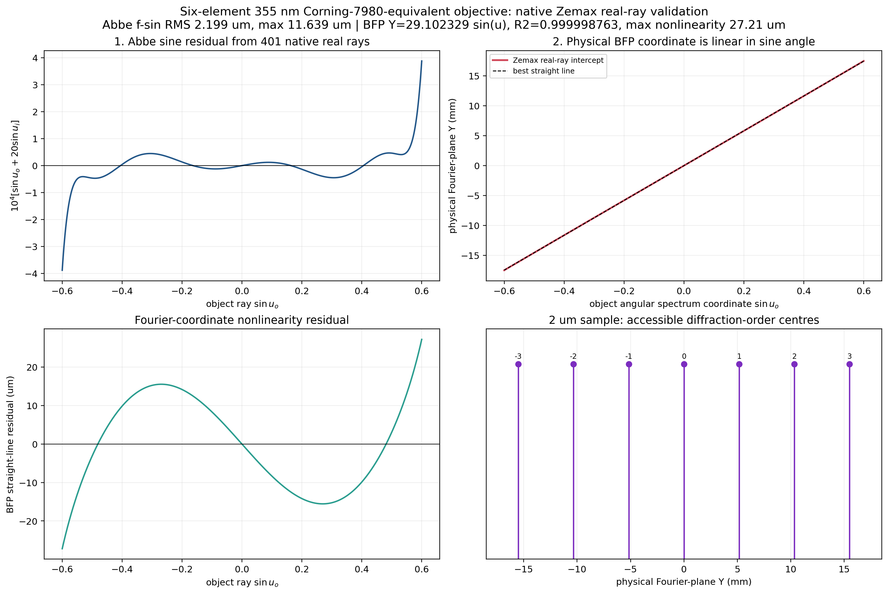
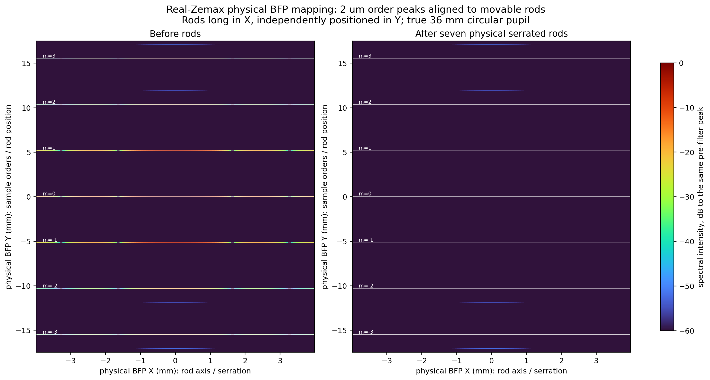
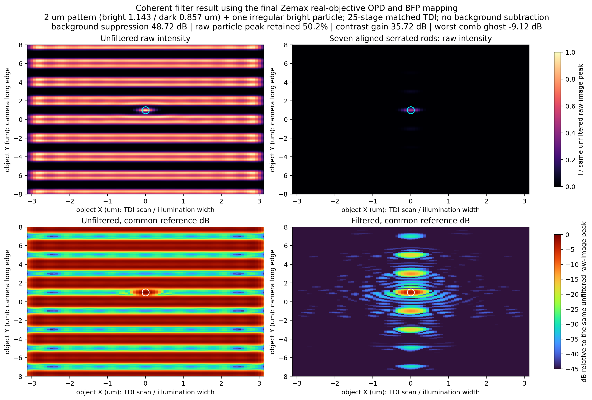

# Zemax 355 nm真实物镜：阿贝条件、频谱线性和傅里叶滤波验证

> 最终计算日期：2026-09-02。基础模型为6片Corning HPFS 7980等效熔融石英物镜，物方NA=0.6，实际倍率−20.0042×，真实36 mm瞳，tube lens为600 mm理想透镜。本页验证的是中路成像、轴上相干照明条件。

## 1. 验证结论

| 验证项目 | 结果 | 判断 |
|---|---:|---|
| 阿贝 $f\sin u$ 残差RMS | 2.199 µm | 通过10 µm项目参考线 |
| 阿贝 $f\sin u$ 最大残差 | 11.639 µm | 通过25 µm项目参考线 |
| 傅里叶面正弦坐标斜率 | 29.102329 mm | 应使用该实测值定位档杆 |
| 傅里叶坐标线性拟合 $R^2$ | 0.999998763 | 通过 |
| 全NA范围线性残差RMS/最大值 | 12.22 / 27.21 µm | 相对毫米级杆宽很小 |
| 2 µm实际相邻级次间距 | 5.165663 mm | 非理想模型的5.325 mm |
| 2 µm级次点最大位置非线性 | 13.21 µm | 仅为1 mm核心杆宽的1.32% |
| 周期背景抑制（2048网格） | 48.72 dB | 有效；深抑制值受离散采样影响 |
| 原始particle峰值保留 | 50.18% | 有效 |
| particle/周期背景对比提升 | 35.72 dB | 有效 |
| 最强相邻梳状副像 | particle峰值的12.24%，即−9.12 dB | 仍需继续降低振铃串扰 |

因此，这个真实物镜已经满足阿贝正弦映射，物理傅里叶面的频率位置近似严格线性；把7根档杆放到**真实模型计算的位置**后，可以显著抑制2 µm周期背景并保留孤立高亮particle。但是，当前7杆梳状遮挡仍会形成−9.12 dB的相邻副像，滤波器还不是“无串扰”的最终状态。

## 2. 坐标关系和验证场景

本轮严格采用已经确认的相机坐标：

- X：TDI扫描和电荷转移方向；
- Y：相机长边和照明线方向；
- 档杆长轴、三角锯齿重复方向：傅里叶面X；
- 档杆独立调节和样品周期级次方向：傅里叶面Y。

样品为沿Y周期变化的水平亮条纹，周期2 µm，其中亮区1.142857 µm、暗区0.857143 µm；一个约0.6 µm的不规则高亮particle位于暗区。25级TDI、像方5 µm像元对应物方积分/照明宽度

$$
W_{\mathrm{obj}}=\frac{25\times5\ \mu\mathrm m}{20}=6.25\ \mu\mathrm m.
$$

匹配扫描时TDI不把图像拉长；本轮只把6.25 µm作为X方向照明和有效采集宽度。

## 3. 阿贝正弦条件

对轴上物点，在整个归一化瞳径上追迹401条Zemax真实光线。物方和像方均为空气，标称−20倍条件为

$$
R_{\mathrm{Abbe}}(p)=\sin u_o(p)+20\sin u_i(p).
$$

换算成物镜傅里叶坐标残差：

$$
\Delta Y_{\mathrm{Abbe}}=30\ \mathrm{mm}\times R_{\mathrm{Abbe}}.
$$

计算得到

$$
\operatorname{RMS}(\Delta Y_{\mathrm{Abbe}})=2.199\ \mu\mathrm m,
\qquad
\max|\Delta Y_{\mathrm{Abbe}}|=11.639\ \mu\mathrm m.
$$

这与前一轮独立验证结果完全一致，说明六片化、物理口径设置和后续滤波模型没有改变物镜的阿贝条件。

## 4. 物理傅里叶面的线性度

同一批真实光线同时追迹到36 mm实体光阑S11，直接使用光线在该面的物理截点，而不是用理想 $f\sin u$ 代替。直线拟合为

$$
Y_{\mathrm{BFP}}=29.10232883\sin u_o+1.03\times10^{-15}\ \mathrm{mm}.
$$

拟合结果为

$$
R^2=0.9999987626,
$$

全NA范围内的坐标残差RMS为12.22 µm，最大值27.21 µm。对于周期 $p$ 的衍射级次，正入射时

$$
\sin u_m=\frac{m\lambda}{p},
$$

因此真实物镜上的级次位置应取

$$
Y_m=29.10232883\frac{m\lambda}{p},
$$

而不是直接使用名义30 mm焦距。2 µm周期、355 nm波长下：

| 级次 $m$ | $\sin u_m$ | 档杆中心Y/mm |
|---:|---:|---:|
| −3 | −0.5325 | −15.496990 |
| −2 | −0.3550 | −10.331327 |
| −1 | −0.1775 | −5.165663 |
| 0 | 0 | 0 |
| +1 | +0.1775 | +5.165663 |
| +2 | +0.3550 | +10.331327 |
| +3 | +0.5325 | +15.496990 |

相邻级次间距为5.165663 mm。实际7个级次点相对于全范围直线拟合的最大偏差为13.21 µm，只占1 mm核心杆宽的1.32%，频谱对准余量充分。

## 5. 使用真实Zemax瞳进行相干滤波

### 5.1 为什么没有采用不合格的原生POP像面图

本轮也实际建立并运行了包含物体UDA、双层锯齿档杆和36 mm光阑的OpticStudio原生POP模型。检查发现，在这个NA=0.6、工作距离4.67 mm的有限共轭多片系统中，当前逐面POP设置把2 µm扩展周期物体传播成平滑包络；无滤波像面不能重建原始条纹。这不满足最基本的“无像差时无滤波图应接近原物”检查，因此该原生POP图被判定为无效诊断结果，没有用来证明滤波性能。

最终滤波计算仍然使用同一个Zemax真实物镜，而不是换回理想透镜：

1. 从最终`.zos`导出401条光线的实际 $\sin u\rightarrow Y_{\mathrm{BFP}}$ 映射；
2. 从最终系统导出3209点二维瞳OPD，轴上OPD RMS为0.006015波；
3. 使用真实NA=0.6和36 mm圆瞳；
4. 将二维OPD作为相干传递函数相位：

$$
H(f_x,f_y)=P(f_x,f_y)
\exp\!\left[i2\pi W(f_x,f_y)\right];
$$

5. 使用真实光线映射把空间频率转换到物理档杆坐标，再乘以7根锯齿档杆的二值振幅遮挡；
6. 反变换得到滤波像。全部指标使用原始强度，不减周期参考背景。

这是一种“Zemax真实瞳 + 相干傅里叶传播”的闭环方法。它保留了本物镜的真实波前、真实频谱坐标和真实瞳径，同时避开了已经未通过物像重建检查的高NA逐面POP结果。

### 5.2 档杆参数

| 参数 | 数值 |
|---|---:|
| 档杆数量 | 7根，A层3根+B层4根 |
| A层级次 | −2、0、+2 |
| B层级次 | −3、−1、+1、+3 |
| 核心宽度 | 1.0 mm |
| 单侧三角齿深 | 0.5 mm |
| 最大包络宽度 | 2.0 mm |
| 沿X三角齿周期 | 0.75 mm |
| 物理瞳直径 | 36 mm |

### 5.3 同一强度尺度下的滤波结果

上排两图使用同一个线性强度参考 $I/I_{\mathrm{ref}}=0\ldots1$；下排两图使用同一个未滤波原始峰值作为0 dB。没有减去周期背景，也没有对滤波图单独归一化。

2048网格结果：

- 原始周期背景功率抑制48.72 dB；
- particle原始峰值保留50.18%；
- particle相对于周期pattern的对比度从0.49 dB提高到36.21 dB，提升35.72 dB；
- 最强相邻梳状副像为particle峰值的12.24%，即−9.12 dB。

线性图证明particle在共同曝光尺度下仍然可见；对数图同时暴露了档杆梳状函数造成的相邻副像，不能把这些副像隐藏或归为TDI拖尾。

## 6. 网格复核和数值边界

| 网格 | 物方采样/µm | 背景抑制/dB | particle峰值保留/% | 对比提升/dB |
|---:|---:|---:|---:|---:|
| 1024 | 0.1465 | 37.58 | 50.36 | 30.56 |
| 2048 | 0.0732 | 48.72 | 50.18 | 35.72 |
| 3072 | 0.0488 | 76.50 | 50.07 | 36.45 |
| 4096 | 0.0366 | 62.73 | 50.05 | 36.30 |

particle峰值保留在1024到4096网格间只变化0.31个百分点；2048以上的对比提升变化小于0.74 dB。背景残余已经接近二值边缘离散误差，因而深抑制数值不单调。工程结论应保守表述为：本场景背景抑制至少37.6 dB；2048网格名义结果为48.72 dB，不把62–76 dB数值当作可制造系统精度。

## 7. 最终判断和适用边界

1. **阿贝条件：通过。** 当前真实物镜的正弦残差满足本项目已有验收线。
2. **频谱面线性：通过。** 但加工坐标必须使用29.102329 mm真实斜率，不能继续使用30 mm理想值。
3. **傅里叶滤波：有效但仍有串扰。** 周期背景显著下降，particle保留约50%，但七杆梳状副像仍为−9.12 dB。

当前滤波结果是轴上、单波长、标量相干、局部平移不变近似；不包含镀膜、偏振、散射、装调误差和全视场场依赖。边场OPD RMS可达0.0642波，因此如果整个0.5 mm视野都要同时达到相同滤波效果，应按多个物高分别导出Zemax瞳并重复本验证。75°倾斜照明也必须先按入射波矢平移频谱，再重新定位各通道档杆。

## 8. 交付文件

- 最终真实物镜：[uv355_corning7980_6element_ideal_tube.zos](results/uv_real_objective/models/uv355_corning7980_6element_ideal_tube.zos)
- 阿贝与频谱真实光线数据：[real_ray_abbe_and_fourier_fan.csv](results/uv_real_objective_fourier_validation/real_ray_abbe_and_fourier_fan.csv)
- 2–5 µm级次位置数据：[real_objective_frequency_order_positions.csv](results/uv_real_objective_fourier_validation/real_objective_frequency_order_positions.csv)
- 滤波指标：[zemax_pupil_filter_metrics.json](results/uv_real_objective_fourier_validation/zemax_pupil_filter_metrics.json)
- 网格复核：[grid_convergence.csv](results/uv_real_objective_fourier_validation/grid_convergence.csv)
- 滤波图像数组：[zemax_pupil_filter_images.npz](results/uv_real_objective_fourier_validation/zemax_pupil_filter_images.npz)
- Zemax真实光线及POP审查脚本：[validate_uv_real_objective_fourier_filter.py](zemax/validate_uv_real_objective_fourier_filter.py)
- Zemax真实瞳相干滤波脚本：[validate_uv_real_objective_coherent_filter.py](src/validate_uv_real_objective_coherent_filter.py)
- 绘图脚本：[plot_uv_real_objective_fourier_validation.py](src/plot_uv_real_objective_fourier_validation.py)
