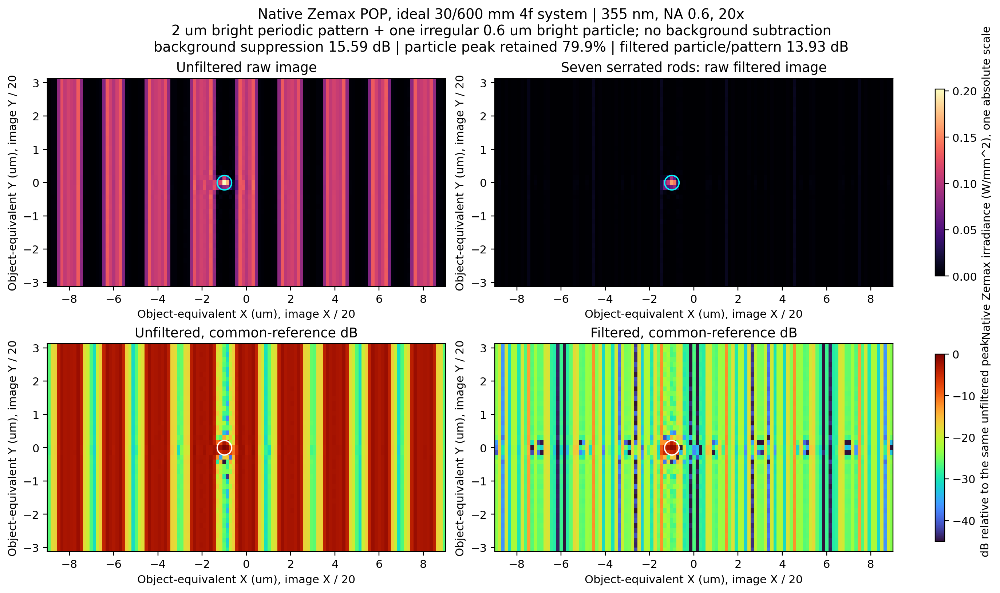
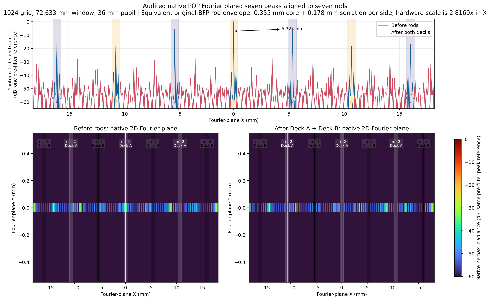

# Zemax理想透镜：2 µm周期pattern与孤立高亮particle原生POP验证

> 计算日期：2026-09-02。计算引擎为本机OpticStudio 2022 R2.02的原生Physical Optics Propagation（POP），不是Python FFT替代结果。滤波前后均使用原始照度，使用同一绝对强度参考，不进行周期背景相减。

## 1. 结论

在355 nm、物镜焦距30 mm、NA=0.6、真实光瞳直径36 mm、管镜焦距600 mm和20×成像条件下，选择2 µm周期亮暗pattern中的一个约0.6 µm不规则高亮particle作为缺陷案例。七根锯齿档杆与 $m=-3\ldots+3$ 七个传播级次对准后，本机Zemax原生POP得到：

| 指标 | 原生POP结果 |
|---|---:|
| 周期背景抑制 | 15.59 dB |
| particle峰值能量保留 | 79.93% |
| 未滤波particle/周期背景 | 1.86 dB |
| 滤波后particle/周期残余 | 13.93 dB |
| 统一线性色标峰值 | 0.20213 W/mm² |
| POP警告 | 无 |

这说明理想无像差4f系统中，当前七杆位置能够显著压低2 µm周期pattern，同时保留大部分局部particle峰值。该结果是后续真实355 nm物镜设计的理想上限基准，不是实际镜头像差、偏振、散射和加工误差均已验证的结论。



上图上排使用同一个 $0\sim0.20213\ \mathrm{W/mm^2}$ 绝对照度范围。下排使用同一个未滤波峰值作为0 dB参考。图中没有滤波后重新归一化，也没有减去规则周期参考图。

## 2. Zemax理想4f模型

| 面 | 功能 | 到下一面的厚度 |
|---|---|---:|
| S1 | 2 µm周期振幅pattern；可选孤立particle UDA | 30 mm |
| S2 | 理想Paraxial Lens，$f_1=30$ mm；圆瞳半径18 mm | 30 mm |
| S3 | 傅里叶面Deck A，$m=-2,0,+2$ | 0 mm（理想等效共面） |
| S4 | 傅里叶面Deck B，$m=-3,-1,+1,+3$ | 600 mm |
| S5 | 理想Paraxial Lens，$f_2=600$ mm | 600 mm |
| S6 | 20×像面 / TDI采集面 | — |

倍率为

$$
M=-\frac{f_2}{f_1}=-20.
$$

本轮是第一阶段理想对比，因此S2、S5使用Zemax的理想近轴透镜，A/B层在同一傅里叶面等效叠加。机械方案中的4 mm层间距尚未加入；真实系统应使用中继共轭或逐层离焦传播验证两层位置。

### 2.1 缺陷案例

- pattern周期：2.0 µm；
- 亮条宽：1.143 µm；
- 暗区宽：0.857 µm；
- 缺陷：暗区内一个约0.6 µm、边界不规则的高亮particle；
- 照明：Ch3中路、轴上相干Top-Hat理想照明；
- 几何方向：pattern沿X变化、条纹沿Y延伸；傅里叶峰沿 $X_F$ 排列；档杆长轴和锯齿周期沿 $Y_F$，每根杆沿 $X_F$ 对准相应峰。

这里将高亮particle作为等效振幅缺陷建模，适合先验证滤波和成像链路。它不等同于对真实三维particle进行RCWA、FDTD或严格暗场散射计算。

## 3. 频谱峰和档杆位置

理想正弦傅里叶面在本轮小角度级次下给出相邻峰间距

$$
\Delta X_F=\frac{f_1\lambda}{p}
=\frac{30\times0.000355}{0.002}
=5.325\ \mathrm{mm}.
$$

因此原物镜后焦面七个档杆中心为

$$
X_m=m\times5.325\ \mathrm{mm},\qquad m=-3,-2,\ldots,+3.
$$

加入 $M_{FX}=2.8169$ 的X向傅里叶中继后，机械滤杆面相邻间距为

$$
\Delta X'_F=M_{FX}\Delta X_F=15.000\ \mathrm{mm}.
$$

1.0 mm硬质核心和0.5 mm单侧锯齿深度在原后焦面中的等效尺寸分别为

$$
w_{c,F}=\frac{1.0}{2.8169}=0.355\ \mathrm{mm},
\qquad
b_F=\frac{0.5}{2.8169}=0.178\ \mathrm{mm}.
$$

最大等效包络为 $w_{c,F}+2b_F=0.710$ mm；机械滤杆面仍为2.0 mm最大包络。锯齿周期沿Y保持0.75 mm。



频谱图上部为对Y积分后的原生Zemax照度。蓝线显示滤波前七个主峰位于 $m\times5.325$ mm；红线显示两层档杆后这些主峰被移除。两张二维图使用同一个滤波前峰值作为dB参考。杆间剩余谱是有限计算窗、pattern边缘和局部particle的连续频谱，不是用背景相减产生的结果。

## 4. POP采样有效性

本轮使用1024×1024网格和0.15 mm局部物面计算窗。理想傅里叶面理论计算范围为

$$
L_F\approx\frac{N\lambda f_1}{L_0}
=\frac{1024\times0.000355\times30}{0.15}
=72.704\ \mathrm{mm}.
$$

Zemax实际导出的傅里叶面范围为72.633 mm，覆盖36 mm真实光瞳以及最外侧 $m=\pm3$ 的 $\pm15.975$ mm峰。像面实际范围为2.997 mm，与 $20\times0.15=3.000$ mm一致。

物方等效采样为

$$
\Delta x_o=\frac{0.15}{1024}=0.1465\ \mu\mathrm m,
$$

因此0.6 µm particle跨越约4个采样点；25级、5 µm像元行距对应的125 µm像方TDI积分宽度也完整处于2.997 mm像面窗口内。POP设置显式使用`TopHat`、`Irradiance`、1024×1024枚举和`NoZoom`，六组计算均无Zemax警告。

## 5. 原始功率核对

| 场景 | 整个POP窗口积分功率 |
|---|---:|
| 规则pattern，无档杆 | 0.558044 W |
| pattern + particle，无档杆 | 0.558055 W |
| 规则pattern，七根档杆 | 0.015280 W |
| pattern + particle，七根档杆 | 0.015290 W |

周期背景抑制指标在125 µm像方TDI接收带内计算；particle峰值保留率在同一像面坐标和同一W/mm²强度基准下计算。TDI速度匹配时只进行同步电荷积分，不人为拉伸、复制或背景相减，因此本轮静态像面可以作为理想逐像素扫描拼接的空间图像基准。

## 6. 可复现文件

- Zemax运行脚本：[run_current_ideal_particle_pop.py](zemax/run_current_ideal_particle_pop.py)
- 绘图脚本：[plot_current_ideal_zemax_pop.py](src/plot_current_ideal_zemax_pop.py)
- 原生网格：[native_pop_grids.npz](results/zemax_current_ideal_particle/native_pop_grids.npz)
- 指标汇总：[summary.json](results/zemax_current_ideal_particle/summary.json)
- 四个Zemax模型：[models](results/zemax_current_ideal_particle/models/)
- UDA物体与双层锯齿档杆：[uda](results/zemax_current_ideal_particle/uda/)

本机复现命令：

```powershell
E:\anconda\envs\lens-design-zemax22\python.exe .\zemax\run_current_ideal_particle_pop.py --output-dir .\results\zemax_current_ideal_particle --grid 1024
$env:MPLBACKEND='Agg'
E:\anconda\envs\fourier-filter\python.exe .\src\plot_current_ideal_zemax_pop.py --input-dir .\results\zemax_current_ideal_particle
```

## 7. 适用边界和下一阶段

本轮已经验证：理想4f传播、36 mm瞳、2 µm频谱位置、七根二值锯齿UDA、统一原始亮度评价和25级TDI接收带。尚未验证：

1. 355 nm真实玻璃、曲率和镀膜；
2. 真实物镜的阿贝正弦残差、波前和场依赖峰位；
3. A/B层4 mm轴向分离；
4. 75°倾斜照明和Ch1/Ch2通道；
5. particle的矢量散射、偏振、杂散光和探测器MTF。

下一阶段应保持本轮相同物体、档杆和统一强度评价，只把S2/S5理想透镜替换为满足355 nm、30 mm、NA=0.6和20×要求的真实处方。这样真实镜头结果可以与本理想基准逐项直接比较。
