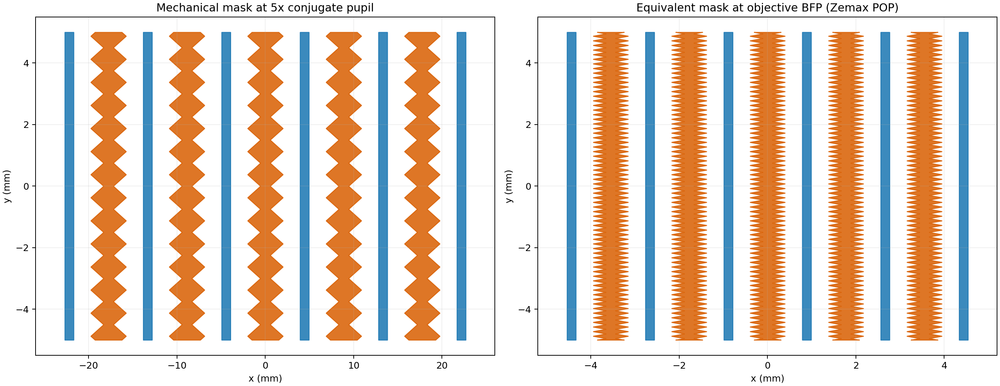
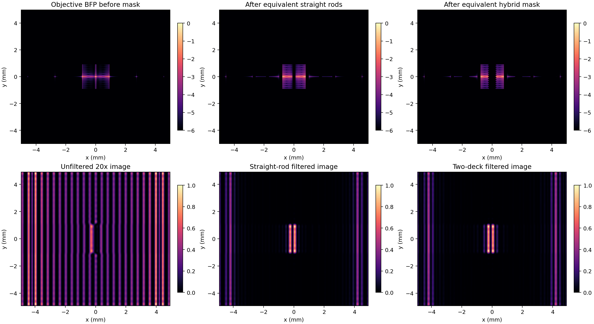
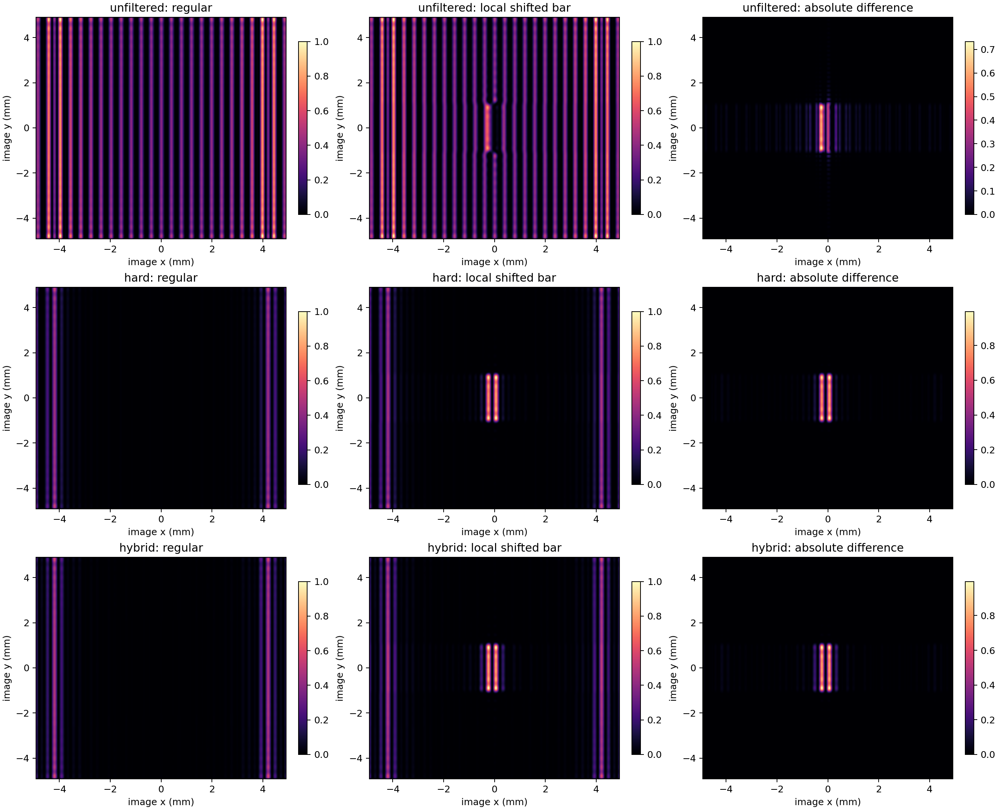
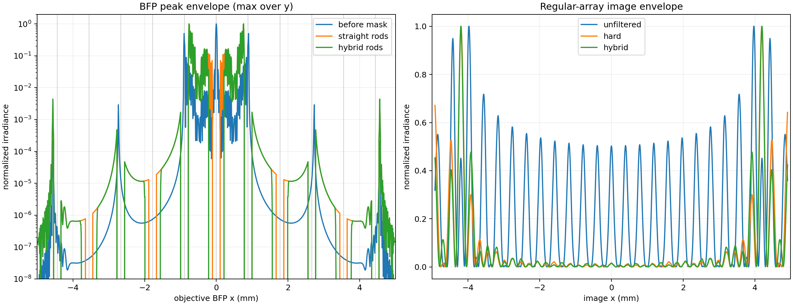

# Zemax 中阿贝正弦条件的建模、约束与计算结果

## 1. 先给结论

本项目的傅里叶滤棒位置应按

$$
\rho=f_{\mathrm{obj}}n\sin\theta
$$

设计，而不是按 $\rho=f_{\mathrm{obj}}\tan\theta$ 设计。对周期为 $\Lambda$ 的物体，第 $m$ 级衍射满足

$$
n\sin\theta_m=\frac{m\lambda_0}{\Lambda},
$$

因此理想阿贝正弦物镜后焦面上的级次位置为

$$
\boxed{\rho_m=f_{\mathrm{obj}}\frac{m\lambda_0}{\Lambda}}.
$$

这里 $\lambda_0$ 是真空波长，$n$ 是物方介质折射率。本项目物方为空气，$n=1$。

必须区分两件事：

1. 当前已经完成的 Zemax POP 模型使用 **Paraxial Lens** 表示 50 mm 物镜和 1000 mm 管镜，物面、物镜后焦面和像面均按严格的 4f 共轭关系放置。这个模型是理想傅里叶系统的基准模型，可验证“频谱形成—滤棒遮挡—第二次变换成像”的系统过程。
2. Paraxial Lens 没有真实玻璃曲率、高阶球差、彗差和瞳畸变，因此它不能单独证明一套实际 355 nm 物镜处方满足阿贝正弦条件。真实物镜必须换成实际镜片处方，再通过实光线追迹、波像差和 POP 三层验收。

换句话说：当前模型证明了滤波原理和滤棒尺度；真实物镜是否满足阿贝正弦条件，要由后续实际处方的定量残差来证明，不能靠在 Zemax 中勾选某个选项自动保证。

## 2. 阿贝正弦条件到底约束什么

### 2.1 从拉格朗日不变量理解

对于一对共轭的小物高 $y$ 和像高 $y'$，物像两侧折射率为 $n,n'$，光线相对光轴的角度为 $u,u'$，理想无彗差成像要求

$$
n y\sin u=n'y'\sin u'.
$$

因此，对同一物像共轭，不同孔径光线都应给出相同的正弦比：

$$
\frac{n'\sin u'}{n\sin u}=\frac{y}{y'}=\text{常数}.
$$

实际检验时不必纠结放大率的正负号，可把近轴光线作为基准，定义归一化正弦残差

$$
\varepsilon_{\mathrm{SC}}(P)=
\frac{
\left[n'\sin u'(P)/(n\sin u(P))\right]
}{
\left[n'\sin u'/(n\sin u)\right]_{P\rightarrow 0}
}-1,
$$

其中 $P$ 是归一化瞳坐标。若全孔径内 $\varepsilon_{\mathrm{SC}}$ 接近零，说明不同孔径光线遵守同一个正弦比例；若随瞳坐标明显变化，则会表现为离轴彗差和角度—瞳坐标映射误差。

### 2.2 为什么傅里叶面使用 `sin` 而不是 `tan`

周期结构产生的是平面波角谱。横向波矢为

$$
k_x=k_0n\sin\theta,
\qquad k_0=\frac{2\pi}{\lambda_0}.
$$

物体频率 $\nu_x$ 与角度的关系为

$$
\nu_x=\frac{n\sin\theta}{\lambda_0}.
$$

满足阿贝正弦条件的物镜把这个方向余弦映射到瞳面坐标：

$$
\rho=f_{\mathrm{obj}}n\sin\theta
=f_{\mathrm{obj}}\lambda_0\nu_x.
$$

而 $f\tan\theta$ 描述的是“从一个几何投影中心出发，在距离 $f$ 的平面上截取直线”的中心投影。它适合普通几何截面或特意设计为 $f\tan\theta$ 的投影镜头，不是高 NA 显微物镜的阿贝瞳映射规律。扫描镜头的 $f\theta$ 是另一种规律，不能与 $f\tan\theta$ 混称。

小角度下两者都约等于 $f\theta$，所以近轴模型看不出差别：

$$
\tan\theta-\sin\theta\approx\frac{\theta^3}{2},
\qquad
\frac{\tan\theta-\sin\theta}{\sin\theta}\approx\frac{\theta^2}{2}.
$$

### 2.3 扩展到 NA=0.1～0.9：位置差的精确计算

**空气中，孔径边缘的相对位置差从 NA=0.1 的 0.5038% 增至 NA=0.9 的 129.4157%。** 沿用截图中的 $f=50\ \mathrm{mm}$、物方 $n=1$，不计瞳中继；以下是解析映射计算，不是新一轮 Zemax 仿真。边缘位置表本身不依赖波长；计算具体网格级次时才需要波长和周期。

孔径边缘 $s=\sin\theta=\mathrm{NA}$，因此

$$
\rho_{\sin}=50\,\mathrm{NA},\qquad
\rho_{\tan}=\frac{50\,\mathrm{NA}}{\sqrt{1-\mathrm{NA}^2}}\quad[\mathrm{mm}],
$$

$$
\Delta\rho=50\,\mathrm{NA}
\left(\frac{1}{\sqrt{1-\mathrm{NA}^2}}-1\right)\quad[\mathrm{mm}],
\qquad
\epsilon=\frac{\Delta\rho}{\rho_{\sin}}
=\frac{1}{\sqrt{1-\mathrm{NA}^2}}-1.
$$

下表使用精确式，不将小角度近似外推到高 NA。差值为 `tan − sin`，相对差以 `sin` 为分母。

| NA | 半角 $\theta$ / ° | $f\sin\theta$ / mm | $f\tan\theta$ / mm | 差值 / µm | 相对差值 / % |
|---:|---:|---:|---:|---:|---:|
| 0.1 | 5.7392 | 5.0000 | 5.0252 | 25.19 | 0.5038 |
| 0.2 | 11.5370 | 10.0000 | 10.2062 | 206.21 | 2.0621 |
| 0.3 | 17.4576 | 15.0000 | 15.7243 | 724.27 | 4.8285 |
| 0.4 | 23.5782 | 20.0000 | 21.8218 | 1821.79 | 9.1089 |
| 0.5 | 30.0000 | 25.0000 | 28.8675 | 3867.51 | 15.4701 |
| 0.6 | 36.8699 | 30.0000 | 37.5000 | 7500.00 | 25.0000 |
| 0.7 | 44.4270 | 35.0000 | 49.0098 | 14009.80 | 40.0280 |
| 0.8 | 53.1301 | 40.0000 | 66.6667 | 26666.67 | 66.6667 |
| 0.9 | 64.1581 | 45.0000 | 103.2371 | 58237.08 | 129.4157 |

图中对比的是**孔径边缘**，不是同一级次随 NA 改变位置。NA 越大，两种映射在可接纳的外围角谱上差别越大；这不代表现有真实物镜已经可以达到 NA=0.9。


若有 5× 瞳中继，坐标与绝对差同时乘 5，相对差不变。浸没介质则须先统一 $n f_{\mathrm{obj}}$ 的正弦映射比例系数，不能直接把 NA 当成 $\sin\theta$ 套用此空气表。

### 2.4 一个周期网格的 `sin` / `tan` 频谱区别

**同一物体的空间频谱不变，改变的是频率到物理平面坐标的映射。** 为清楚显示高阶差异，本节另选 2 µm 周期、0.6 µm 方孔、250×250 单元的二维网格；标称方形视野 0.5 mm、波长 355 nm、焦距 50 mm、空气中法向相干照明。这是补充算例，不修改原 20 µm 周期配置，也不替换真实物镜的可见光参数。

#### 2.4.1 频谱和坐标公式

级次 $(m,\ell)$ 的频率为 $(m/p,\ell/p)$，方向余弦为 $s_x=m\lambda_0/p$、$s_y=\ell\lambda_0/p$，总正弦 $s=\sqrt{s_x^2+s_y^2}$。两种物理坐标为

$$
(X_{\sin},Y_{\sin})_{m\ell}=8.875(m,\ell)\quad[\mathrm{mm}],
$$

$$
(X_{\tan},Y_{\tan})_{m\ell}
=\frac{8.875(m,\ell)}{\sqrt{1-0.1775^2(m^2+\ell^2)}}\quad[\mathrm{mm}].
$$

二维 `tan` 映射共用一个径向分母，不能给 x、y 分别单独取正切。中心通过条件是 $0.1775\sqrt{m^2+\ell^2}\le\mathrm{NA}$。

方孔网格的频谱由单孔 sinc 包络乘有限阵列因子构成。在倒格点中心，相对 DC 的模平方为

$$
\frac{\lvert\widetilde t_{m\ell}\rvert^2}{\lvert\widetilde t_{00}\rvert^2}
=\operatorname{sinc}^2(0.3m)\operatorname{sinc}^2(0.3\ell),
\qquad\operatorname{sinc}(q)=\frac{\sin(\pi q)}{\pi q}.
$$

图中 NA=0.9 接纳 81 个级次中心（包括 DC）；两张频谱图使用相同毫米尺度和相同系数色标。`sin` 为等间距方格，`tan` 的外围级次向外展开、离轴行列弯曲。虚线圆是同 NA 的映射边界，**不是同一直径的机械孔径**；散点只表示级次中心，点大小不表示峰宽，颜色不是 W/mm²。


| 级次 $(m,\ell)$ | 最低 NA | sin 坐标 $(X,Y)$ / mm | tan 坐标 $(X,Y)$ / mm | 径向差 / mm | 相对差 / % | 系数模平方 / DC |
|---|---:|---|---|---:|---:|---:|
| (1,0) | 0.177500 | (8.8750, 0.0000) | (9.0182, 0.0000) | 0.1432 | 1.6135 | 0.736840 |
| (1,1) | 0.251023 | (8.8750, 8.8750) | (9.1686, 9.1686) | 0.4152 | 3.3078 | 0.542933 |
| (2,0) | 0.355000 | (17.7500, 0.0000) | (18.9867, 0.0000) | 1.2367 | 6.9672 | 0.254572 |
| (2,2) | 0.502046 | (17.7500, 17.7500) | (20.5240, 20.5240) | 3.9230 | 15.6282 | 0.064807 |
| (3,0) | 0.532500 | (26.6250, 0.0000) | (31.4556, 0.0000) | 4.8306 | 18.1433 | 0.011945 |
| (3,3) | 0.753069 | (26.6250, 26.6250) | (40.4671, 40.4671) | 19.5757 | 51.9891 | 0.000143 |
| (4,0) | 0.710000 | (35.5000, 0.0000) | (50.4117, 0.0000) | 14.9117 | 42.0048 | 0.024309 |
| (4,3) | 0.887500 | (35.5000, 26.6250) | (77.0386, 57.7790) | 51.9233 | 117.0103 | 0.000290 |
| (5,0) | 0.887500 | (44.3750, 0.0000) | (96.2983, 0.0000) | 51.9233 | 117.0103 | 0.045032 |

“最低 NA”是通过级次中心所需的 NA；有限阵列的峰有宽度，需要余量才能完整接纳主瓣。相同半径级次 `(4,3)` 与 `(5,0)` 的径向偏差相同，但因单孔包络不同，谱权重不同。

#### 2.4.2 不只峰位不同：间距、峰宽和面积密度也要区分

| 频谱比较项 | `sin` | `tan` |
|---|---|---|
| 轴向相邻级次间距 | 恒为 8.875 mm | 0→1 至 4→5 依次为 9.0182、9.9685、12.4690、18.9561、45.8866 mm |
| 二维离轴行列 | 等间距直行列 | 变为弯曲行列，不能按统一格距放棒 |
| `(5,0)` 局部径向/切向尺度 | 作为基准 | 分别放大 10.2198 / 2.1701 倍 |
| `(5,0)` 中心到首零点距离 | 0.0355 mm | 径向约 0.3628 mm，切向约 0.0770 mm（局部估计） |
| 纯坐标映射中的傅里叶系数 | 给定物体决定 | 不产生新的频率或新的系数 |
| 对应局部面积 | 基准面积 | `(5,0)` 附近放大约 22.1779 倍 |
| 纯功率重映射的单位面积密度 | 基准密度 | 对应位置乘 $(1-s^2)^2$；`(5,0)` 为约 0.04509 倍 |
| 相同 NA 下的中心接纳 | 由角谱截止决定 | 相同，但需要更大的物理平面半径 |

下面左图给绝对峰位；右图把 `(5,0)` 两峰中心对齐、分别归一化，只展示有限阵列峰形变化，不能用右图的峰高推断两套镜头的功率或效率。实际强度还需 apodization、偏振、透过率和像差模型。


**NA 的作用是接纳更多角谱，而不是推着已有级次移动。** 此 2 µm 网格在 NA=0.1～0.9 时，接纳的级次中心数（含 DC）依次为 **1、5、9、21、21、37、45、69、81**。例如 `(2,2)` 要求 NA≥0.502046，NA=0.5 仍不能接纳它的中心。

原项目 20 µm 周期在 355 nm 下的轴向一级则是另一组固定数值：`sin` 位置 0.887500 mm，`tan` 位置 0.887639842 mm，差 **0.139842 µm**。它不能套用孔径边缘 NA=0.1 的 **25.19 µm** 差值。

本算例已由 Python 解析式和可分离二维 FFT 交叉验证，每周期 100 / 200 像素的系数模平方最大绝对差均小于 $8\times10^{-18}$；全项目 22 项测试通过。这仅验证数学模型和实现一致，不表示真实光学系统达到同等精度。完整有限阵列推导、Jacobian、截止条件及 Anaconda 复现命令见[主原理文档第 6.6～6.8 节](D:/work/git_share/Fourier/傅里叶滤波原理推导与数学模型.md)，全部 81 个级次见[计算 CSV](D:/work/git_share/Fourier/results/sine_tangent/periodic_grid_orders.csv)。

对滤棒设计的直接结论：先按 `sin` 建立峰位和尺寸，再按真实 Zemax 结果标定；不能将几何 `tan` 投影直接当作满足阿贝条件的物镜频谱坐标。本节的 NA=0.9 是理论范围，不是现有真实物镜的已验证工作孔径。

## 3. 当前 Zemax 理想傅里叶模型如何建立

### 3.1 系统参数

| 参数 | 当前值 |
|---|---:|
| 真空波长 | 355 nm |
| 物镜焦距 | 50 mm |
| 物镜 NA | 0.10（首轮工程假设） |
| 物镜瞳径 | 10 mm |
| 管镜焦距 | 1000 mm |
| 总倍率 | $-1000/50=-20$ |
| 物方全视野 | 0.5 mm |
| 像方全视野 | 10 mm |
| 条纹周期 | 20 µm |
| 条纹宽度 | 10 µm |
| POP 网格 | 1024×1024 |

### 3.2 Lens Data Editor 结构

当前 `.zos` 文件的顺序模式结构如下：

| 面号 | Zemax 面 | 类型 | 到下一面距离 | 作用 |
|---:|---|---|---:|---|
| 1 | 周期物体 | Standard + UDA | 50 mm | 25 根周期透光条及局部移位缺陷 |
| 2 | 物镜 | Paraxial，$f=50$ mm | 50 mm | 第一次傅里叶变换 |
| 3 | 物镜 BFP | Standard + 滤棒 UDA | 1000 mm | 遮挡离散衍射级次 |
| 4 | 管镜 | Paraxial，$f=1000$ mm | 1000 mm | 第二次傅里叶变换 |
| 5 | 像面 | Image | 0 | 形成 20× 像 |

物体到物镜、物镜到 BFP 都等于 $f_{\mathrm{obj}}$；BFP 到管镜、管镜到像面都等于 $f_{\mathrm{tube}}$。在标量近轴理论中，这个 ABCD 关系使 BFP 上的复振幅与物体复振幅构成傅里叶变换对，管镜再把滤波后的频谱变回像面。

当前模型用 Paraxial Lens 的意义是把物镜视为理想二次相位元件。它在 Zemax 中没有可被优化的真实高阶像差，所以“满足正弦条件”是理想近轴假设的一部分，而不是由一组实际曲率经过验收得到的结论。

### 3.3 5× 瞳中继与原始 BFP 等效

参考尺寸对应 5× 放大的机械滤波面。当前 POP 为避免旧版 OpticStudio 在多级 4f 链中间自动重采样造成峰位偏移，把缩小 5 倍的等效掩模直接放在原始 BFP：

$$
\rho'=M_p\rho,\qquad M_p=5,
$$

$$
H_{\mathrm{BFP}}(\rho)=H_{5\times}(M_p\rho).
$$

因此机械面 1.0 mm 直棒在当前 Zemax BFP 中为 0.20 mm；1.1–4.0 mm 齿形包络为 0.22–0.80 mm；0.75 mm 齿距为 0.15 mm。两种放置遮挡的是同一组空间频率。



## 4. 真实物镜如何在 Zemax 中保证阿贝正弦条件

### 4.1 不能只用 Paraxial Lens

真实验收模型必须把面 2 的 Paraxial Lens 替换为实际 355 nm 物镜处方，包括：

- 每个镜片表面的曲率、厚度、材料、半口径和机械空气间隔；
- 真实孔径光阑位置；
- 355 nm 下材料折射率和吸收可用性；
- 物方工作距离、盖玻片或窗口；
- 实际可访问的后焦面，或者把内部瞳面用无焦 4f 中继成像到机械滤波面。

对于无限远校正显微物镜，物体放在物镜前焦面附近，物镜后方输出近似准直光，管镜形成最终像。若物镜的真实 BFP 位于镜组内部，滤棒不能简单放在“最后一片镜后 50 mm”；应先定位真实出瞳，再增加瞳中继，把它共轭到可加工、可装调的位置。

### 4.2 System Explorer 的建议设置

1. 单位设为 mm，主波长设为 0.355 µm。
2. Aperture Type 建议设为 **Object Space NA**，数值 0.10；同时核对实际边缘光线给出的 $n\sin u$ 是否确实为 0.10。
3. Fields 使用物高而不是角度，至少加入 $y=0,\pm0.125,\pm0.25$ mm，覆盖 0.5 mm 全视野。
4. 打开真实光线追迹；对于强孔径畸变或高 NA 处方，启用合适的 ray aiming，并确认边缘光线实际命中光阑边缘。
5. 物镜和管镜组合后用实光线核对倍率；首阶目标为 $-20$，但最终应以真实像高比和畸变结果为准。
6. POP 使用的起始窗、采样和输出窗必须逐面检查，不能只相信 Automatic。Ansys 官方 POP 指南也强调：POP 以复振幅数组传播，必须同时平衡网格分辨率和窗口宽度，并检查每一面的采样是否截断。

### 4.3 先定位真实 BFP/出瞳

建议按以下顺序做：

1. 在 Sequential Mode 中完成物镜实际处方和光阑设置。
2. 查看一阶数据中的 entrance/exit pupil location，并用多条视场光线确认该位置确实是光阑的像。
3. 在候选位置插入不改变光线的 Dummy/Standard 面。
4. 对不同视场追迹 chief rays：在真正的瞳共轭面，各视场主光线应以符合设计的方式穿过瞳中心；对不同角谱分量，位置应稳定地表示方向余弦。
5. 若 BFP 在镜内或空间不足，建立两组真实中继镜，将该瞳面按 5× 成像到滤棒面；中继自身也要检查瞳畸变、像差和通光口径。

### 4.4 用实光线建立“正弦残差”验收

最直接的办法不是看 Layout，而是输出一张角度—BFP 坐标标定表。

对一组物方角度 $\theta_j$ 或等价的物体空间频率 $\nu_j$，用 ZOS-API 实光线追迹得到滤波面的真实截距 $\rho_{\mathrm{Zemax},j}$，计算

$$
\rho_{\sin,j}=f_{\mathrm{obj}}n\sin\theta_j,
$$

$$
\varepsilon_{\rho,j}
=\rho_{\mathrm{Zemax},j}-\rho_{\sin,j},
\qquad
\delta_{\rho,j}
=\frac{\rho_{\mathrm{Zemax},j}}{f_{\mathrm{obj}}n\sin\theta_j}-1.
$$

同时计算几何投影预测

$$
\rho_{\tan,j}=f_{\mathrm{obj}}\tan\theta_j.
$$

然后分别拟合

$$
\rho_{\mathrm{Zemax}}=a\sin\theta+c
$$

和

$$
\rho_{\mathrm{Zemax}}=b\tan\theta+c.
$$

合格的阿贝正弦物镜应表现为：`sin` 拟合斜率接近有效焦距、截距接近零、全孔径残差无系统弯曲，并且离轴彗差足够小。不能仅因 `sin` 拟合的 RMS 比 `tan` 小一点就宣布合格；还要把残差与滤棒容差、衍射峰宽和装调误差比较。

### 4.5 Merit Function 中怎么约束

#### 4.5.1 先澄清 `SINE` 操作数

OpticStudio 2022 R2.02 中存在 `SINE` 操作数，但它只是“对另一个操作数的数值取正弦”：`Op#` 指向被计算的行，`Flag=0` 表示输入为弧度，非零表示角度。它不是“一键检查阿贝正弦条件”的专用操作数。

真正的正弦条件要由以下操作数组合出来：

- `REAX`、`REAY`：某条实光线在指定面的局部 X/Y 截距；
- `REAA`、`REAB`、`REAC`：光线折射后在局部坐标系中的 X/Y/Z 方向余弦；在 X-Z 子午面内，`REAA = sin(theta_x)`；
- `RANG`：实光线相对指定面局部 Z 轴的角度，单位为弧度；
- `SINE`：对 `RANG` 的结果取正弦；
- `PROD`、`PROB`、`DIFF`、`DIVI`：构造乘积、常数因子、差和比值；
- `EFFL`：当前波长的近轴有效焦距；
- `ZPLM` 或 `UDOC`：当普通操作数不便表达批量残差时，分别调用 ZPL 宏或 ZOS-API 外部程序。

本项目最推荐 `REAA/REAB + REAX/REAY`，因为方向余弦已经是有正负号的 `sin` 值，不需要先计算角度再调用 `SINE`。

#### 4.5.2 建立一个独立的 `Objective_SC_Test.zos`

不要直接在生产 POP 模型中反复改变物面。复制实际物镜处方，建立一个只用于正弦条件验收的文件：

1. 保留实际物镜的所有曲率、厚度、材料、STOP、半口径和 355 nm 波长。
2. 暂时移除滤棒、瞳中继和管镜。
3. 把 Object 设为无穷远，`Field Type` 设为 **Angle (deg)**。这等效于用不同倾角的平面波照射物镜。
4. 在实际后焦面处放置 Image/Dummy 面。可先用 `CARD` 操作数的 `Data=3`（Image Space Focal Plane）或一阶焦点数据找初值，再通过轴上 RMS Spot/波前最小化微调该面轴向位置。
5. 对本项目条纹方向，在 Field Data Editor 的 X Field 中加入
   $-5.091700,-3.052444,-1.017053,0,1.017053,3.052444,5.091700$ 度；它们分别对应 $m=-5,-3,-1,0,1,3,5$。
6. 最大绝对场角为 5.091700° 时，`REAX` 使用的归一化 `Hx` 依次为
   $-1,-0.599494,-0.199747,0,0.199747,0.599494,1$。所有行均设 `Hy=0, Px=0, Py=0`，即追迹每个倾斜平面波的主光线。
7. 若真实系统不是轴对称，再建立 Y Field 组，并用 `REAY`/`REAB` 做同样约束。

这里以“无穷远角度场 → 后焦面焦点”的方式测试，正好直接测量傅里叶系统所需要的平面波角谱映射。它比从 Layout 图上用标尺量 BFP 更准确。

#### 4.5.3 可直接录入的 MFE 映射行

先固定或强约束 `EFFL=50 mm`。对于空气中的测试，下面各 `REAX` 行的 Target 就是 $50\sin\theta_m$：

| Operand | Surf | Wave | Hx | Hy | Px | Py | Target / mm | 说明 |
|---|---:|---:|---:|---:|---:|---:|---:|---|
| `EFFL` | - | 1 | - | - | - | - | 50.0000 | 物镜焦距 |
| `REAX` | BFP | 1 | -1.000000 | 0 | 0 | 0 | -4.4375 | $m=-5$ |
| `REAX` | BFP | 1 | -0.599494 | 0 | 0 | 0 | -2.6625 | $m=-3$ |
| `REAX` | BFP | 1 | -0.199747 | 0 | 0 | 0 | -0.8875 | $m=-1$ |
| `REAX` | BFP | 1 | 0 | 0 | 0 | 0 | 0 | 零级 |
| `REAX` | BFP | 1 | 0.199747 | 0 | 0 | 0 | 0.8875 | $m=1$ |
| `REAX` | BFP | 1 | 0.599494 | 0 | 0 | 0 | 2.6625 | $m=3$ |
| `REAX` | BFP | 1 | 1.000000 | 0 | 0 | 0 | 4.4375 | $m=5$ |

`BFP` 应替换为测试文件中的实际面号。以上 Target 不是拟合出来的，而是由 $m\lambda f/\Lambda$ 直接计算。对于旋转对称物镜，只优化正场角通常已经足够，但验收表仍应输出正负场角来检查偏心或符号错误。

如果滤棒位置允许误差为 $T_\rho$，可按标准加权平方和

$$
MF=\sum_i W_i(V_i-T_i)^2
$$

取 $W_i=1/T_\rho^2$。例如暂定 $T_\rho=0.020$ mm 时，映射行可从 `Weight=2500` 开始。这个 20 µm 仅是优化归一化示例，最终容差必须用第 5 节的峰宽和装调预算倒推。

#### 4.5.4 焦距参与优化时的动态操作数链

若曲率在优化中变化，`EFFL` 也会变化，固定的 4.4375 mm Target 会把“焦距误差”和“正弦条件误差”混在一起。可以对每个角度用以下操作数链直接构造
$\rho_{\mathrm{ray}}-fL=0$，其中 $L=\sin\theta_x$：

| 行 | Operand | 关键参数 | Target | 作用 |
|---:|---|---|---:|---|
| 1 | `EFFL` | Wave=1 | 50 mm | 返回并约束当前焦距 |
| 2 | `REAA` | Surf=Object，Wave=1，指定 Hx/Hy/Px/Py | - | 返回入射平面波的有符号 X 方向余弦 $L$ |
| 3 | `PROD` | Op#1=1，Op#2=2 | - | 计算 $fL=f\sin\theta_x$ |
| 4 | `REAX` | Surf=BFP，与第 2 行同一条光线 | - | 返回真实 BFP 截距 $\rho_{\mathrm{ray}}$ |
| 5 | `DIFF` | Op#1=4，Op#2=3 | 0 | 正弦映射残差 |

物方不是空气时，在第 3 行后增加 `PROB`，`Factor=n`，得到 $fnL$。Y 子午面把 `REAA/REAX` 换成 `REAB/REAY`。

如果某个版本在 Object 面返回方向余弦的方式与预期不同，可改用：`RANG(Object)` → `SINE(Op#=RANG, Flag=0)` → `PROD(EFFL,SINE)`。先用正场角验证符号，再扩展到负场角。

#### 4.5.5 生产物镜/管镜模型的 MFE 分组

正弦测试文件控制角谱映射；生产模型仍要同时满足完整成像要求。建议按以下顺序建立 Merit Function：

| 组 | 推荐操作数/工具 | 本项目目标 |
|---|---|---|
| 一阶规格 | `EFFL` | 物镜 50 mm |
| 有限共轭孔径 | `OBSN` | 物方 NA=0.10 |
| 总倍率 | `PMAG`，并用真实像高复核 | $-20$ |
| 瞳位置初值 | `EXPP` 或 `CARD` | 定位实际出瞳/BFP；仅作为一阶初值 |
| 正弦映射 | `REAX/REAY` 固定 Target，或 `REAA/REAB + PROD + DIFF` 动态残差 | 全角度残差接近 0 |
| 波像差 | Optimization Wizard：RMS Wavefront、Centroid、Gaussian Quadrature | 轴上、0.5 视场、全视场，355 nm |
| 彗差辅助 | `COMA`、Ray Fan、OPD Fan | 只作辅助；三阶 `COMA` 不能替代实光线正弦残差 |
| 工程约束 | 中心/边缘厚度、曲率、玻璃、半口径、工作距离相关操作数 | 保证 355 nm 材料与加工可行性 |

推荐的实际点击顺序是：

1. `Optimize > Merit Function Editor`。
2. `Wizards and Operands > Optimization Wizard`，选择 `RMS / Wavefront / Centroid`，Pupil Integration 选 Gaussian Quadrature；初始可用 6 Rings、12 Arms。
3. 让 Wizard 生成中心、0.5 视场和全视场的基础波像差行。
4. 在 Wizard 行之前加入 `EFFL`、`OBSN`、`PMAG` 和机械约束。
5. 在波像差行之后加入上面的 `REAX/REAY` 或动态 `REAA/REAB + PROD + DIFF` 正弦残差组。
6. 先只开放空气间隔和少量曲率做小步优化；确认结构稳定后再增加非球面系数或玻璃变量。
7. 每轮优化后都重新运行角度—BFP 坐标标定，不只看总 Merit Function 数值。

#### 4.5.6 用 ZOS-API 做最终审计

MFE 适合优化，但最终报告最好用独立 ZOS-API 脚本重新追迹。对每个 $\theta_j$ 记录：

```text
theta_deg, L=sin(theta), zemax_bfp_x_mm,
f*n*L_mm, residual_um, relative_residual,
tan_prediction_mm, vignette_code
```

验收脚本应检查：无丢光、无 vignetting、正负角度反对称、X/Y 子午结果一致、采样加密后 RMS 残差收敛。若要把外部计算直接反馈到优化器，可使用 `UDOC`；如果用 ZPL 宏返回自定义数值，则使用 `ZPLM`。

### 4.6 用彗差和波前再交叉验证

阿贝正弦条件与轴上邻域的无彗差成像相关，因此正弦映射合格后还应检查：

- Ray Fan：全视场切向/弧矢扇形图中不应有明显的彗差型不对称；
- OPD Fan / Wavefront Map：355 nm 下波前误差应满足系统给定指标；
- FFT/Huygens PSF 或 MTF：中心至全视场均应保持可接受的对称性和对比度；
- Grid Distortion：确认整体倍率和畸变不会把缺陷位置误判；
- POP：最终用周期物体复场和真实孔径传播，确认峰位、峰宽、滤后漏光和像面缺陷对比度。

光线追迹验证映射，波像差验证实际成像质量，POP 验证相干衍射与硬边滤棒；三者用途不同，不能只保留其中一个。

## 5. 滤棒位置的验收指标

设某级频谱峰半宽为 $b_m$，等效 BFP 滤棒宽度为 $w_m$，装调、加工和温漂预算合计为 $a_m$。若要求峰始终被挡住，中心位置误差至少应满足

$$
|\varepsilon_{\rho,m}|+b_m+a_m\leq\frac{w_m}{2}.
$$

本项目直棒机械宽度为 1.0 mm，5× 中继对应原始 BFP 宽度 0.20 mm，半宽为 0.10 mm。不能把这 0.10 mm 全部分配给物镜正弦误差；还必须留出 POP 峰宽、掩模加工、瞳中继畸变和装调偏心的预算。最终允许的 $\lvert \varepsilon_{\rho,m}\rvert$ 应由上式倒推，而不是随意规定一个百分比。

## 6. 当前 Zemax POP 计算结果

### 6.1 衍射级次理论位置

20 µm 周期在原始 BFP 的理想级次间距为

$$
\Delta\rho_{\mathrm{BFP}}
=\frac{\lambda f_{\mathrm{obj}}}{\Lambda}
=\frac{0.000355\times50}{0.020}
=0.8875\ \mathrm{mm}.
$$

5× 瞳中继后为

$$
\Delta\rho_{5\times}=4.4375\ \mathrm{mm}.
$$

50% 占空比方波的偶数级在理想情况下为零，因此下面从 POP 网格提取 $m=0,\pm1,\pm3,\pm5$ 奇数级峰。

| 级次 $m$ | $\sin\theta_m$ | Zemax 峰位 / mm | `sin` 预测 / mm | `tan` 预测 / mm | `sin` 误差 / µm |
|---:|---:|---:|---:|---:|---:|
| -5 | -0.088750 | -4.558529 | -4.437500 | -4.455080 | -121.03 |
| -3 | -0.053250 | -2.733165 | -2.662500 | -2.666283 | -70.67 |
| -1 | -0.017750 | -0.898040 | -0.887500 | -0.887640 | -10.54 |
| 0 | 0 | 0 | 0 | 0 | 0 |
| 1 | 0.017750 | 0.898040 | 0.887500 | 0.887640 | 10.54 |
| 3 | 0.053250 | 2.733165 | 2.662500 | 2.666283 | 70.67 |
| 5 | 0.088750 | 4.558529 | 4.437500 | 4.455080 | 121.03 |

提取结果汇总：

| 指标 | 当前 POP 数值 |
|---|---:|
| 峰位线性拟合级次间距 | 0.911148 mm |
| 正弦理论级次间距 | 0.887500 mm |
| `sin` 映射 RMS 残差 | 75.124 µm |
| `tan` 映射 RMS 残差 | 66.080 µm |
| BFP 网格像素间距 | 9.761 µm |
| 第五级 `sin/tan` 最大分离 | 17.580 µm |

这里 **不能** 因 `tan` 的拟合 RMS 稍小就判断系统遵循 `tan`。当前 1024 点 UDA 中 10 µm 物条宽度约只有一个采样单元，峰值提取还叠加了有限视场、硬边衍射和离散像素取峰误差；75 µm 量级的提取偏差已经大于 17.58 µm 的 `sin/tan` 分离。这个 POP 结果有能力验证“级次是否被滤棒遮挡”，没有足够分辨力单独完成 `sin/tan` 标定。

因此，本项目选择 `sin` 的依据是波矢关系和阿贝正弦条件；实际物镜处方完成后，再用更细的角度扫描和实光线追迹给出独立验收数据。

原始数据见 [zemax_peak_positions.csv](results/zemax/zemax_peak_positions.csv) 和 [zemax_peak_summary.txt](results/zemax/zemax_peak_summary.txt)。

### 6.2 滤波前后 POP 过程

下图上排依次为物镜 BFP 原始频谱、直棒遮挡后的频谱、双层混合滤棒遮挡后的频谱；下排为对应 20× 像面。滤波后规则竖条背景显著下降，中央局部移位缺陷成为主响应。



### 6.3 定量滤波结果

| Zemax POP 方案 | 周期背景抑制 | 缺陷强度差分保留 | 相对可见度 | 可见度增益 |
|---|---:|---:|---:|---:|
| 无滤波 | 0 dB | 100.00% | 0.1516 | 1.00× |
| 11 根等效直棒 | 11.37 dB | 58.69% | 0.6886 | 4.54× |
| 5 根齿形 + 6 根直棒 | 11.73 dB | 52.68% | 0.6793 | 4.48× |

这些指标来自 Zemax 输出的辐照度网格。缺陷保留率定义为“缺陷图与规则参考图的 RMS 强度差”在滤波前后的比值，所以不能与 Python 复振幅差分的百分数逐项强行相等。可用于工程判断的共同趋势是：周期背景下降比缺陷差分下降更快，缺陷相对可见度提高约 4.5 倍。





原始指标见 [zemax_metrics.csv](results/zemax/zemax_metrics.csv)，可重新打开的六个模型位于 [results/zemax/models](results/zemax/models/)。

## 7. 当前结果能证明与不能证明的范围

### 已经证明

- 50 mm 物镜与 1000 mm 管镜构成的理想 4f 系统可实现 20× 傅里叶滤波成像；
- 20 µm 周期对应原始 BFP 级次间距 0.8875 mm，5× 滤波面间距 4.4375 mm；
- 参考尺寸的直棒和齿形棒在加工尺度上可按 5× 瞳中继实现；
- Zemax POP 中遮挡离散周期级次后，规则背景降低约 11.4–11.7 dB，缺陷相对可见度提高约 4.5 倍。

### 尚未证明

- 一套真实 355 nm 多片物镜的玻璃、曲率和间隔已经满足阿贝正弦条件；
- 真实物镜、5× 瞳中继和管镜组合后的全视场瞳畸变、彗差、波前和公差已经达标；
- 当前 1024 点 POP 峰值位置足以区分 `sin` 与 `tan` 的 17.58 µm 微小差别；
- 偏振、矢量高 NA 效应、表面散射和真实滤棒边缘粗糙度已被覆盖。

## 8. 建议的下一步实际 Zemax 验收流程

1. 获得或设计一套 355 nm、$f=50$ mm、NA=0.10 的实际物镜处方。
2. 用实际镜片替换当前 Paraxial Lens，保留同一物体、滤棒和管镜接口。
3. 定位真实出瞳；若不可直接访问，建立 5× 瞳中继并检查其瞳畸变。
4. 用 ZOS-API 对 $n\sin\theta=0\ldots0.10$ 做密集扫描，输出 $\rho_{\mathrm{Zemax}}$、`sin` 残差、`tan` 残差和正弦比残差。
5. 把残差写入 Merit Function，联合优化轴上球差、全视场彗差、波前、倍率和机械约束。
6. 用比当前更细的物体和 BFP 采样重新运行 POP；至少让第五级的 17.58 µm `sin/tan` 分离跨越多个采样点，并做 2× 采样收敛性复算。
7. 最后把峰位误差、峰半宽、滤棒加工与装调误差放入同一个容差预算，确认每个需遮挡级次都满足
   $\lvert \varepsilon_{\rho,m}\rvert+b_m+a_m\le w_m/2$。

## 9. 参考资料

- 本机 `OpticStudio_UserManual_en.pdf`（Ansys Zemax OpticStudio 2022 R2.02）：手册 PDF 第 1487 页说明 `EFFL`、`PMAG` 等一阶操作数；第 1536 页说明 `RANG`、`REAA/REAB/REAC`、`REAX/REAY`；第 1541 页说明通用数学操作数 `SINE`；第 1548–1549 页说明 `ZPLM` 与 `UDOC`。
- [Ansys Optics：Exploring Physical Optics Propagation (POP) in OpticStudio](https://optics.ansys.com/hc/en-us/articles/42661957754131-Exploring-Physical-Optics-Propagation-POP-in-OpticStudio)：说明 POP 逐面传播复振幅，并可处理 UDA 和空间滤波器。
- [Ansys Optics：Using Physical Optics Propagation, Part 1](https://optics.ansys.com/hc/en-us/articles/42661958168083)：强调 POP 需要同时检查网格分辨率和窗口宽度。
- [Ansys Optics：Designing a microscope objective with OpticStudio](https://optics.ansys.com/hc/en-us/articles/42661787388947-Designing-a-microscope-objective-with-OpticStudio-webinar)：给出显微物镜从分析、优化到公差的完整工作流。
- [Ansys Optics：Methods for analyzing MTF in OpticStudio](https://optics.ansys.com/hc/en-us/articles/42661772706835-Methods-for-analyzing-MTF-in-OpticStudio)：说明 FFT/Huygens/几何 MTF 的适用条件和瞳采样要求。

---

本文对应本机 Ansys Zemax OpticStudio 2022 R2.02 的当前工程结果。完整 POP 建模说明见 [Zemax_POP仿真说明.md](Zemax_POP仿真说明.md)，理论推导见 [傅里叶滤波原理推导与数学模型.md](傅里叶滤波原理推导与数学模型.md)。
