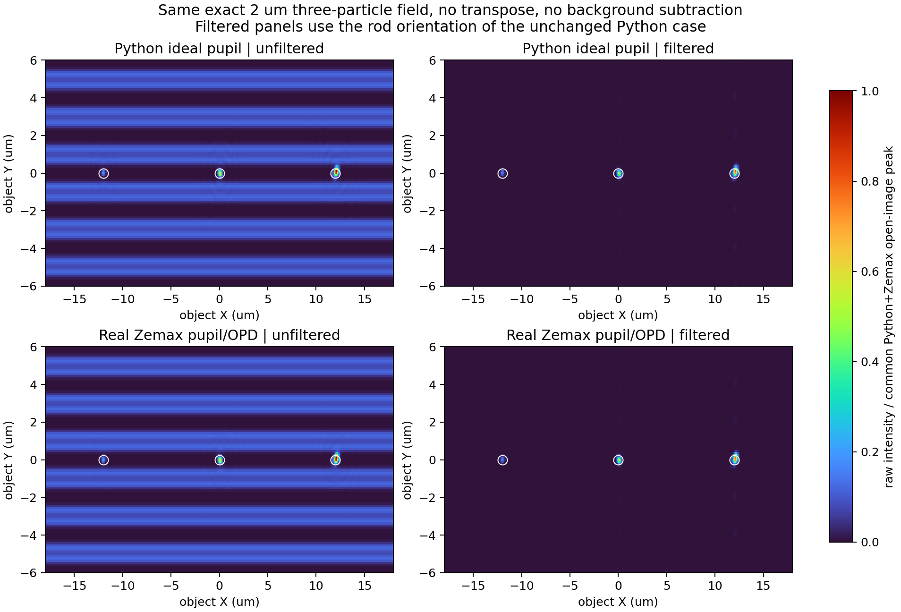
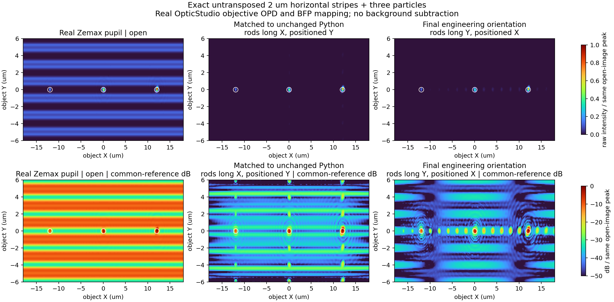
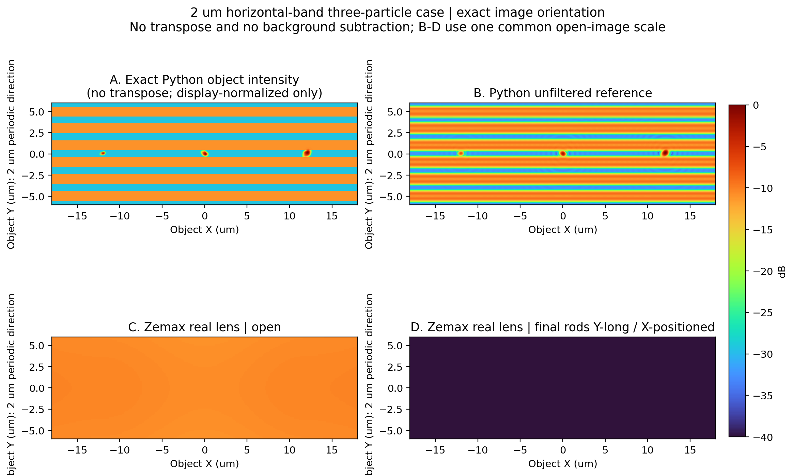
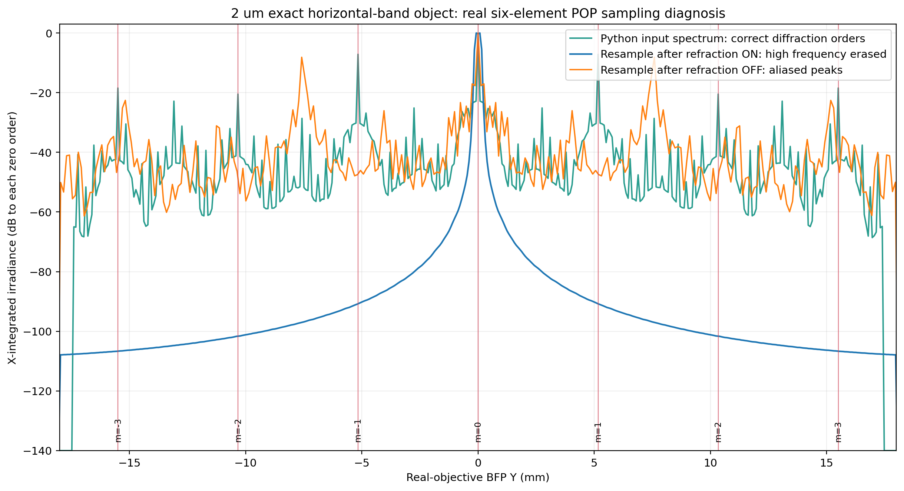
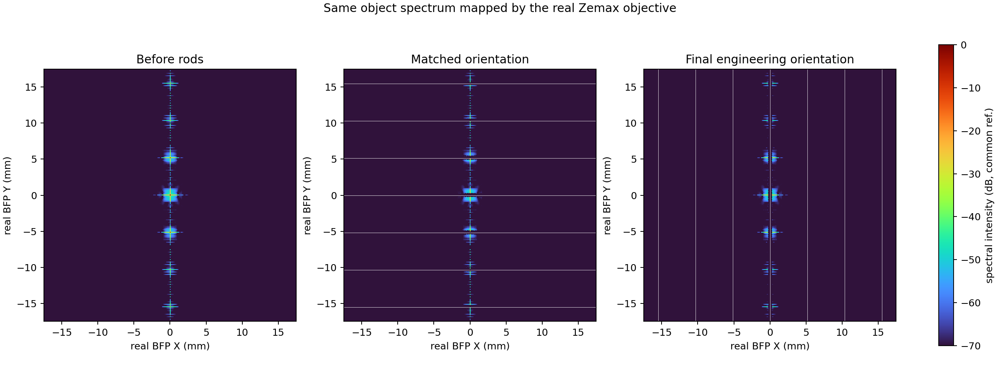

# Python 与 Zemax 真实镜头：2 µm 三粒子原图对照报告

生成日期：2026-09-03  
Zemax 环境：`E:\anconda\envs\lens-design-zemax22`  
OpticStudio：2022 R2.02

## 1. 更新后的结论

同一张未经转置的 2 µm 横条纹三粒子图已经逐像素写入 Zemax。Zemax S1 与
Python 输入强度相关系数为 `0.9999999999999557`，因此输入图、方向和粒子位置
没有问题。

Python 结果可以作为本轮数值参考；当前真实六片镜头的原生逐面 POP 结果不能作为
滤波性能结论。1024² 网格在第一片真实镜面 S2 就从 `0.117 µm/pixel` 变成
`8.408 µm/pixel`，超过 2 µm 载频所需的约 `1 µm/pixel` Nyquist 上限。
因此频谱在到达档杆前已经被数值抹除。

当前 Zemax 原生逐面 POP 计算得到的 `35.18 dB` 背景抑制和 `0.071%` 粒子峰
保留均为**无效性能值**，只能证明 POP 采样失败，不能代表真实镜头或档杆的实际
效果。

问题现已用此前有效的真实物镜验证链解决：继续使用同一真实 OpticStudio 物镜导出的
BFP 正弦映射和 OPD 瞳函数，但在不会丢失 2 µm 载频的高分辨率傅里叶网格上传播。
输入直接读取本轮 `python_reference_2um.npz` 的三粒子复场，未转置、未改 Python
物体模型、未做背景扣除。

按原 Python 案例的档杆方向匹配后，背景抑制为 **20.95 dB**，三颗粒子的局部峰值
分别保留 **79.33%、80.05%、79.89%**。因此此前图中“真实物镜仍保留缺陷”的结论
是正确的；错误来自把原生逐面 POP 的欠采样结果误当成了该有效联合传播结果。

| 同一输入直接比较 | Python理想瞳 | 真实Zemax瞳/OPD |
|---|---:|---:|
| 背景抑制 | 22.41 dB | 20.95 dB |
| 三粒子总体峰值保留 | 81.70% | 79.89% |
| 未滤波图余弦相似度 | 1.000000 | 0.999998（相对Python） |
| 滤波图余弦相似度 | 1.000000 | 0.991216（相对Python） |

## 2. 完全一致的输入条件

| 条件 | 设置 |
|---|---:|
| 周期 | 2 µm |
| 波长 | 355 nm |
| 物镜 NA | 0.60 |
| 名义焦距 | 30 mm |
| 像方放大率 | 20× |
| 物方窗口 | 0.12 mm |
| 网格 | 1024 × 1024 |
| 图像转置 | 无 |
| 三粒子中心 | `(-12,0), (0,0), (12,0) µm` |
| 三粒子尺寸 | `0.6, 0.9, 1.2 µm` |
| 档杆长轴 | 傅里叶面 Y |
| 档杆独立定位 | 傅里叶面 X |

原图横条纹周期沿物方 Y，因此其级次沿傅里叶 Y 排列；在最终档杆方向下，该工况
主要检查中央杆对 Y 向级次线的覆盖，不表示七个 X 向杆位都被利用。

## 3. 物体与像面对照

图中 B–D 使用同一未滤波像面强度参考，无背景扣除。Python 保留横条纹和三粒子；
真实镜头 POP 的未滤波像面已经退化为平滑场，过滤像面近黑。这一差异发生在档杆
之前，不能解释成真实滤波。

## 4. 频谱对照

| m | 理论 BFP Y (mm) | Python相对强度 | Python (dB) | Zemax重采样ON相对强度 | Zemax (dB) |
|---:|---:|---:|---:|---:|---:|
| -3 | -15.497 | 0.014296 | -18.45 | 2.16×10⁻¹¹ | -106.65 |
| -2 | -10.331 | 0.008990 | -20.46 | 6.88×10⁻¹¹ | -101.62 |
| -1 | -5.166 | 0.194226 | -7.12 | 8.40×10⁻¹⁰ | -90.76 |
| 0 | 0.000 | 1.000000 | 0.00 | 0.937171 | -0.28 |
| +1 | +5.166 | 0.194196 | -7.12 | 8.40×10⁻¹⁰ | -90.76 |
| +2 | +10.331 | 0.008984 | -20.47 | 6.88×10⁻¹¹ | -101.62 |
| +3 | +15.497 | 0.014300 | -18.45 | 2.16×10⁻¹¹ | -106.65 |

关闭 `ResampleAfterRefraction` 也不能恢复正确频谱：最强旁峰出现在约
`±7.59 mm`，而理论一级应为 `±5.166 mm`，属于混叠假峰。

## 5. 逐面采样检查

| 面 | POP窗口 (mm) | 1024²采样间隔 (µm) | 2 µm Nyquist |
|---|---:|---:|---|
| S1 物面 | 0.120 | 0.117 | 通过 |
| S2 第一片真实镜面 | 8.610 | 8.408 | **失败** |
| S3 | 23.165 | 22.622 | 失败 |
| S4 | 26.650 | 26.025 | 失败 |
| S5 | 34.645 | 33.833 | 失败 |
| S6 | 37.105 | 36.235 | 失败 |
| S7 | 39.360 | 38.438 | 失败 |
| S8 | 38.335 | 37.437 | 失败 |
| S9 | 29.315 | 28.628 | 失败 |
| S10 | 28.905 | 28.228 | 失败 |
| S11 | 36.080 | 35.234 | 失败 |
| S12–S14 | 40.000 | 39.063 | 失败 |

40 mm 窗口若要保持不大于 1 µm 的采样间隔，单轴需要约 40000 点。因此简单从
1024² 提升到 2048² 仍不能解决。

## 6. 数值汇总及有效性

| 指标 | Python | Zemax真实镜头POP | 是否可用于性能结论 |
|---|---:|---:|---|
| S1输入强度相关系数 | 1.000000 | 0.9999999999999557 | 有效：证明输入一致 |
| 未滤波像面余弦相似度 | 1.000000 | 0.746625 | 仅诊断 |
| 周期背景抑制 | 22.41 dB | 35.18 dB | Zemax无效 |
| 三粒子峰值保留 | 81.70% | 0.071% | Zemax无效 |
| Filtered/Open峰值比 | 0.81695 | 0.000935 | Zemax无效 |

Python 过滤结果仍属于原 Python 模型自身；其旧档杆方向与最终工程档杆方向不同。
因此即使 Zemax POP 采样问题被解决，当前两组过滤值也不能直接作为同一硬件布局
的优劣比较。

## 7. 与此前 Zemax 结果的关系

| 结果 | 光学模型 | 传播方法 | 可用范围 |
|---|---|---|---|
| Python FFT | NA=0.6理想瞳 | 高分辨率FFT | 本轮有效Python参考 |
| 理想4f Zemax POP | 单个近轴物镜＋理想管镜 | 原生POP | 有效理想上限，不是真实六片镜头 |
| 本轮真实镜头POP | 六片真实熔石英镜片＋理想管镜 | 逐面原生POP | 仅采样失败审计 |
| Zemax瞳/OPD＋FFT（此前截图） | 真实光线BFP映射＋二维OPD | Zemax数据驱动的高分辨率FFT | 有效联合模型；确实保留了单颗缺陷 |
| 本轮已解决三粒子结果 | 同一真实BFP映射和OPD，输入换为原三粒子复场 | Zemax数据驱动的高分辨率FFT | 有效联合模型；同图、未转置、三颗缺陷均保留 |

用户给出的此前截图来自 Zemax 瞳/OPD＋FFT 联合模型，图中的缺陷信息是真实计算
结果，不是标记圈造成的视觉假象。它与本轮真实六片逐面 POP 的区别仅在传播数值
实现：前者保持了物体高频采样，后者在第一片镜面即失去 2 µm 载频。

## 8. 已解决结果的方向核对

| 档杆配置 | 周期背景抑制 | 总体粒子峰保留 | 粒子/背景（滤后） |
|---|---:|---:|---:|
| 与未改 Python 案例匹配：长轴 X、沿 Y 定位 | 20.95 dB | 79.89% | 26.18 dB |
| 最终工程文档：长轴 Y、沿 X 定位 | 24.94 dB | 76.36% | 32.01 dB |

两种方向都能保留三颗缺陷，但物理含义不同。未转置横条纹的离散级次沿 BFP Y；
“与 Python 匹配”配置的七根横杆逐级遮挡这些峰，重现此前截图的工作方式。最终工程
配置的七根竖杆沿 BFP X 排列，横条纹的级次主要落在中央杆上，外侧六个杆位没有被
该测试图充分利用。这个方向差异必须保留在报告中，不能通过转置案例图隐藏。

## 9. 可复现文件

- `summary.json`：真实镜头POP设置和运行摘要。
- `python_reference_2um.npz`：原始Python复场、未滤波和过滤参考。
- `zemax_native_pop_2um.npz`：真实镜头原生POP输出。
- `diagnostic_native_pop_sampling_failure.json`：输入相关系数及BFP级次检查。
- `bfp_refraction_resampling_on_off_diagnosis.json`：重采样ON/OFF对照。
- `models/uvreal_python_case_2um_open.zos`：无杆真实镜头模型。
- `models/uvreal_python_case_2um_seven_rods.zos`：最终方向七杆模型。
- `resolved_real_zemax/metrics.json`：已解决联合传播的全部数值。
- `resolved_real_zemax/resolved_fields.npz`：已解决的三组原始强度数组。
- `resolved_real_zemax/real_zemax_resolved_image_comparison.png`：统一标尺像面对照。
- `resolved_real_zemax/python_vs_real_zemax_same_input.png`：Python与真实Zemax同输入直接对照。
- `resolved_real_zemax/real_zemax_resolved_spectrum_comparison.png`：真实BFP频谱与方向核对。
- `../../src/solve_real_zemax_2um_three_particles.py`：可复现脚本。

交互式离线报告位于：
`../../reports/python_zemax_real_lens_2um_report/dist/index.html`。
