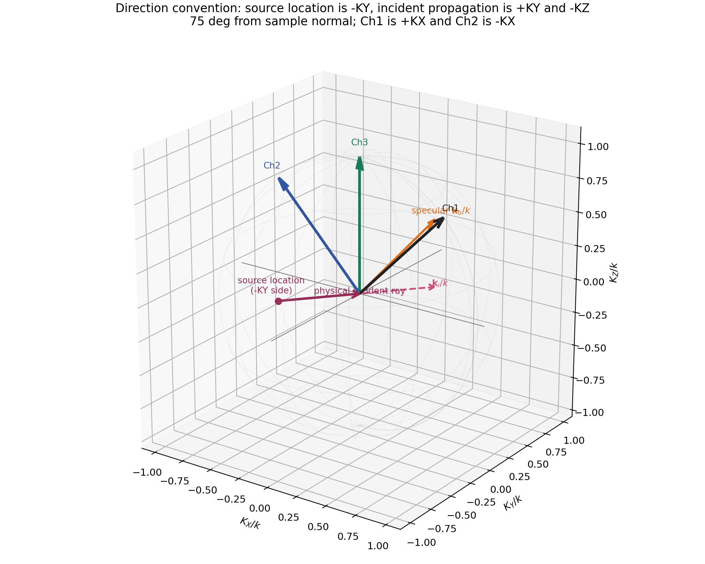
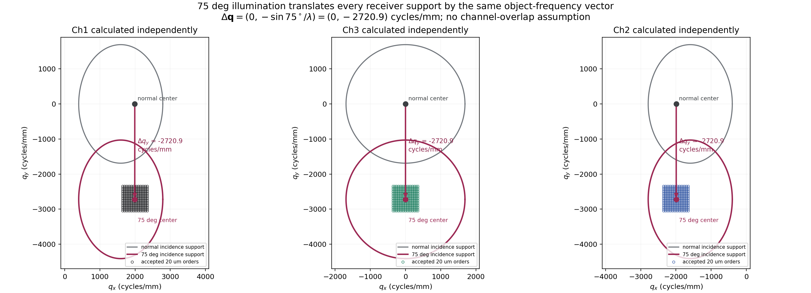
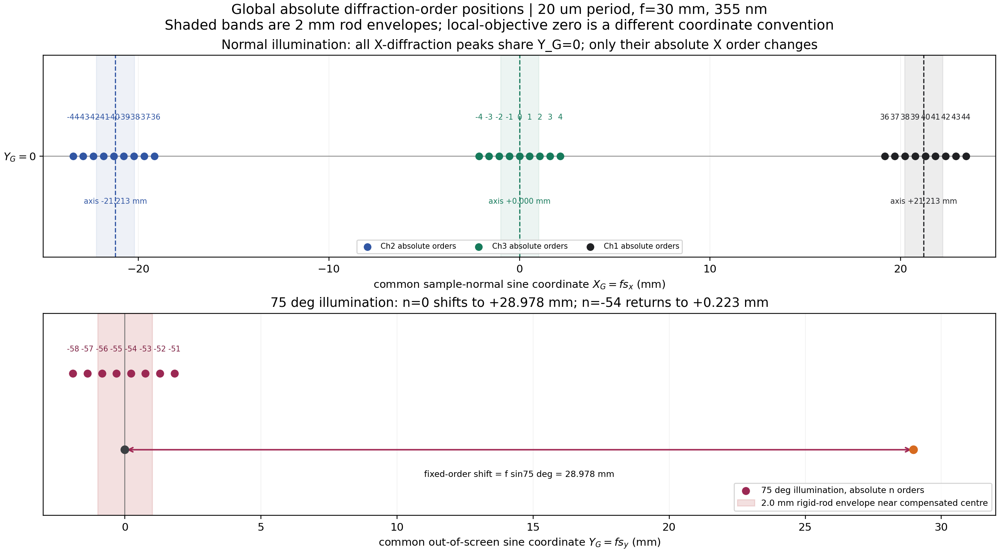
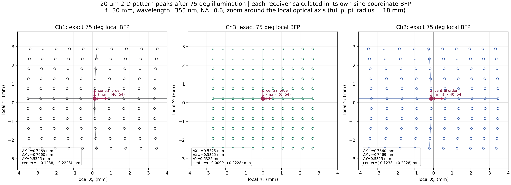
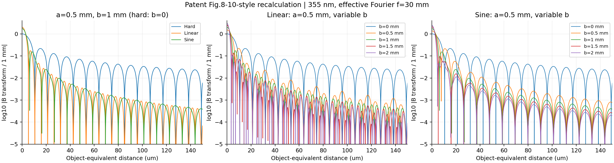
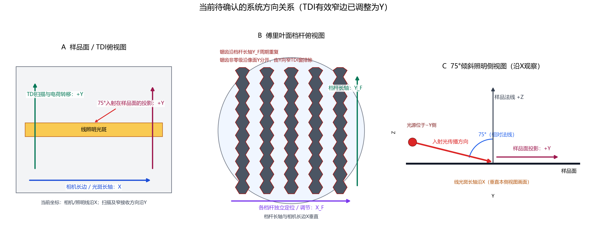

# 三通道傅里叶滤波：正弦物镜、频谱分布与锯齿振铃

## 结论先行

本系统需要同时处理三个问题：物镜必须把方向余弦按阿贝正弦条件映射到可标定的傅里叶面；倾斜入射会把整套衍射级次作确定的切向波矢平移；锯齿边缘用周期二值结构形成平滑的零级平均透过率，从而减小硬边衍射，但其非零级必须落到线阵/TDI有效接收区之外。

用户补充的75°照明方向非常关键：三只接收物镜位于屏幕平面内，Ch1/Ch2相对法线左右45°，Ch3沿法线；75°照明的样品面投影垂直屏幕。因此斜照明引起的频谱平移方向与Ch1-Ch3-Ch2分离方向互相正交，必须使用二维波矢，不能直接把75°与±45°作一维加减。本文对三路分别计算，不利用也不讨论三只物镜接收锥的物理重叠。

## 1. 傅里叶物镜为什么必须满足阿贝正弦条件

对空气中的无彗差傅里叶物镜，出射方向单位矢量在物镜局部坐标中的横向方向余弦记为 \((l,m)\)，理想傅里叶面坐标为

$$
X_F=f_F l,\qquad Y_F=f_F m.
$$

一维写法就是

$$
\rho_F=f_F\sin\theta.
$$

周期为 \(p\) 的物体满足

$$
\sin\theta_m=\sin\theta_i+\frac{m\lambda}{p}.
$$

因此正弦校正后的傅里叶坐标对空间频率保持线性。几何直线与一个平面相交得到的 \(f\tan\theta\) 是中心投影，不是高NA显微傅里叶物镜的设计目标。NA=0.6时边缘角为36.87°，若误用tan，边缘半径比sin大25%，不能靠统一倍率修正整个孔径。

### 1.1 当前系统建议固定的一级规格

| 项目 | 建议设计值或验收方式 | 原因 |
|---|---:|---|
| 波长 | 355 nm；若有带宽，加入实际谱线和权重 | UV材料、镀膜和色差必须按真实波长设计 |
| 物方NA | 0.60（空气） | 最大半角36.87° |
| 傅里叶焦距 | 30 mm | 当前标称参数 |
| 正弦瞳直径 | \(2f\mathrm{NA}=36\) mm | 50 mm仍是机械开口，不是光学瞳 |
| 物方全视野 | 0.5 mm | 至少取中心、0.7场和全场的X/Y/对角点 |
| 成像倍率 | -20×，正负号按实际倒像约定 | 同时用PMAG和真实像高复核 |
| 正弦映射残差 | 建议RMS≤10 µm、最大≤25 µm，最终应小于频谱峰宽和挡杆位置预算 | 这是建议目标，不是当前真实处方已通过的数据 |
| 像质 | 各工作场点RMS波前≤约λ/14或Strehl≥0.8 | 正弦映射合格不能替代球差、彗差和场像质 |
| 渐晕 | 规定角谱内无非计划渐晕 | 否则频谱峰强度和形状被场点相关截断 |
| 远心性/倍率 | 物方主光线角和倍率漂移分别给出装调容差；建议初始目标≤0.1°、≤0.1% | 防止扫描拼接与滤杆标定随场漂移 |
| 偏振 | 75°照明必须分别计算s/p偏振和矢量散射 | 75°不能继续只用标量等反射率模型 |

正弦残差的工程判据应写成

$$
\left|\Delta\boldsymbol r_F\right|
\le \min\left(0.1\Delta r_{\rm order},\;0.25W_{\rm peak},\;T_{\rm position}\right),
$$

其中 \(W_{\rm peak}\) 是有限照明/有限阵列产生的频谱峰宽，\(T_{\rm position}\) 是滤杆定位预算。上表10/25 µm只是当前机构预算下的建议起点，必须由真实峰宽和灵敏度分析收紧。

### 1.2 Zemax约束思路

1. 系统一级量使用`EFFL=30 mm`、`OBSN=0.60`、`PMAG=-20`并用真实边缘光线、实际像高复核；不要把System Explorer中的名义NA当成无渐晕证明。
2. 在实际后焦面或其严格共轭面设置验收面。用轴上和离轴实光线扫描方向余弦，而不是用Paraxial Lens证明真实多片物镜。
3. `REAA/REAB`读取物方实光线X/Y方向余弦，`REAX/REAY`读取傅里叶面截点；用`PROD`构造 \(f l\)、\(f m\)，再用`DIFF`最小化实测截点与正弦目标的差。
4. 焦距参与优化时，目标必须随当前`EFFL`动态变化，不能用固定毫米坐标把焦距误差混入正弦残差。
5. 采样不能只放在一个子午面：对多个孔径半径、X/Y/45°方位和中心/边场分别建立残差；正负方向还要检查反对称性。
6. 正弦约束之外，继续使用波前/RMS Spot或MTF默认评价函数控制球差、彗差、像散和场曲，并增加中心厚度、边缘厚度、曲率、玻璃、工作距离和半口径等加工边界。

OpticStudio中的`SINE`只是对其他操作数数值取正弦的数学操作数，不是“阿贝正弦条件”一键约束。批量二维残差不便用普通操作数表达时，可用`ZPLM`或ZOS-API用户操作数。[Ansys官方操作数说明](https://ansyshelp.ansys.com/public/Views/Secured/Zemax/v251/en/OpticStudio_User_Guide/OpticStudio_Help/topics/Optimization_Operands_Alphabetically.html)

## 2. 三路接收的二维频谱关系

### 2.1 坐标和通用方程

令样品法线为 \(z\)，屏幕内Ch2-Ch3-Ch1方向为 \(x\)，垂直屏幕方向为 \(y\)。以下按新示意图把右侧Ch1定义为 \(+K_X\)、左侧Ch2定义为 \(-K_X\)；如果机构图采用相反编号，只需交换Ch1/Ch2标签，所有物理结论不变。三路接收光轴的出射单位矢量为

$$
\boldsymbol c_1=(+\sin45^\circ,0,\cos45^\circ),\quad
\boldsymbol c_3=(0,0,1),\quad
\boldsymbol c_2=(-\sin45^\circ,0,\cos45^\circ).
$$

### 2.1.1 光源位置、入射传播矢量和镜面零级不能混为一谈

用户图中“source \(-K_Y\)”表示光源位于样品的 \(-Y\) 一侧。光从光源传播到样品，传播方向与“从样品指向光源”的位置矢量正好相反。设75°是相对样品法线的极角，则从样品指向光源的单位矢量为

$$
\widehat{\boldsymbol r}_{\rm source}
=(0,-\sin75^\circ,+\cos75^\circ).
$$

入射光朝向样品传播，所以入射波矢为

$$
\frac{\boldsymbol k_i}{k}
=(0,+\sin75^\circ,-\cos75^\circ).
$$

平面镜面反射保持切向波矢、翻转法向分量，因此镜面零级出射矢量为

$$
\frac{\boldsymbol k_0}{k}
=(0,+\sin75^\circ,+\cos75^\circ).
$$

所以正确说法是：**光源位于 \(-K_Y\) 一侧；入射传播波矢投影为 \(+K_Y\)；镜面零级的样品面投影也为 \(+K_Y\)。** 如果把“光源方位箭头”直接当成 \(\boldsymbol k_i\)，后续所有频谱平移符号都会反向。

物体的二维空间频率为 \(\boldsymbol q=(q_x,q_y)\)，入射光的样品面方向余弦为 \(\boldsymbol s_{i,\parallel}\)。衍射后的样品面方向余弦满足

$$
\boldsymbol s_{o,\parallel}
=\boldsymbol s_{i,\parallel}+\lambda\boldsymbol q.
$$

第 \(j\) 路能够接收该频率的精确角度条件是

$$
\boldsymbol s_o\cdot\boldsymbol c_j\ge
\cos\!\left(\arcsin\frac{\mathrm{NA}_j}{n}\right).
$$

这比在高角度下写一个简单的二维圆更准确。每个物镜的局部傅里叶面仍是以本通道光轴为中心的正弦坐标圆瞳，但投影回样品的 \((q_x,q_y)\) 平面后，45°边路的覆盖区会发生方向相关伸缩。

为了把物体空间频率换算为某一通道实际滤杆平面的毫米坐标，在每个通道建立与 \(\boldsymbol c_j\) 正交的局部基矢 \(\boldsymbol e_{x,j},\boldsymbol e_{y,j}\)。满足正弦条件时

$$
X_{F,j}=f_j\,\boldsymbol s_o\cdot\boldsymbol e_{x,j},\qquad
Y_{F,j}=f_j\,\boldsymbol s_o\cdot\boldsymbol e_{y,j}.
$$

将

$$
\boldsymbol s_{o,\parallel}
=\boldsymbol s_{i,\parallel}+\lambda\boldsymbol q
$$

代入，即可对任意入射角、任意二维级次和任意通道直接计算滤杆坐标。这是三通道Zemax模型最终需要逐级标定的目标公式。

### 2.2 垂直（法向）入射基准工况

入射传播方向和镜面零级分别为

$$
\frac{\boldsymbol k_i}{k}=(0,0,-1),\qquad
\frac{\boldsymbol k_0}{k}=(0,0,+1)=\boldsymbol c_3,
$$

因此样品面切向方向余弦为

$$
\boldsymbol s_{i,\parallel}=(0,0).
$$

三路在物体频率平面的中心为

$$
\boldsymbol q_{c,j}=\frac{\boldsymbol c_{j,\parallel}-\boldsymbol s_{i,\parallel}}{\lambda}.
$$

355 nm下：Ch3中心为 \((0,0)\)；右侧Ch1中心约为 \((+1992,0)\) cycles/mm；左侧Ch2中心约为 \((-1992,0)\) cycles/mm；Ch1到Ch2的中心距离约3984 cycles/mm。也就是说，中路入射、中路接收取得低空间频率和镜面零级；中路入射、边路接收取得由高阶衍射或散射送到±45°方向的高空间频率区域，不是把Ch3图像简单搬到边路。

以 \(p_x=p_y=20\ \mu\mathrm m\) 的二维阵列为例，每级50 cycles/mm，所以Ch1/Ch2频带中心约对应 \(m=+40/-40\)。一维图案只有一个倒易方向：如果该方向不能把频谱送到边路中心，边路就没有对应峰；二维阵列同时具有X/Y倒易矢量，三路更容易同时出现离散峰。

对垂直入射还应明确区分图案方向：一维 \(q_x\) 梳状频谱可以用约第 \(m=\pm40\) 级进入左右边路，同时低阶进入Ch3；一维 \(q_y\) 梳状频谱没有X倒易分量，只能进入Ch3，不能进入±45°边路；二维网格同时有X/Y倒易分量，三路均可能接收到离散峰。这一工况是判断75°入射“平移了多少”的零点基准。

### 2.3 75°照明：样品面投影垂直屏幕

此时

$$
\boldsymbol s_{i,\parallel}=(0,\sin75^\circ).
$$

所以三个通道在物体频率空间的中心分别为

$$
\begin{aligned}
\boldsymbol q_{c,3}&=(0,-\sin75^\circ/\lambda),\\
\boldsymbol q_{c,1}&=(+\sin45^\circ/\lambda,-\sin75^\circ/\lambda),\\
\boldsymbol q_{c,2}&=(-\sin45^\circ/\lambda,-\sin75^\circ/\lambda).
\end{aligned}
$$

与垂直入射相比，任一接收通道的频率选择中心都发生同一个平移：

$$
\Delta\boldsymbol q_c
=\boldsymbol q_{c,j}^{75^\circ}-\boldsymbol q_{c,j}^{0^\circ}
=-\frac{\Delta\boldsymbol s_{i,\parallel}}{\lambda}
=\left(0,-\frac{\sin75^\circ}{\lambda}\right).
$$

355 nm下，公共平移量为

$$
\Delta q_x=0,\qquad
\Delta q_y=-2720.92\ \mathrm{cycles/mm}.
$$

这就是倾斜入射带来的频谱级次平移。它与接收通道无关：Ch1、Ch2、Ch3的结果应分别计算，但三者都沿 \(-q_y\) 平移2720.92 cycles/mm；各通道原先不同的 \(q_x\) 中心不变。

上图每一栏只画一只物镜，未假设三路存在物理重叠。灰色边界是垂直入射时该通道选择的物方频率区域，彩色边界是75°入射后的区域，箭头就是上述平移矢量。

若物体Y周期为 \(p_y\)，级次写成 \(q_y=n/p_y\)，则等效级次平移为

$$
\Delta n=-\frac{p_y\sin75^\circ}{\lambda}.
$$

对 \(p_y=20\ \mu\mathrm m\)，

$$
\Delta n=-54.42.
$$

所以这不是“恰好平移54个整数级”，而是平移54.42个级次间隔。最接近补偿入射切向波矢的是 \(n=-54\) 级；在 \(f=30\) mm正弦傅里叶面中，它仍离理想通道中心约+0.223 mm，\(n=-55\) 级约为-0.310 mm。

从另一种等价视角看，对同一个固定衍射级次，倾斜照明使三路各自局部傅里叶面的屏外坐标都增加

$$
\Delta Y_F=f\sin75^\circ=28.98\ \mathrm{mm}.
$$

该平移大于36 mm光学瞳的18 mm半径，所以“垂直入射时位于瞳中心的同一级次”会移出接收瞳；必须由约第 \(-54\) 级移回中心附近。对边路而言，某些原级次在平移后甚至会先超过 \(|\boldsymbol s_{o,\parallel}|=1\) 而不再是传播级次。频率空间的 \(-2720.92\) cycles/mm与傅里叶面的+28.98 mm看似符号相反，是因为前者描述固定接收通道需要选择的物体频率，后者描述固定物体级次随入射波矢移动的像方位置。

| 独立通道 | 垂直入射中心 \((q_x,q_y)\) cycles/mm | 75°入射中心 \((q_x,q_y)\) cycles/mm | 20 µm网格的连续级次中心 \((m,n)\) |
|---|---:|---:|---:|
| Ch1 | \((+1991.85,0)\) | \((+1991.85,-2720.92)\) | \((+39.84,-54.42)\) |
| Ch3 | \((0,0)\) | \((0,-2720.92)\) | \((0,-54.42)\) |
| Ch2 | \((-1991.85,0)\) | \((-1991.85,-2720.92)\) | \((-39.84,-54.42)\) |

完整未取整结果见[倾斜入射逐通道平移CSV](results/three_channel_principles/tilt_translation_by_channel.csv)。

对20 µm二维网格，Ch3中心约对应 \((m,n)=(0,-54)\)，Ch1约对应 \((+40,-54)\)，Ch2约对应 \((-40,-54)\)。这给出PPT第54-56页现象的统一解释：

- 如果一维条纹的倒易矢量没有Y分量，它无法抵消75°照明带来的 \(\sin75^\circ\) 横向波矢，三路都可能收不到离散峰。
- 如果一维条纹的倒易矢量沿Y，它可以用高阶级次抵消入射Y分量，主要进入Ch3。
- 二维周期图案同时有X、Y倒易分量，可分别补偿75°照明偏移和±45°边路偏移，因此Ch1、Ch2、Ch3都可能出现峰列并需要滤杆。
- 是否真正有足够强的第40、54级不能只由几何决定，还取决于单元形状因子、占空比、有限阵列包络、偏振和表面散射。

三路方向余弦中心的完整数值另见[三路中心与间距CSV](results/three_channel_principles/channel_centres_and_spacing.csv)。这里不以三路接收区是否重叠作为任何结论或优化约束。

### 2.4 各通道傅里叶面上的峰间距

#### 2.4.1 公共绝对坐标与物镜局部坐标必须分开

此前的旧图把边路物镜自身光轴定义为局部傅里叶坐标0，这是合法的局部坐标；但图中又把峰标成 \(-6\ldots6\)，容易被误解成物体的绝对衍射级次。严格地说，它们只能写成相对中心级次 \(\Delta m=-6\ldots6\)。这张图的坐标标注不完整，现已改正。

以样品法线为公共参考，屏幕内方向的正弦坐标为

$$
X_G=f s_x.
$$

因此三路光轴在公共坐标中的位置为

$$
X_{G,1}=+f\sin45^\circ=+21.213\ \mathrm{mm},\qquad
X_{G,3}=0,\qquad
X_{G,2}=-f\sin45^\circ=-21.213\ \mathrm{mm}.
$$

对20 µm周期，它们对应的连续绝对级次为 \(m=+39.837,0,-39.837\)，即最近的整数级次分别为+40、0和-40。边路“局部傅里叶面为0”只表示第±40级落到该边路物镜自己的光轴附近，绝不表示边路收集的是物体0级。

在Ch3局部傅里叶面，两个方向的小范围级次间距均近似为

$$
\Delta r_3=\frac{f\lambda}{p}.
$$

在±45°边路自己的局部傅里叶面，沿屏幕内径向方向的峰间距在光轴附近近似为

$$
\Delta r_{1,2,x}\approx\frac{f\lambda}{p\cos45^\circ},
$$

而垂直屏幕方向仍近似为

$$
\Delta r_{1,2,y}\approx\frac{f\lambda}{p}.
$$

对于 \(f=30\) mm、355 nm、20 µm周期，Ch3间距为0.5325 mm；边路屏幕内径向间距约0.7531 mm，屏外方向仍约0.5325 mm。远离通道中心或NA较高时，应使用上面的三维波矢方程逐级求坐标，不能一直使用常数间距近似。

这也解释了机械尺寸矛盾：若核心全宽大于1 mm、单侧齿深大于0.5 mm，则包络大于2 mm。在20 µm周期下，它相当于Ch3约3.76个级次间隔、边路径向约2.66个级次间隔，不能再作为“一杆只挡一个相邻级次”的结构。后续应在以下两条路线中选择：增加傅里叶面中继放大倍率；或者把宽刚性挡杆定义为一次遮挡一簇级次，并重新优化目标能量与振铃。

下图上半部分使用垂直入射和一维X衍射的公共绝对坐标。此时三路所有峰的物理 \(Y_G\) 均为0，只有X中心分别位于-21.213、0和+21.213 mm，对应绝对第-40、0和+40级。下半部分才是75°照明使固定级次沿Y移动+28.978 mm，以及第-54级返回+0.223 mm附近。旧版本为了排版把三组点上下错开，未明确说明那只是显示偏移，现已改为同一条 \(Y_G=0\) 线。

#### 2.4.2 75°倾斜入射的精确局部傅里叶面峰阵列

对20 µm二维周期，定义

$$
u_m=\frac{m\lambda}{p_x},\qquad
v_n=\sin75^\circ+\frac{n\lambda}{p_y},\qquad
w_{mn}=\sqrt{1-u_m^2-v_n^2}.
$$

将每个传播级次分别投影到三个物镜自己的阿贝正弦傅里叶坐标，得到

$$
\begin{aligned}
\text{Ch3:}\quad
X_F&=f u_m,&Y_F&=f v_n,\\
\text{Ch1:}\quad
X_F&=f\left(u_m\cos45^\circ-w_{mn}\sin45^\circ\right),&Y_F&=f v_n,\\
\text{Ch2:}\quad
X_F&=f\left(u_m\cos45^\circ+w_{mn}\sin45^\circ\right),&Y_F&=f v_n.
\end{aligned}
$$

这里每一行都是独立通道计算，不使用三路接收锥重叠关系。结果如下图；坐标原点是该物镜局部光轴，图中只放大±4 mm附近，完整光学瞳半径仍为18 mm。

| 独立通道 | 采用的中心整数级次 \((m,n)\) | 中心峰 \((X_F,Y_F)\) mm | 左侧 \(\Delta X_-\) mm | 右侧 \(\Delta X_+\) mm | \(\Delta Y\) mm |
|---|---:|---:|---:|---:|---:|
| Ch1 | \((40,-54)\) | \((+0.1238,+0.2228)\) | 0.7469 | 0.7660 | 0.5325 |
| Ch3 | \((0,-54)\) | \((0,+0.2228)\) | 0.5325 | 0.5325 | 0.5325 |
| Ch2 | \((-40,-54)\) | \((-0.1238,+0.2228)\) | 0.7660 | 0.7469 | 0.5325 |

三个中心峰没有恰好落在 \((0,0)\)，原因不是物镜像差，而是连续理想级次为 \((m,n)=(\pm39.837,-54.418)\)，实际周期图案只能产生整数级次。选择最近的 \((\pm40,-54)\) 后自然留下约0.124 mm的屏内残差和0.223 mm的屏外残差。

Ch3局部坐标与样品X/Y方向一致，所以两个方向的峰间距都严格等于

$$
\frac{f\lambda}{p}=0.5325\ \mathrm{mm}.
$$

Ch1/Ch2的 \(Y_F\) 方向仍与全局Y方向一致，因此 \(\Delta Y=0.5325\) mm；但 \(X_F\) 同时包含 \(u_m\) 和 \(w_{mn}\)，高角度下相邻两侧不再严格等距。Ch1和Ch2互为镜像，0.7469/0.7660 mm的左右次序相反。逐峰未取整数值见[75°局部峰间距CSV](results/three_channel_principles/oblique75_local_bfp_peak_spacing.csv)。

## 3. 锯齿参数与振铃效应

### 3.1 硬边为什么产生振铃

像面复振幅是傅里叶面复场与滤波器传递函数乘积后的逆变换：

$$
U_I=\mathcal F^{-1}\{U_F H_F\}.
$$

傅里叶面上的直边矩形遮挡具有sinc型像面响应，边界越突然，高频尾部越强。单根宽硬杆主要产生较宽的低频衍射晕；多根近等间距硬杆还会形成类似梳状阵列因子的窄而高的复制峰，即PPT第45-46页区分的“diffraction”和“ringing”。因此只看中心缺陷峰值会漏掉真正影响缺陷尺寸和相邻缺陷判断的外围能量。

下面按照专利US7397557的坐标重新推导。令 \(u\) 为傅里叶面上横跨挡杆宽度的坐标，\(v\) 为沿锯齿排列方向的坐标，\(a\) 为不透明核心半宽，\(b\) 为单侧过渡宽度。采用归一化sinc定义

$$
\operatorname{sinc}(z)=\frac{\sin(\pi z)}{\pi z}.
$$

像面坐标 \(x\) 与挡杆横向傅里叶共轭频率 \(\nu\) 的关系为

$$
\nu=\frac{x}{\lambda f_{\rm relay}}.
$$

由Babinet原理，把振幅透过率写成

$$
T(u)=1-B(u),
$$

其中 \(B(u)\) 是等效阻挡函数，则

$$
\widehat T(\nu)=\delta(\nu)-\widehat B(\nu).
$$

这里的Dirac项对应未偏折的理想成像分量，\(-\widehat B\) 是挡杆额外引入的扩散振幅。振铃强弱因此直接由 \(\widehat B\) 的远端尾部决定。

#### 3.1.1 硬边挡杆

硬边核心为

$$
B_H(u)=\operatorname{rect}\left(\frac{u}{2a}\right).
$$

其傅里叶变换为

$$
\boxed{
\widehat B_H(\nu)=2a\operatorname{sinc}(2a\nu)
}.
$$

远离中心时

$$
|\widehat B_H|\propto\frac{1}{|\nu|},\qquad
|\widehat B_H|^2\propto\frac{1}{\nu^2}.
$$

所以硬边的强度旁瓣衰减较慢。单纯增大核心宽度只会改变主瓣宽度和零点位置，不能消除由边缘不连续产生的长尾。

#### 3.1.2 多根挡杆为什么产生更明显的复制振铃

若有 \(N\) 根相同挡杆，中心位置为 \(u_j\)，且彼此不重叠，则

$$
B_N(u)=\sum_{j=0}^{N-1}B_1(u-u_j),
$$

$$
\widehat B_N(\nu)=\widehat B_1(\nu)
\sum_{j=0}^{N-1}\exp(-i2\pi\nu u_j).
$$

第二项是阵列因子。若挡杆严格等间距 \(u_j=jd\)，则

$$
\boxed{
|A_N(\nu)|^2
=\left|
\frac{\sin(N\pi d\nu)}{\sin(\pi d\nu)}
\right|^2
}.
$$

它会在 \(\nu=k/d\) 附近形成窄而高的相干峰，峰值可接近 \(N^2\)。因此实际振铃由“单杆包络 \(|\widehat B_1|^2\)”和“多杆阵列因子 \(|A_N|^2\)”共同决定。锯齿软边负责压低单杆包络；减少杆数、逐杆独立定位和避免不必要的严格等距，则用于降低阵列因子的相干增强。

### 3.2 专利锯齿的物理作用

US7397557的核心不是让物理边缘变成真正灰度，而是：

1. 用周期二值锯齿改变每个锯齿周期内的遮光占空比。
2. 只让锯齿自身的零级进入线阵/TDI有效接收区。
3. 探测器看到的零级平均振幅透过率随横跨挡杆的位置平滑变化，因此近似真正的灰度软边。
4. 锯齿自身的非零级被送到探测器有效区域之外。

若横跨过渡区的零级振幅透过率记为 \(t_0(y)\)，则需要优先降低

$$
\left|\mathcal F\{1-t_0(y)\}\right|
$$

在缺陷邻域之外的幅度，而不能只降低挡杆中心的透光量。

#### 3.2.1 二值锯齿怎样产生连续的零级透过率

令一个锯齿周期为 \(p_s\)，在给定横向位置 \(u\) 处的透明占空比为 \(t(u)\)。二值透过函数沿 \(v\) 作傅里叶级数展开：

$$
T_{\rm bin}(u,v)=
\sum_{k=-\infty}^{+\infty}c_k(u)
\exp\left(i\frac{2\pi k v}{p_s}\right).
$$

对于周期内居中的矩形透明区，

$$
c_0(u)=t(u),
$$

$$
c_k(u)=t(u)\operatorname{sinc}[k t(u)]\exp(i\phi_k),qquad k\ne0.
$$

若光学系统只允许锯齿的 \(k=0\) 级进入TDI有效积分区域，则探测器看到的有效振幅透过率就是

$$
T_{\rm eff}(u)=c_0(u)=t(u).
$$

这就是专利所谓“周期二值锯齿形成平滑过渡区”的严格含义。它不是材料灰度，而是空间平均后的零级振幅。

#### 3.2.2 线性三角锯齿的等效软边

线性锯齿对应的零级平均振幅透过率可写为

$$
\overline T_L(u)=
\begin{cases}
0,&|u|\le a,\\
\dfrac{|u|-a}{b},&a<|u|<a+b,\\
1,&|u|\ge a+b.
\end{cases}
$$

相应阻挡函数 \(B_L=1-\overline T_L\) 的变换为

$$
\boxed{
\widehat B_L(\nu)
=(2a+b)\operatorname{sinc}[(2a+b)\nu]
\operatorname{sinc}(b\nu)
}.
$$

等价写法为

$$
\widehat B_L(\nu)=
\frac{(a+b)^2\operatorname{sinc}^2[(a+b)\nu]
-a^2\operatorname{sinc}^2(a\nu)}{b}.
$$

当 \(b\rightarrow0\) 时，它回到硬边结果。由于 \(B_L\) 本身连续而斜率分段跳变，远端通常满足

$$
|\widehat B_L|\propto\frac{1}{\nu^2},\qquad
|\widehat B_L|^2\propto\frac{1}{\nu^4}.
$$

与硬边相比，强度长尾理论上多获得约 \(1/\nu^2\) 的衰减因子，这就是线性锯齿抑制远端振铃的主要来源。

#### 3.2.3 正弦锯齿的等效软边

专利的正弦平均过渡可写成

$$
\overline T_S(u)=
\begin{cases}
0,&|u|\le a,\\
\sin\left[\dfrac{\pi(|u|-a)}{2b}\right],&a<|u|<a+b,\\
1,&|u|\ge a+b.
\end{cases}
$$

对应专利式(20)、(27)和(28)的稳定变换形式为

$$
\boxed{
\widehat B_S(\nu)=
\frac{
2(a+b)\operatorname{sinc}[2(a+b)\nu]
-\dfrac{4b}{\pi}\cos(2\pi a\nu)
}{1-(4b\nu)^2}
}.
$$

在 \(\nu=\pm1/(4b)\) 处分子和分母同时趋近于零，是可去奇点；数值程序必须使用极限或分段积分，不能直接除以零。正弦过渡的平均变化比直线过渡更平缓，因此专利仿真中远端峰值略低，但其尖锐齿尖更难制造。两种软边的主要远端振幅都约按 \(1/\nu^2\) 衰减，正弦结构主要改善系数和局部峰，而不是把渐近阶数无限提高。

#### 3.2.4 零级、高阶和吸收能量的推导

二值孔在一个齿周期中的总透过能量等于透明占空比 \(t\)，而零级功率是 \(|c_0|^2=t^2\)。由Parseval关系，全部非零级功率为

$$
\sum_{k\ne0}|c_k|^2=t-t^2.
$$

令归一化过渡坐标 \(s=(|u|-a)/b\in[0,1]\)。对整个过渡区平均：

线性齿 \(t_L=s\)：

$$
\begin{aligned}
\eta_{\rm trans,L}&=\int_0^1s\,ds=\frac12,\\
\eta_{0,L}&=\int_0^1s^2\,ds=\frac13,\\
\eta_{k\ne0,L}&=\int_0^1(s-s^2)\,ds=\frac16,\\
\eta_{\rm abs,L}&=1-\eta_{\rm trans,L}=\frac12.
\end{aligned}
$$

正弦齿 \(t_S=\sin(\pi s/2)\)：

$$
\begin{aligned}
\eta_{\rm trans,S}
&=\int_0^1\sin\left(\frac{\pi s}{2}\right)ds
=\frac{2}{\pi}=0.6366,\\
\eta_{0,S}
&=\int_0^1\sin^2\left(\frac{\pi s}{2}\right)ds
=\frac12,\\
\eta_{k\ne0,S}
&=\frac{2}{\pi}-\frac12=0.1366,\\
\eta_{\rm abs,S}
&=1-\frac{2}{\pi}=0.3634.
\end{aligned}
$$

所以专利给出的过渡区能量比例可严格解释为：线性齿约33.3%入零级、16.7%入非零级、50%被挡；正弦齿约50%入零级、13.7%入非零级、36.3%被挡。所有百分比均以照到过渡区的入射能量为分母，不是整根挡杆或整幅图像的效率。

#### 3.2.5 从挡杆尾部到缺陷变大和相邻缺陷串扰

在当前相干激光模型中，设未加滤杆的复振幅点响应为 \(h_0(x)\)，则加入单根挡杆后的有效点响应可概念性写为

$$
h_F(x)=h_0(x)-h_0(x)*\widehat B(x),
$$

其中星号表示卷积。对于尺寸远小于振铃尺度的孤立缺陷，可近似为 \(U_d(x)=A_d\delta(x)\)，其像面强度为

$$
I_d(x)=|A_d|^2|h_F(x)|^2.
$$

因此挡杆产生的远端 \(|\widehat B|\) 尾部会直接变成缺陷周围的光晕和旁瓣，使FWHM、EE90或阈值分割尺寸大于真实缺陷。可用保护半径 \(r_g\) 外的归一化能量评价振铃：

$$
\boxed{
H(r_g)=
\frac{\displaystyle\int_{|x|>r_g}|h_F(x)|^2dx}
{\displaystyle\int_{-\infty}^{+\infty}|h_F(x)|^2dx}
}.
$$

若两个同相干缺陷相距 \(D\)，其场为

$$
U_{12}(x)=A_1h_F(x)+A_2h_F(x-D).
$$

在第二个缺陷中心处，第一个缺陷带来的归一化强度串扰可定义为

$$
\boxed{
C_I(D)=\frac{|A_1h_F(D)|^2}{|A_2h_F(0)|^2}
}.
$$

若两缺陷相干，还必须保留交叉项

$$
2\operatorname{Re}\left\{A_1A_2^*h_F(D)h_F^*(0)\right\},
$$

所以最坏相位串扰可能高于简单强度相加。软边锯齿降低 \(|h_F(D)|\)，从而同时降低保护区外光晕 \(H\)、缺陷尺寸放大和双缺陷串扰 \(C_I\)。但若增大 \(b\) 使 \(|h_F(0)|\) 也明显下降，则目标保留率恶化，不能仅凭振铃降低判定为更优。

专利给出的参考定义为：不透明核心半宽 \(a=0.5\) mm，即核心全宽 \(2a=1.0\) mm；单侧过渡宽度扫描 \(b=0,0.5,1,1.5,2\) mm；总包络为

$$
W_{\rm env}=2(a+b).
$$

这与用户提出的机械下限一致：核心大于1 mm、单侧齿深大于0.5 mm意味着包络大于2 mm。专利Fig.9-10指出，从 \(b=0\) 增加到0.5 mm带来的衍射改善最大，继续增大仍有改善，但收益逐渐减小；同时被遮掉的有用目标能量继续增加。因此 \(b=0.5\) mm附近是参考拐点，不是越深越好。

这一折中也可以从零频阻挡面积直接看出：

$$
\widehat B_H(0)=2a,
$$

$$
\widehat B_L(0)=2a+b,
$$

$$
\widehat B_S(0)=2a+2b-\frac{4b}{\pi}.
$$

增加 \(b\) 会使边缘更平滑、降低远端尾部，但同时增大零频等效阻挡面积并损失更多目标能量。因此专利观察到的收益递减并不是说 \(b>0.5\) mm完全无效，而是继续增大时“振铃改善/目标能量损失”的边际比值下降。

图中横轴已用355 nm、等效傅里叶焦距30 mm换算为物方等效距离；纵轴是 \(\log_{10}|B|\)，不是强度dB。它说明软过渡能显著降低远端幅度尾部，但不能单凭单杆曲线证明多根周期挡杆的串扰已经合格。

正弦型平均过渡更平滑、光学性能略好，但尖端难加工；线性三角锯齿更容易制造，专利认为多数应用可接受。结合用户提出的核心全宽大于1 mm、单侧齿深大于0.5 mm，线性齿应作为可制造基准，圆钝正弦齿作为性能上限对照。

### 3.3 齿距与线扫/TDI接收条件

在讨论锯齿级次之前，必须先满足物体频谱与档杆的位置对准。对当前Ch3和X向周期，机械滤杆面相邻峰距为

$$
\boxed{
\Delta X_F=M_{FX}\frac{f_{FF}\lambda}{p_x}
}.
$$

当前 $M_{FX}=2.8169$ 时，2、3、4、5和20 µm周期分别对应15、10、7.5、6和1.5 mm档杆间距。1～1.5 mm档杆间距不能拿来滤除2 µm相邻级次；每根独立档杆必须根据目标周期重新定位。有限频谱峰还需要满足

$$
|X_{F,\mathrm{rod},m}-X_{F,m}|
+\frac{W_{\mathrm{peak},F}}{2}
+\varepsilon_{\mathrm{pos}}
<\frac{w_{\mathrm{core}}}{2}.
$$

完整对准和TDI验收关系见[TDI与面阵：更新坐标下的档杆衍射级次选择](TDI与面阵_挡杆衍射级次选择.md)。

本节固定使用2026-09-02最终确认的方向：TDI相机长边/像元排列为 \(X\)，照明直线也沿 \(X\)；晶圆运动和TDI电荷转移扫描为 \(Y\)。档杆长轴与相机长边垂直，因此档杆长轴沿傅里叶面 \(Y_F\)，锯齿也沿 \(Y_F\) 周期重复；各档杆沿 \(X_F\) 独立定位并与物体周期频谱峰对准。傅里叶变换保持共轭方向对应，所以：

- 锯齿周期产生的离散 \(k=0,\pm1,\pm2\ldots\) 级沿像面 \(Y\) 移动，与TDI扫描和窄积分方向平行；
- 档杆核心宽度和软边沿傅里叶面 \(X_F\) 变化，其连续sinc/软边衍射沿像面 \(X\) 展开，与相机长边和照明线平行；
- 多根档杆沿 \(X_F\) 对准并排列时，其阵列因子副峰也沿像面X展开；
- TDI积分宽度能够排除的是沿Y分离的锯齿非零级，不能消除沿X的档杆主体振铃和多杆梳状副峰。

锯齿周期 \(p_s\) 与物体周期 \(p\) 是两个不同参数。物体周期决定需要遮挡的频谱峰间距；锯齿周期决定滤杆自身的像面衍射级次位置。专利要求锯齿足够细，使所有 \(k\ne0\) 级落到有效感光区域外：

$$
\Delta y_o=\frac{\lambda f_{FF}}{p_s},\qquad
\Delta y_i=|M|\Delta y_o
=\frac{|M|\lambda f_{FF}}{p_s}.
$$

这里 \(\Delta y_i\) 是像面0级与±1级中心在TDI扫描Y方向的间距。由于±1级是离0级最近的非零级，只要±1级满足排除条件，更高整数级中心也在更远处。

#### 3.3.1 有限线宽下的严格几何条件

令：

- \(H_Y\)：真正参与电荷积分的TDI扫描Y向有效全宽；
- \(W_{P,Y}\)：照明线及单个衍射级次在Y向的有效全宽，按中央能量比例 \(P\) 定义；
- \(\varepsilon\)：单侧预留量，包括PSF扩展、离焦、装调误差、速度误差和杂散光预算。

0级接收区为 \([-H_Y/2,H_Y/2]\)，+1级有效包络为 \([\Delta y_i-W_{P,Y}/2,\Delta y_i+W_{P,Y}/2]\)。二者不相交需要

$$
\boxed{
\Delta y_i>\frac{H_Y+W_{P,Y}}{2}+\varepsilon
}.
$$

因此允许的最大TDI积分全高为

$$
\boxed{
H_{Y,\max}=2(\Delta y_i-\varepsilon)-W_{P,Y}
}.
$$

反过来，在给定TDI高度 \(H_Y\) 时，允许的最大照明/级次有效全宽为

$$
\boxed{
W_{P,Y,\max}=2(\Delta y_i-\varepsilon)-H_Y
}.
$$

这两个量不能混为一个“线宽”：前者是TDI有效积分区全高，后者是照明线或单级像的有效全宽。

#### 3.3.2 当前0.75 mm锯齿的一级位移

使用当前参数

$$
\lambda=0.000355\ \mathrm{mm},\quad
f_{FF}=30\ \mathrm{mm},\quad
|M|=20,\quad
p_s=0.75\ \mathrm{mm},
$$

得到

$$
\boxed{
\Delta y_o=14.2\ \mu\mathrm m,\qquad
\Delta y_i=284\ \mu\mathrm m.
}
$$

项目当前假定照明线沿X延伸、像方Y向强度FWHM为 \(w_F=125\ \mu\mathrm m\)，对应物方Y向宽度6.25 µm。高斯强度没有严格有限支持，若

$$
I(y)=\exp\left(-4\ln2\frac{y^2}{w_F^2}\right),
$$

包含中央能量比例 \(P\) 的有效全宽为

$$
\boxed{
W_{P,Y}=\frac{w_F}{\sqrt{\ln2}}\operatorname{erf}^{-1}(P)
}.
$$

计算结果如下：

| 中央能量比例 \(P\) | \(W_{P,Y}\)/µm | 无余量 \(H_{Y,\max}\)/µm | 5 µm行数上限 | 取 \(\varepsilon=10\) µm时 \(H_{Y,\max}\)/µm | 5 µm整数行数上限 |
|---:|---:|---:|---:|---:|---:|
| 99% | 273.46 | 294.54 | 58 | 274.54 | 54 |
| 99.9% | 349.34 | 218.66 | 43 | 198.66 | 39 |
| 99.99% | 413.05 | 154.95 | 30 | 134.95 | 26 |

因此，如果把“只有0级进入”定义为：±1级至少99.99%的高斯能量区不进入TDI，并额外保留单侧10 µm工程余量，则

$$
\boxed{
H_Y<134.95\ \mu\mathrm m,
}
$$

对5 µm行距意味着最多启用26行。当前25级的

$$
H_{Y,25}=25\times5=125\ \mu\mathrm m
$$

满足该条件，但余量已经不大；256级的

$$
H_{Y,256}=256\times5=1280\ \mu\mathrm m
$$

明显不满足，±1和±2级中心都会进入有效积分区。

如果“积分线宽”实际指照明线宽而不是TDI高度，则固定25级窗口、无余量时

$$
W_{P,Y,\max}=2\times284-125=443\ \mu\mathrm m;
$$

取单侧10 µm余量后为423 µm。当前99.99%高斯宽度413.05 µm仍满足，但仅余约9.95 µm的TDI总高度空间。

图中曲线只表示各级的归一化空间包络和几何接收关系，不表示±1级与0级具有相同能量。实际级次能量仍由锯齿占空比系数 \(|c_k|^2\) 决定。

#### 3.3.3 齿距对允许TDI线宽的影响

保持125 µm FWHM照明并采用99%能量宽度、暂不加余量：

| 锯齿周期 \(p_s\)/mm | ±1级像移/µm | \(H_{\max}\)/µm | 5 µm行数上限 |
|---:|---:|---:|---:|
| 0.500 | 426.0 | 578.54 | 115 |
| 0.625 | 340.8 | 408.14 | 81 |
| 0.750 | 284.0 | 294.54 | 58 |
| 1.000 | 213.0 | 152.54 | 30 |
| 1.500 | 142.0 | 10.54 | 2 |

齿距越小，锯齿非零级离0级越远，允许的TDI积分线宽越大。但用户规定锯齿周期不小于0.5 mm，因此若未来希望扩大有效TDI级数，应优先在0.5～0.75 mm范围内权衡加工性和排级能力，而不能在0.75 mm齿距下直接启用256行并继续假设只保留零级。

以上“99%、99.9%、99.99%排除”是可测的泄漏容差定义。对理想高斯或Airy尾部，数学上不存在有限宽度能使非零级能量严格等于零；若系统要求真正的硬截止，还必须增加像面场阑/遮光，并通过实测杂散光和像元电荷扩散验证。

### 3.4 后续宽刚性锯齿杆的建议参数路线

| 参数 | 下一轮建议扫描范围 | 决策依据 |
|---|---:|---|
| 核心全宽 \(2a\) | 1.0、1.2、1.5 mm | 满足刚性下限，同时量化宽杆遮挡级次簇的代价 |
| 单侧过渡 \(b\) | 0.5、0.75、1.0、1.5 mm | 以专利0.5 mm拐点为起点，不盲目追求最大深度 |
| 总包络 | 2.0～4.5 mm | 必须与各通道、各方向真实峰间距或中继倍率联合设计 |
| 齿形 | 线性三角齿为制造基准，圆钝正弦齿作性能上限 | 比较振铃与加工性，不使用无限尖角 |
| 齿距 \(p_s\) | 从0.5、0.75、1.0 mm起扫，但最终由25/256级接收不等式决定 | PPT尺寸只能作初值，不能替代探测器接收验证 |
| 杆数与位置 | 最少必要杆数、允许非等距和逐杆移动 | 降低等间距多杆的阵列因子振铃 |

每个候选必须同时报告：周期背景抑制率 \(S\)、缺陷积分能量保留率 \(R\)、保护区外晕圈能量 \(H\)、双缺陷串扰 \(C\)、FWHM和EE90尺寸倍率。优化顺序应当是机械强度/加工尺寸先作硬约束，再在满足 \(R,H,C,\mathrm{EE90}\) 门槛的候选中最大化背景抑制，不能再让光学优化器选择没有刚性的0.1 mm薄杆。

## 4. 建议的总体设计流程

1. 用二维波矢和三通道实际姿态计算每个周期峰能否进入Ch1/Ch2/Ch3，并导出各通道局部傅里叶面坐标。
2. 用真实Zemax处方标定这些峰位，优化并验收正弦映射、波前、渐晕和偏振；不使用tan坐标直接布杆。
3. 确定核心≥1 mm、单侧齿深≥0.5 mm及厚度/悬臂长度后，判断现有30 mm傅里叶焦距是否仍能分峰。不能分峰时先确定中继放大或“频谱簇遮挡”策略。
4. 根据25级和256级TDI的实际有效接收宽度确定锯齿周期，使滤杆自身非零级真正离开感光积分区。
5. 对直边、线性齿、圆钝正弦齿和不同 \(b\) 做统一复振幅传播，联合评价背景、能量、振铃、EE90和双缺陷串扰。
6. 最后把逐杆位置、机械包络、材料、厚度、悬臂挠度、共振和热负载加入公差蒙特卡洛，才形成可加工放行方案。

## 5. 资料依据与适用边界

- 本地PPT：[Puma Fourier Filter训练资料](<参考资料/2_Puma System and Hardware_Fourier Filter.pptx>)，重点核对第45-47页的硬边衍射/多杆振铃，以及第54-59页的斜照明、法向照明与三通道图案关系。
- 本地专利：[US7397557](参考资料/US7397557.pdf)，重点为PDF第11-17页：周期锯齿零级选择、式(7)-(9)的齿距条件、正弦/线性锯齿能量分配，以及Fig.8-10的 \(a=0.5\) mm、\(b=0\)～2 mm比较。
- 专利图给出的纵轴是log amplitude，不是强度dB；本文不把两者混用。
- 本文三通道图是理想方向余弦几何，不包含真实表面RCWA/FDTD散射、偏振Fresnel系数、通道遮挡、实际镜头像差或各通道不同焦距。75°条件下这些因素必须在下一阶段加入。
