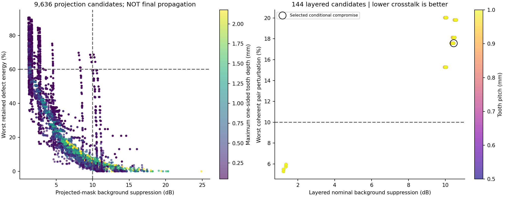
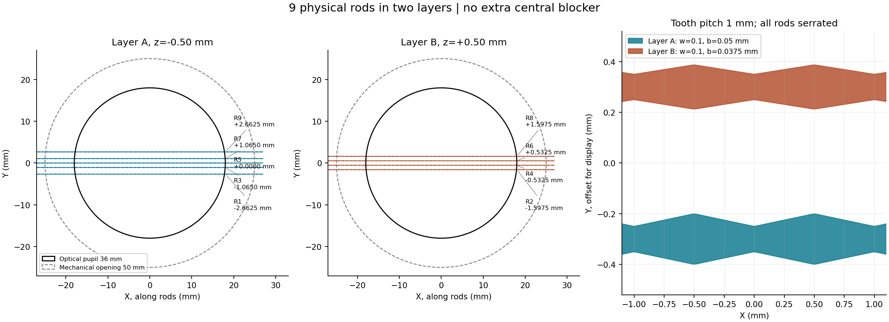
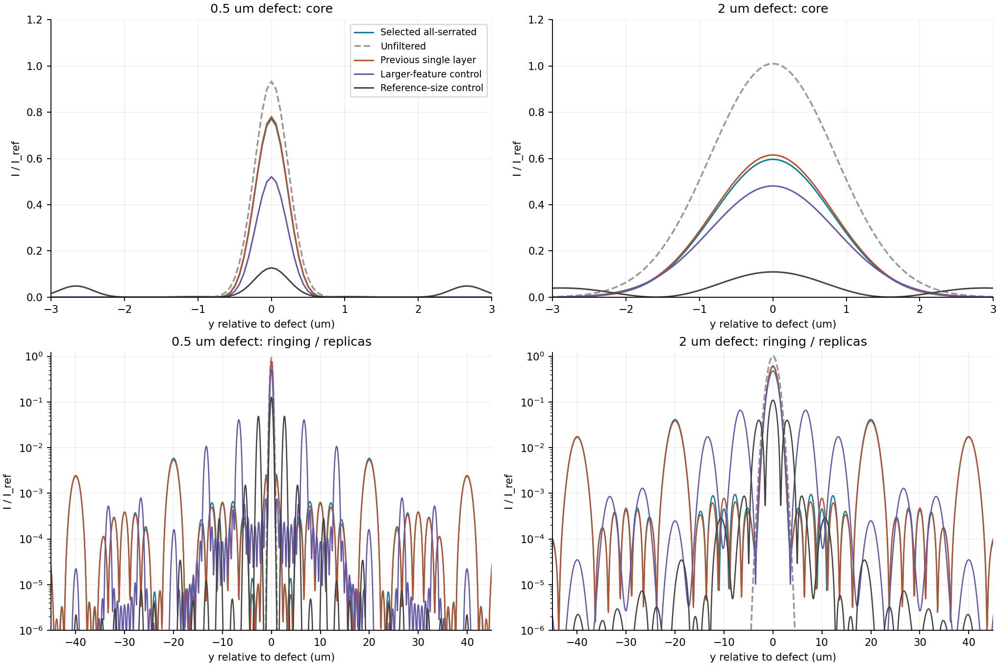
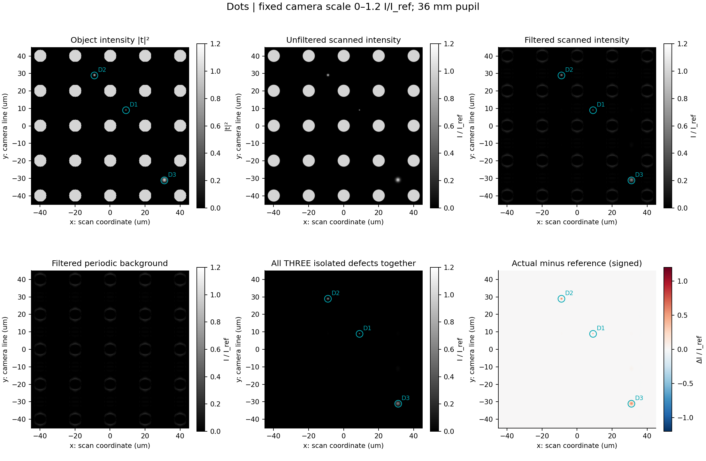
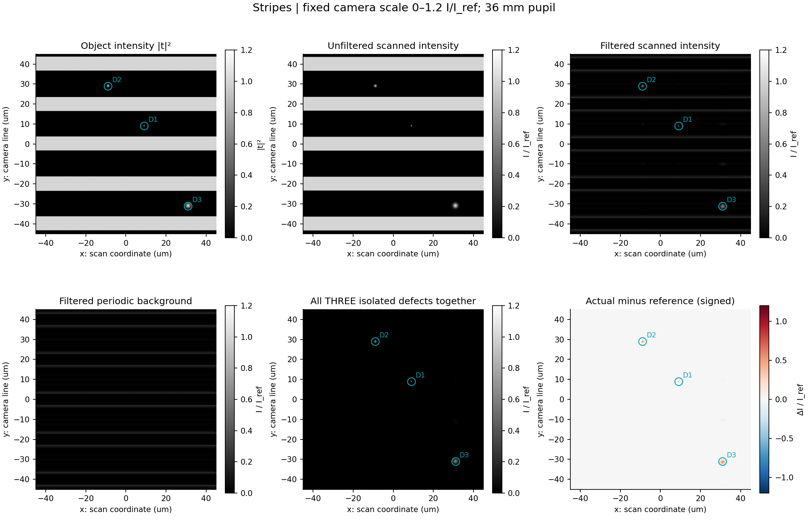
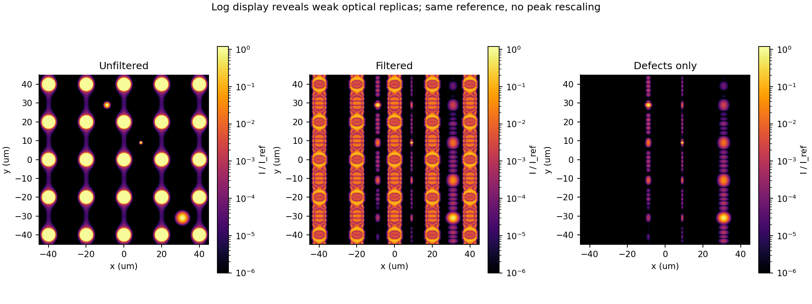
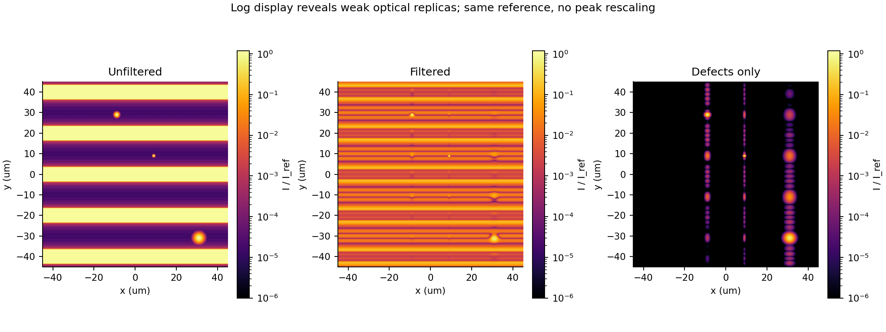
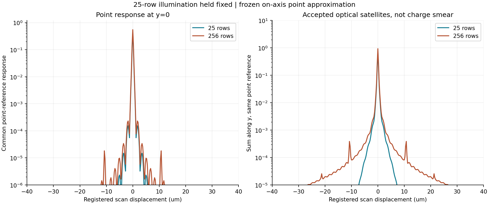

# 全锯齿双层傅里叶滤波：原理、优化与成像结果

更新：2026-08-31。范围：按用户参考图采用分层结构，两层全部改为三角锯齿杆，调整宽度、齿深及间距；齿周期不小于0.5 mm，总物理杆数不超过10。以下均为本机Anaconda环境实际运行的Python结果，不是新Zemax结果。

## 1. 结论先行

结构可以采用，不能把旧“同一平面不能重叠”的限制直接套在不同层上。本次找到的**条件性光学折中**为9根全锯齿杆：A层5根、B层4根；齿周期1.0 mm；两层位于名义傅里叶面两侧±0.5 mm。核心名义全宽均0.100 mm，A/B层单侧齿深分别0.0500/0.0375 mm。36 mm实际光学瞳不变。

同一中心线指标下，背景抑制10.451 dB，0.5～3 µm缺陷最差积分保留70.42%；加上本次共同位置误差、宽度误差及离轴抽查，最差为10.121 dB、68.64%。

**这不是“振铃已经解决”的结论，也不是可直接下单的机械最优方案。** 名义最坏晕圈能量23.62%，双缺陷最坏相位扰动17.58%。如果另外要求背景≥10 dB、晕圈≤10%、串扰≤10%，本轮144组分层候选中通过者为0组。两个10%阈值是诊断用严指标，不冒充用户已确认的验收标准。

光学解仍偏向较小齿深，属于所搜索加工下限附近。为回应之前“锯齿幅度太小”的顾虑，报告同时列出较大尺寸及PPT尺寸实算对照：不能把小齿深解直接宣称为机械加工最优。

齿周期1.0 mm也不是独一无二的光学最优：在同一入选宽度/位置和1 mm层距下，齿周期0.5～1.0 mm的中心线抑制差不到10⁻⁶ dB，远不足以判定优劣。1.0 mm是本轮选出的等效候选，较大的周期有利于满足“不易过窄”的要求；但会让非零级副像更接近主像，需按实际接收窗口重新权衡。层距从1增加到6 mm时，该结构中心线抑制约从10.451降到10.313 dB，也不能据0.14 dB差别忽略实际机械厚度和装配条件。

## 2. 固定条件与参考图的解释

| 项目 | 本轮使用值 |
|---|---|
| 波长、焦距、NA | 355 nm、30 mm、0.6，空气侧理想正弦映射 |
| 实际光学瞳 / 机械开口 | 36 mm / 50 mm，无瞳放大器 |
| 倍率、视场 | 20×，物方0.5 mm有限物体，边缘渐消30 µm |
| 照明 / 收集 | Ch3中路法向；主线扫照明强度FWHM=1 µm |
| 周期对象 | 20 µm周期，7 µm条宽或圆点直径；另用4.9 µm条宽检验背景抑制 |
| 非周期缺陷 | 高斯强度FWHM 0.5、1、2 µm；位置(9,9)、(-9,29)、(31,-31) µm |
| 优化用缺陷 | 0.5、0.75、1、1.5、2、3 µm，共6种尺寸 |
| 像元 / 有效线高 | 像方5 µm，物方0.25 µm；3点线高积分 |
| 挡杆材料模型 | 二值薄屏，遮挡区强度透过率10⁻⁴（假设值） |
| 加工约束代理 | 名义核心≥0.10 mm；三角周期≥0.5 mm；尖/谷平台20 µm；同层包络净隙≥0.10 mm并预留0.01 mm宽误差 |

PPT的双层结构可以借鉴，但原图上层直杆、本轮上层也改锯齿。图中1.1 mm、4.0 mm、0.75 mm用于构建“参考尺寸对照”；不能把图里所有轴向、同层、跨层尺寸都解释成衍射峰间距。本轮参考对照取两层各齿形相同、核心1.1 mm、单侧齿深1.45 mm、包络4 mm、齿距0.75 mm、合计9根、相邻投影中心距4 mm、轴向层距4 mm。它不是Puma完整处方复刻。

## 3. 从理论到代码

先写出的完整模型见[原理与计算方案](全锯齿分层傅里叶滤波_原理与计算方案.md)。以下给出与本次结果直接对应的公式。

### 3.1 物镜的正弦傅里叶坐标

$$
X=\lambda f\nu_x,\quad Y=\lambda f\nu_y,\quad
\alpha=\lambda f=0.01065\ \mathrm{mm}^2.
$$

$$
D_{\rm pupil}=2f\mathrm{NA}=36\ \mathrm{mm},\qquad
\Delta Y=\lambda f/p_{\rm object}=0.5325\ \mathrm{mm}.
$$

采用理想相干、标量、无像差有限圆瞳模型；无滤波不是无限分辨率复制，有限NA衍射仍存在。这里不是用FFT声称真实物镜自动满足阿贝正弦条件；真实处方必须另由Zemax实光线检验。高NA偏振/矢量及实际镀膜不在本轮模型内。

### 3.2 锯齿杆与分层传播

$$
Y_{j,\pm}(X)=Y_j\pm[w_j/2+b_jv(X-\phi_jp_s)].
$$

v是0到1的三角波，尖谷平台按20 µm截平；w是截平前的名义核心，b是单侧名义齿深。实体轮廓的最小/最大宽度还应按截平量修正，已写入逐杆CSV。本解A层实际约0.1020～0.1980 mm、B层约0.1015～0.1735 mm；不能把二值齿形当作直接灰度透过片。

$$
U_{F,\mathrm{out}}=
\mathcal P_{-z_2}\left[T_2\mathcal P_{z_2-z_1}[T_1\mathcal P_{z_1}U_F]\right].
$$

$$
D_z(x,y)=\exp[-i\pi z(x^2+y^2)/(\lambda f^2)],\qquad
\delta=\lambda f/p_s.
$$

$$
c_{i,0}=\sqrt\eta+(1-\sqrt\eta)\tau_i,\quad
c_{i,k}=(1-\sqrt\eta)\tau_i\operatorname{sinc}(k\tau_i)e^{-i2\pi k\phi_i}.
$$

两层共面总零级是各对−k、+k系数乘积的总和，而不只是两层零级之积。计算中保留层间非零级往返耦合；总零级快速模型由独立二维FFT及相位循环测试核对。局部Fresnel近似又与局部精确标量角谱核对，不把物方NA误当作傅里叶面层间传播角。

### 3.3 线扫与统一强度

对每个扫描位置，把移动物体与固定线照明相乘，经圆瞳和双层复场传播后，在物理相机线位置u取样，最后做有限线高/像元强度积分。扫描物体坐标s不是相机位置u，代码没有把s代入层间传播相位来制造扫描拖尾。

$$
I_{\rm camera}(s,y)=\int w(u)\,|E_s(u,y)|^2\,du,\qquad
I_{\rm display}=I_{\rm camera}/I_{\rm ref}.
$$

固定参考是同一照明、同一线高、无挡杆、无限均匀单位振幅物体：I_ref=0.985745190802。所有主成像线性图均0～1.2 I/I_ref，对数图均10⁻⁶～1.2 I/I_ref，差图为±1.2 ΔI/I_ref，不逐图或逐缺陷归一化。物体图显示强度|t|²。没有功率、曝光、量子效率标定，不能将这些数值标成W/mm²或DN。

## 4. 搜索范围与选择规则

第一阶段实际计算9,636组投影候选，2,850组满足缺陷保留/FWHM守护条件，其中9组达到沿用的10 dB背景目标。第二阶段从9个不同结构出发，计算144组分层复场。大尺寸对照另计算16组，未混入144组统计。

- 杆数：3、5、7、9，均含中央杆；只搜索对称奇数布置，因此≤10不代表已枚举所有10杆非对称解。
- 等中心距：0.5325 mm的0.75、1、1.25、1.5、2、3、4、6、8倍，另包含旧非等距九杆位置；两层交替分配。
- 核心全宽：0.10、0.14、0.20、0.30、0.50、0.75、1.10 mm。
- A层单侧齿深：0.05、0.10、0.20、0.40、0.75、1.45 mm；B层尺度倍率0.75、1、1.5，核心仍不小于0.10 mm。
- 相对齿相位：0、1/4、1/2周期；投影阶段比较，第二阶段保留入选相位，未遍历所有连续相位。
- 齿周期：0.5、0.625、0.75、1.0 mm；层间距：1、2、4、6 mm。所有结果只对这些范围负责，未声称更大周期或任意自由位置无更优解。

缺陷保留R≥60%、主峰FWHM不超过无滤波的1.10倍作为守护条件；对达到10 dB的候选按以下联合评分选取。本次10 dB是延续的工程折中目标，不是用户提出的新硬要求。

$$
J=S+10\log_{10}R
-10\log_{10}(1+H/0.05)
-10\log_{10}(1+C/0.10)
-10\log_{10}[1+\max(W_{90}/W_{90,0}-1,0)].
$$

S为两种条宽中较差的背景积分抑制；R取6种缺陷的最差积分比；H为保护半径max(0.75 µm,1.5倍缺陷尺寸)外的能量比例；EE90为以原缺陷位置为中心包含90%能量的全宽；C在正负1～25 µm、0.05 µm间隔采样同尺寸0.5 µm双缺陷的最坏相位干扰。单个邻居场比r对应C=2r+r²，不等同于独立强度之和。



## 5. 九根全锯齿杆的具体位置

所有长度单位为mm；杆长方向为X，横跨杆为Y。各杆均齿周期1.0 mm、齿相位相同；中央R5已经计入九根，不额外加第十根或隐藏零级遮挡。

| 杆号 | 层 | z | 中心Y | 名义核心全宽 | 单侧齿深 | 名义全包络 |
|---|---|---:|---:|---:|---:|---:|
| R1 | A | -0.500 | -2.6625 | 0.1000 | 0.0500 | 0.2000 |
| R2 | B | +0.500 | -1.5975 | 0.1000 | 0.0375 | 0.1750 |
| R3 | A | -0.500 | -1.0650 | 0.1000 | 0.0500 | 0.2000 |
| R4 | B | +0.500 | -0.5325 | 0.1000 | 0.0375 | 0.1750 |
| R5 | A | -0.500 | +0.0000 | 0.1000 | 0.0500 | 0.2000 |
| R6 | B | +0.500 | +0.5325 | 0.1000 | 0.0375 | 0.1750 |
| R7 | A | -0.500 | +1.0650 | 0.1000 | 0.0500 | 0.2000 |
| R8 | B | +0.500 | +1.5975 | 0.1000 | 0.0375 | 0.1750 |
| R9 | A | -0.500 | +2.6625 | 0.1000 | 0.0500 | 0.2000 |

投影相邻中心距最小0.5325 mm，外侧间隔1.065 mm；A、B各自的同层最小中心距均1.065 mm。跨层投影重叠在本轮允许，但实体同层不许相交。



尺寸数据：[逐杆CSV](results/stacked_all_serrated/rod_dimensions.csv)；[分层DXF光学轮廓](results/stacked_all_serrated/rod_silhouettes_not_for_release.dxf)。DXF中A/B为两个图层，均以名义傅里叶面坐标表达，不含支架、厚度或实体三维层位，不能直接用作加工放行图。

## 6. 尺寸增大后的取舍：不是越大越能抑制振铃

下表全部重新采用相同的中心线名义指标，避免将旧容差最坏值和新名义值混比。

| 方案 | 背景抑制dB | 最差缺陷保留 | 最坏晕圈H | 最坏串扰C | 最大FWHM倍率 |
|---|---:|---:|---:|---:|---:|
| 旧单层正弦边缘（同口径对照） | 10.387 | 72.06% | 22.45% | 16.74% | 0.975 |
| 全锯齿双层：光学折中 | 10.451 | 70.42% | 23.62% | 17.58% | 0.972 |
| 全锯齿双层：大尺寸对照 | 1.715 | 62.78% | 26.33% | 61.98% | 1.000 |
| 全锯齿双层：PPT尺寸对照 | 11.608 | 4.60% | 44.41% | 161.15% | 1.001 |

大尺寸对照定义为核心≥0.30 mm、单侧齿深≥0.20 mm；优选为9根、核心0.30 mm、单侧齿深0.20 mm、包络0.70 mm、投影等中心距1.5975 mm、齿距1 mm、层间距6 mm。它只是一个明确尺寸等级的对照，不能当作已获加工厂确认的下限。

PPT尺寸对照背景降低更多，但大量缺陷频谱也被遮挡。0.5 µm缺陷保留约24.47%，3 µm仅4.60%。**“结构可用”不等于“参考毫米尺寸可原样照搬”**。如果必须采用毫米级齿深，应重新讨论物体周期、傅里叶面倍率或其他系统参数，而不能暗中改变36 mm瞳。

双层全锯齿本轮没有证明优于旧单层低振铃方案；这是针对用户所选结构给出的可比较结果，不将结构切换包装成必然提升。



### 6.1 选中方案对六种缺陷的响应

| 缺陷强度FWHM µm | 积分保留 | 主峰FWHM：无滤波→有滤波 µm | EE90：无滤波→有滤波 µm | 晕圈能量 |
|---:|---:|---:|---:|---:|
| 0.5 | 86.71% | 0.541 → 0.515 | 0.750 → 1.250 | 9.87% |
| 0.75 | 81.74% | 0.773 → 0.725 | 1.125 → 39.000 | 13.64% |
| 1 | 78.07% | 1.017 → 0.947 | 1.375 → 40.250 | 16.66% |
| 1.5 | 73.78% | 1.511 → 1.412 | 2.125 → 41.375 | 20.51% |
| 2 | 71.75% | 2.008 → 1.903 | 2.750 → 42.125 | 22.38% |
| 3 | 70.42% | 3.005 → 2.922 | 4.250 → 43.125 | 23.62% |

这里尤其不能只看FWHM：有些主峰变窄，但EE90接近40 µm，说明弱能量已进入周期副像。其主要沿Y分布，与挡杆中心阵列的频谱对应；不是TDI电荷错配把目标拉长。

## 7. 完整扫描图：圆点阵列与长条

计算网格8192²、窗口1.024 mm、物方网格0.125 µm；最终像元间隔0.25 µm。主图显示±45 µm，三个缺陷均圈出，D3位于右下角(31,-31) µm，不被裁掉。差图可能含正负相干交叉项，不能把差图亮点数当作真实缺陷数。

最终成像使用连续矩形/圆盘的解析物体频谱，不让网格取整改变条宽、圆点大小；圆点视场边缘以每个圆点中心的渐消权重建模。粗网格复场先带限插值，再平方成强度，最后以矩形像元的sinc响应积分，避免强度带宽加倍后混叠。初版逐点二值画物体、粗网格直接平方会放大边界误差，已修正后重算本节所有图，不沿用其数值。

| 对象 | 全Y积分背景抑制dB | 显示ROI背景抑制dB | D1/D2/D3：全Y积分保留 |
|---|---:|---:|---|
| 圆点阵列 | 10.495 | 11.475 | 86.74% / 78.07% / 71.75% |
| 长条阵列 | 10.460 | 11.424 | 86.74% / 78.07% / 71.75% |

“全Y”指整个1.024 mm计算窗、扫描X仍为±45 µm；显示ROI仅±45 µm方框，不是同一个积分域。缺陷周期副像可能超出显示框，因此不以显示ROI漏掉的能量误判目标消失。中心线筛选与有限线高完整二维指标也不应强行相等。





对数诊断图使用相同参考和相同色标，会显著放大本来很弱的振铃，仅用于定位副像，不替代线性成像图：





## 8. 25级照明配置下扩大到256级接收

仍采用之前单独的TDI假设：照明强度FWHM固定为物方6.25 µm，像方行距5 µm、20×倍率；25级接收全高6.25 µm，256级为64 µm。不要与主线扫1 µm照明混用。

运动与电荷同步时，每个目标像素配准累积，不生成25或256像素长的卷积核。增加积分行数可以改变被接收的**光学副像**，不是把原像几何拉长。新齿距1 mm的一级位移为10.65 µm，256级窗口中心±32 µm能显著接收±1、±2级，±3级靠近窗口边缘；25级则主要接收中央区域。

$$
G_N(r)=\tfrac12\left[\operatorname{erf}\left(q(H_N/2-r)\right)
+\operatorname{erf}\left(q(H_N/2+r)\right)\right],\qquad
q=2\sqrt{\ln2}/w_{\rm illum}.
$$

本轮对双层的TDI数值采用**冻结轴上全级次点响应近似**：保留真实二值屏的所有衍射级次，之后用|h|²G_N计算窗口接收。它不是完整的移动物场—电荷转移联合验证，因为双层系统不严格空间平移不变；不能据此宣称已优化256级下所有有限缺陷的串扰。完整场景的最终候选仍按主线扫条件选取。

| 接收级数 | 中央点曝光接收比例 | 扫描方向±2 µm以外能量占比（该点近似） |
|---:|---:|---:|
| 25 | 76.097% | 0.743% |
| 256 | 100.000% | 1.766% |



本图使用一个共同“无滤波点峰值×无限曝光”点响应参考，不标成主图的I/I_ref；它和主图的源对象不同，不能把点响应强度与扩展物体强度混比。明细见[TDI级次接收CSV](results/stacked_all_serrated/tdi_order_acceptance.csv)。

## 9. 数值验证、误差与未覆盖项

| 层间保留谐波 | 中心线背景抑制dB | 最差缺陷保留 | 相对上一档的复场L2变化 |
|---|---:|---:|---:|
| ±6 | 10.450572 | 70.42031% | — |
| ±12 | 10.450573 | 70.42031% | 1.5e-06 |
| ±24 | 10.450573 | 70.42031% | 4.77e-07 |
| ±48 | 10.450573 | 70.42031% | 2.19e-07 |

- 独立二维FFT加共同相位循环提取总零级，与快速谐波算法在单元测试中逐点比对；共面时也与二值投影共同透明区核对。
- 局部精确角谱相对Fresnel的全场强度L2差约8.89e-09，复场差约1.74e-06。
- 对0.5 µm高斯缺陷、1 µm线照明，直接保留所有级次的二维二值屏模型与总零级线中心强度L2差约1.1e-05。该数包含二值边缘网格误差，不是独立测出的纯非零级泄漏；也不保证对任意照明/更大齿距都成立。
- 直接二值验证的傅里叶面网格约0.010400 mm。谐波系数沿杆长解析计算；仍需进一步细化实际毛刺、圆角、装配公差。
- 公差/离轴抽查：Y偏场0、±0.20 mm；两层共同横移±0.025 mm；核心全宽误差±0.010 mm。最坏晕圈25.43%、串扰18.62%。未覆盖每根杆独立位置、倾角、齿相位、轴向公差的蒙特卡洛。
- 两层均按理想薄屏；厚度、侧壁投影、支架、倒角、多反射、355 nm材料/镀膜、热稳定性未设计。图中54 mm轮廓长度用于覆盖光学瞳，并非最终杆长或支架尺寸。
- 当前为有界离散搜索与候选精筛，不是全局最优证明；没有重新优化物体周期、物镜处方或瞳放大倍率。

网格4096→8192的同坐标完整长条图：滤波强度相对L2差6.35e-06，D1强度相对L2差0.000124；详见[图像网格核查](results/stacked_all_serrated/image_grid_check.json)。全部新旧单元测试及交付文件核查见[验收记录](results/stacked_all_serrated/artifact_validation.json)。

## 10. 可复现文件与执行顺序

环境沿用本机Anaconda：`E:\anconda\envs\fourier-filter\python.exe`；环境定义见[environment.yml](environment.yml)。未改动本机原始Zemax物镜。

```powershell
$py = 'E:\anconda\envs\fourier-filter\python.exe'
& $py src/stacked_serrated.py prescreen
& $py src/stacked_serrated.py refine
& $py src/stacked_validate.py
& $py src/stacked_comparisons.py
& $py src/stacked_images.py --n 8192
& $py src/stacked_images.py --n 4096 --case stripes
& $py src/stacked_report.py
& $py -m pytest -q --junitxml=results/stacked_all_serrated/pytest.xml
& $py src/validate_stacked_artifacts.py
```

核心文件：[配置](config/stacked_serrated.yml)、[分层光学与优化](src/stacked_serrated.py)、[独立验证](src/stacked_validate.py)、[完整线扫](src/stacked_images.py)、[大尺寸及TDI对照](src/stacked_comparisons.py)。完整候选数据保存在[投影候选CSV](results/stacked_all_serrated/projection_candidates.csv)和[分层候选JSON](results/stacked_all_serrated/layer_refinement.json)，保留未达标结果。

## 11. 下一步与未决条件

当前可作为全锯齿双层的光学验证候选，**不建议据此直接定版加工**。若要求同时达到≥10 dB抑制、≤10%晕圈和≤10%串扰，本轮没有找到满足解。若要进一步工程化，需先确认可接受的最低齿深/核心宽度及真实杆厚，随后做独立杆公差、256级移动场接收、实际偏振/材料与物镜处方联合验证。

参考：[US7397557B2锯齿边缘与衍射阶次处理](https://patents.google.com/patent/US7397557B2/en)、[Matsushima与Shimobaba，2009，角谱传播采样](https://pubmed.ncbi.nlm.nih.gov/19997186/)。参考图只作为用户指定的尺寸和结构依据；未把图中说明当作额外指令。
