# 双层交错傅里叶档杆：最终工程方案与验证结果

> 最终版，2026-09-02。本文件只保留最终坐标、推荐结构、验收公式和有效仿真结果。滤波前后均使用同一强度参考，不做周期背景相减。

## 1. 最终结论

每个成像通道使用一套独立傅里叶滤杆模块，共安装9根双侧三角锯齿杆，A层5根、B层4根。默认启用相对级次 $m=-3\ldots+3$ 的7根杆；其余两根作为扩展级次或备用杆。各杆沿傅里叶面 $X_F$ 独立移动并与实测频谱峰对准，未启用杆沿长轴方向退出光瞳。

最终推荐参数如下。

| 项目 | 最终值 |
|---|---:|
| 波长 | 355 nm |
| 傅里叶物镜焦距 | 30 mm |
| 物方NA | 0.60 |
| 真实光学瞳直径 | 36 mm |
| 成像倍率 | 20× |
| 物方视野 | 0.5 mm |
| 档杆安装数 | 9根，A/B层为5/4根 |
| 默认启用数 | 7根，$m=-3\ldots+3$ |
| 档杆核心全宽 | 1.0 mm |
| 单侧锯齿深度 | 0.5 mm |
| 最大遮光包络 | 2.0 mm |
| 锯齿周期 | 0.75 mm |
| A/B层名义间距 | 4 mm |
| X向傅里叶中继倍率 | $M_{FX}=2.8169$ |
| Y向傅里叶中继倍率 | $M_{FY}=1$ |
| TDI配置 | 25级，5 µm行距 |

该方案的目标是在周期背景抑制、particle能量保留、振铃串扰和机械刚性之间取得可制造的平衡。2–5 µm周期仿真中，7杆模式的原始周期背景抑制为15.49–22.62 dB，不规则高亮particle峰值保留率为68.81%–81.66%。

## 2. 最终坐标关系

| 对象 | 方向 |
|---|---|
| 相机长边、照明线长轴 | X |
| 晶圆运动、TDI电荷转移、窄积分方向 | Y |
| 档杆长轴、锯齿周期 | 傅里叶面 $Y_F$ |
| 档杆独立定位 | 傅里叶面 $X_F$ |
| 75°照明在样品面的投影 | $+Y$，光源位于 $-Y$ 侧 |

这一坐标关系决定了两种完全不同的衍射效应：

- 锯齿沿 $Y_F$ 周期重复，其 $k\ne0$ 级沿像面Y分开，可由窄Y的TDI接收区排除；
- 档杆核心宽度和多杆阵列沿 $X_F$ 排列，其像面振铃沿X展开，TDI不能排除。

## 3. 正弦物镜与频谱位置

傅里叶物镜必须使用方向正弦映射，而不是正切映射。在空气中：

$$
X_F=f_{FF}s_x=f_{FF}\sin\theta_x,
\qquad
Y_F=f_{FF}s_y=f_{FF}\sin\theta_y.
$$

经过各向异性傅里叶面中继后：

$$
X'_F=M_{FX}X_F,
\qquad
Y'_F=M_{FY}Y_F.
$$

对物体X向周期 $p_x$，Ch3第 $m$ 级的档杆目标位置为

$$
\boxed{
X'_{F,m}=X'_{F,c}+mM_{FX}\frac{f_{FF}\lambda}{p_x}
}.
$$

相邻频谱峰间距为

$$
\boxed{
\Delta X'_F=M_{FX}\frac{f_{FF}\lambda}{p_x}
}.
$$

当前参数下：

| 物体周期 | 相邻峰距 | 7杆最外侧位置（相对中心） |
|---:|---:|---:|
| 2 µm | 15.0 mm | ±45.0 mm |
| 3 µm | 10.0 mm | ±30.0 mm |
| 4 µm | 7.5 mm | ±22.5 mm |
| 5 µm | 6.0 mm | ±18.0 mm |
| 20 µm | 1.5 mm | ±4.5 mm |

因此1.0–1.5 mm档杆间距不能用于2 µm周期。不同周期必须重新移动每根档杆，不能使用固定杆距。

### 3.1 频谱对准验收条件

有限视野使理想离散峰具有有限宽度。物方X向有效视野为 $W_x$ 时，峰宽量级为

$$
W_{\mathrm{peak},F}\approx
M_{FX}\frac{f_{FF}\lambda}{W_x}.
$$

每根档杆必须满足

$$
\boxed{
|X'_{F,\mathrm{rod},m}-X'_{F,m}|
+\frac{W_{\mathrm{peak},F}}{2}
+\varepsilon_{\mathrm{pos}}
<\frac{w_{\mathrm{core}}}{2}
}.
$$

$\varepsilon_{\mathrm{pos}}$ 包括正弦映射残差、机构定位误差和样品周期漂移。对 $W_x=0.5$ mm、$w_{\mathrm{core}}=1.0$ mm：

$$
W_{\mathrm{peak},F}\approx0.060\ \mathrm{mm},
$$

所以允许的中心误差为 $0.470\ \mathrm{mm}-\varepsilon_{\mathrm{pos}}$。工程上仍应采集傅里叶面峰图进行闭环对准。

### 3.2 倾斜照明和三通道

三通道分别计算，不把三套频谱画在同一个物理滤杆面。对任一通道，将样品的出射波矢旋转到该通道局部坐标，再按方向正弦映射：

$$
\boldsymbol s_o
=\boldsymbol s_i+\lambda\boldsymbol G_{mn},
\qquad
\begin{bmatrix}s_{x,c}&s_{y,c}&s_{z,c}\end{bmatrix}^{T}
=R_c\boldsymbol s_o.
$$

只有满足通道NA的级次进入该通道。随后采用

$$
X'_{F,c}=M_{FX}f_{FF}s_{x,c},
\qquad
Y'_{F,c}=M_{FY}f_{FF}s_{y,c}.
$$

75°照明位于Y–Z入射面，首先沿Y平移频谱；档杆长轴沿 $Y_F$ 覆盖该平移。各杆的X位置仍由本通道实际接收峰的 $X'_F$ 坐标标定。

## 4. 双层锯齿档杆结构

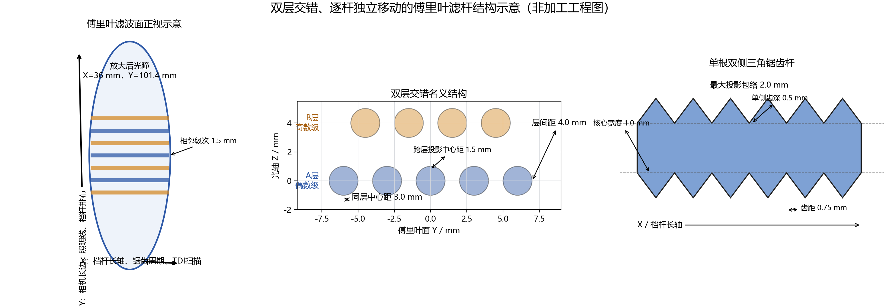

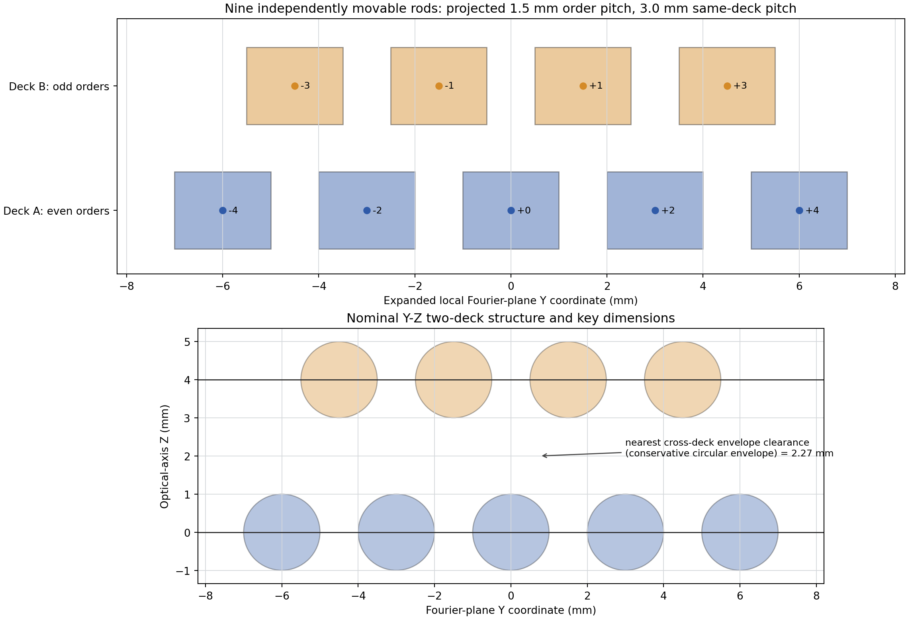

推荐结构：

1. A层放置5根、B层放置4根，相邻频谱级次交错分层；
2. 核心全宽1.0 mm，保证悬臂刚性；
3. 两侧各设置0.5 mm深三角锯齿，最大包络2.0 mm；
4. 锯齿周期0.75 mm，不采用小于0.5 mm的难加工齿距；
5. 档杆Y向有效长度不小于40 mm；
6. X向独立定位行程至少±45 mm，覆盖2 µm周期的±3级；
7. 未启用档杆沿Y长轴方向完全退出有效光瞳。

20 µm基准周期下，投影相邻峰距1.5 mm，而同层相邻档杆中心距为3.0 mm。2.0 mm最大包络对应同层1.0 mm名义净间隙，不发生投影重叠。2–5 µm周期的同层间距为12–30 mm，机械分离更充分。

### 4.1 滤杆面口径

物镜真实光学瞳仍为

$$
D=2f_{FF}\mathrm{NA}=36\ \mathrm{mm}.
$$

X向2.8169倍中继使滤杆面共轭瞳变为

$$
D'_X=101.4\ \mathrm{mm},
\qquad
D'_Y=36\ \mathrm{mm}.
$$

滤杆模块净开口应不小于110 mm × 40 mm（X×Y）。50 mm机械开口无法同时容纳该展开瞳和1.5 mm级次间距；这不会改变物镜本身36 mm的真实入瞳。

## 5. 锯齿与振铃抑制

锯齿不是材料灰度结构。沿 $Y_F$ 的周期二值齿形只保留 $k=0$ 后，在横跨档杆宽度的X方向形成等效软边透过率。线性三角齿的零级平均振幅从核心边缘连续过渡到全透，从而降低硬边的远端衍射包络。

同为2.0 mm最大包络时，最终锯齿结构相对于2.0 mm硬边杆的单particle结果为：

| 结构 | particle能量保留 | 最强X向副峰 | 核外振铃能量 |
|---|---:|---:|---:|
| 2.0 mm硬边包络 | 85.94% | −16.11 dB | 13.76% |
| 1.0 mm核心＋双侧0.5 mm锯齿 | 88.85% | −19.36 dB | 9.35% |

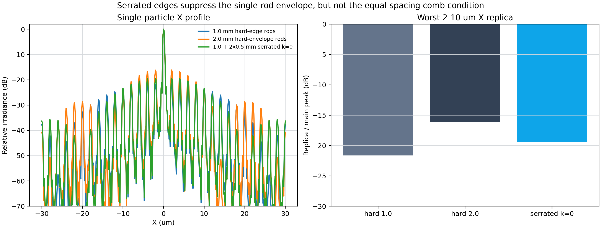

### 5.1 A/B层锯齿深度联合优化

保持不透明核心全宽1.0 mm、齿距0.75 mm、7根杆位置和同一个2 µm周期particle缺陷场不变。A层承载偶数级 $m=-2,0,+2$，B层承载奇数级 $m=-3,-1,+1,+3$。分别扫描两层的单侧锯齿深度

$$
b_A,b_B\in\{0.50,0.75,1.00,1.25,1.50,1.75,2.00\}\ \mathrm{mm},
$$

共49组。综合评价权重为：particle能量保留35%、最强X向副峰30%、核外振铃能量20%、周期背景抑制15%。所有图使用同一个未滤波强度参考，不做背景相减或滤波后重新归一化。

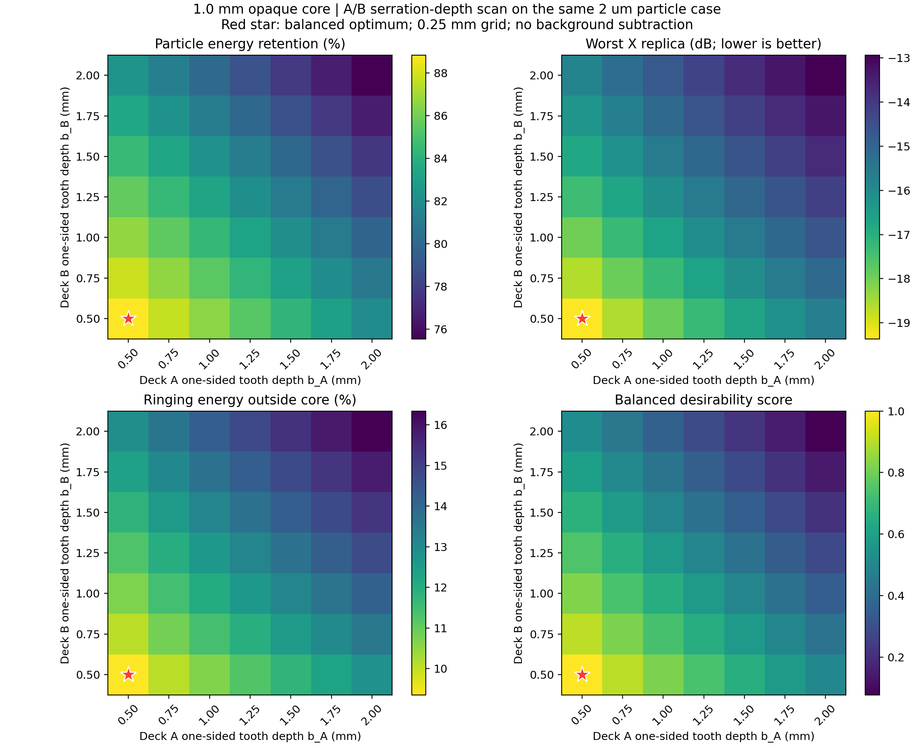

该2 µm案例的7根核心已经遮挡全部X向传播级次，所以49组的理想周期背景均达到数值消光，不能用背景抑制继续区分齿深。增大 $b_A$ 或 $b_B$ 会扩大被移除的连续particle频带，并在当前2 µm多杆梳状增强位置提高副峰。对称配置的代表结果为：

| $b_A=b_B$ | 最大包络 | particle能量保留 | 最强X向副峰 | 核外振铃能量 | 综合得分 |
|---:|---:|---:|---:|---:|---:|
| 0.50 mm | 2.0 mm | 88.85% | −19.36 dB | 9.35% | 1.000 |
| 1.00 mm | 3.0 mm | 84.39% | −16.67 dB | 12.05% | 0.651 |
| 1.50 mm | 4.0 mm | 79.96% | −14.60 dB | 14.25% | 0.353 |
| 2.00 mm | 5.0 mm | 75.54% | −12.94 dB | 16.34% | 0.078 |

49组中没有非对称A/B组合优于 $(0.50,0.50)$ mm。因此本案例的最终最优配置为

$$
\boxed{b_A=b_B=0.50\ \mathrm{mm}}.
$$

它同时保持最小2.0 mm包络、最高particle能量和最低梳状副峰。齿深加到2.0 mm虽然在2 µm峰距下仍能机械分开，但没有获得光学收益，也会降低对20 µm等较密频谱的机械兼容性。

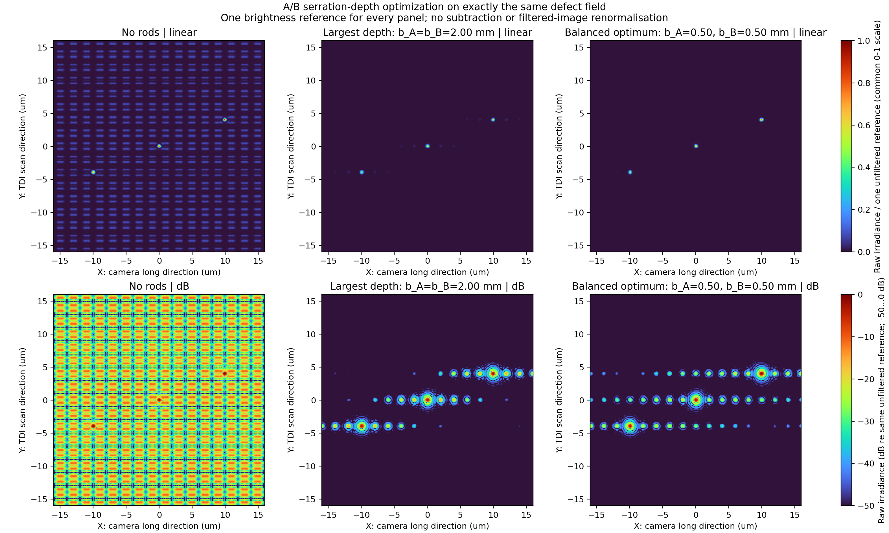

锯齿降低的是单杆包络。多根档杆与周期峰严格对准后仍会产生X向有限梳状阵列因子：

$$
D_N(x)=
\exp[i\pi(N-1)\Delta f_xx]
\frac{\sin(N\pi\Delta f_xx)}{\sin(\pi\Delta f_xx)}.
$$

因此最终验收必须保留“X向副峰不高于−19 dB”和“相邻缺陷串扰”指标，不能假设TDI会消除这部分振铃。

## 6. TDI积分宽度

锯齿周期 $p_s=0.75$ mm时，锯齿相邻级次的物方和像方位移为

$$
\Delta y_o=\frac{\lambda f_{FF}}{p_s}=14.2\ \mu\mathrm m,
$$

$$
\Delta y_i=20\Delta y_o=284\ \mu\mathrm m.
$$

设 $H_Y=Np_Y$ 为TDI像方积分全宽，$W_{P,Y}$ 为照明线或单级像按中央能量比例 $P$ 定义的有效全宽，$\varepsilon_Y$ 为单侧余量。只接收锯齿 $k=0$ 的条件为

$$
\boxed{
\Delta y_i>\frac{H_Y+W_{P,Y}}{2}+\varepsilon_Y
}.
$$

当前照明线像方强度FWHM为125 µm，与25级、5 µm行距的TDI宽度匹配。取99.99%高斯中央能量和10 µm单侧余量：

$$
W_{P,Y}=413.05\ \mu\mathrm m,
\qquad
H_{Y,\max}=134.95\ \mu\mathrm m.
$$

因此：

- 25级：$H_Y=125\ \mu$m，通过；
- 256级：$H_Y=1280\ \mu$m，不通过；
- 5 µm行距下最多允许26级。

理想速度匹配TDI对同一物点同步累积，归一化后不产生扫描拖尾或几何拉伸。上述接收宽度只排除Y向锯齿非零级，不排除X向多杆副峰。

## 7. Python最终仿真结果

仿真采用复振幅傅里叶光学：

$$
U_F=\mathcal F\{U_o\}P,
\qquad
U_i=\mathcal F^{-1}\{TU_F\},
\qquad
I_i=|U_i|^2.
$$

$P$ 为NA=0.6圆瞳，$T$ 为7根锯齿杆的 $k=0$ 等效透过率。周期pattern保持明亮，高亮不规则particle直接叠加在周期结构中。评价遵守：

- 滤波前后使用同一个未滤波峰值；
- 同一强度单位和同一色标；
- 不做周期参考相减；
- 不对滤波后图像单独归一化。

### 7.1 频谱面和档杆位置

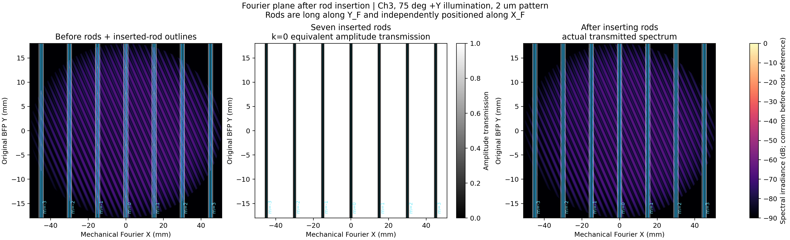

档杆只衰减原有频谱，不会在傅里叶面产生新的亮级次。图中的杆中心与目标离散峰逐根对准；插杆后的频谱未重新归一化。

### 7.2 同强度滤波前后对比

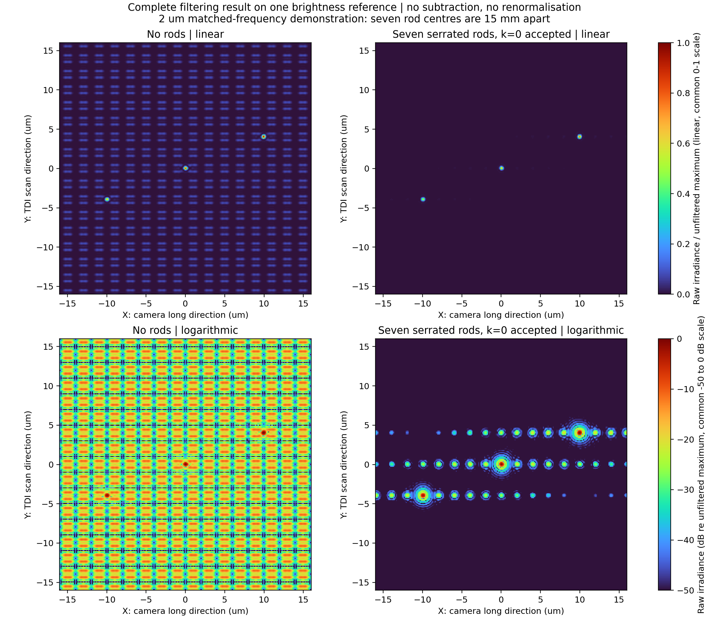

下面的线性图是标准统一亮度结果。2、3、4、5 µm四种周期及全部滤波前后图，共同使用整组数据中唯一的未滤波全局峰值

$$
I_{\mathrm{ref}}=\max_{p\in\{2,3,4,5\}\,\mu\mathrm m}\max I_{\mathrm{open},p},
$$

并统一显示 $0\le I/I_{\mathrm{ref}}\le1$。没有逐行、逐周期或逐图重新归一化。

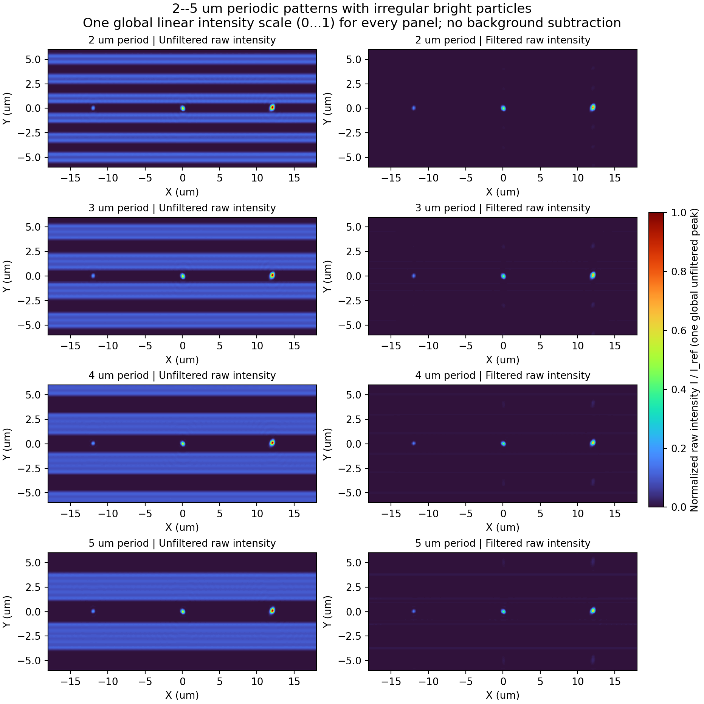

下图使用同一个全局 $I_{\mathrm{ref}}$ 转换为−35～0 dB，用于观察线性图中不可见的弱残余；它仍然没有背景相减或滤波后增亮。

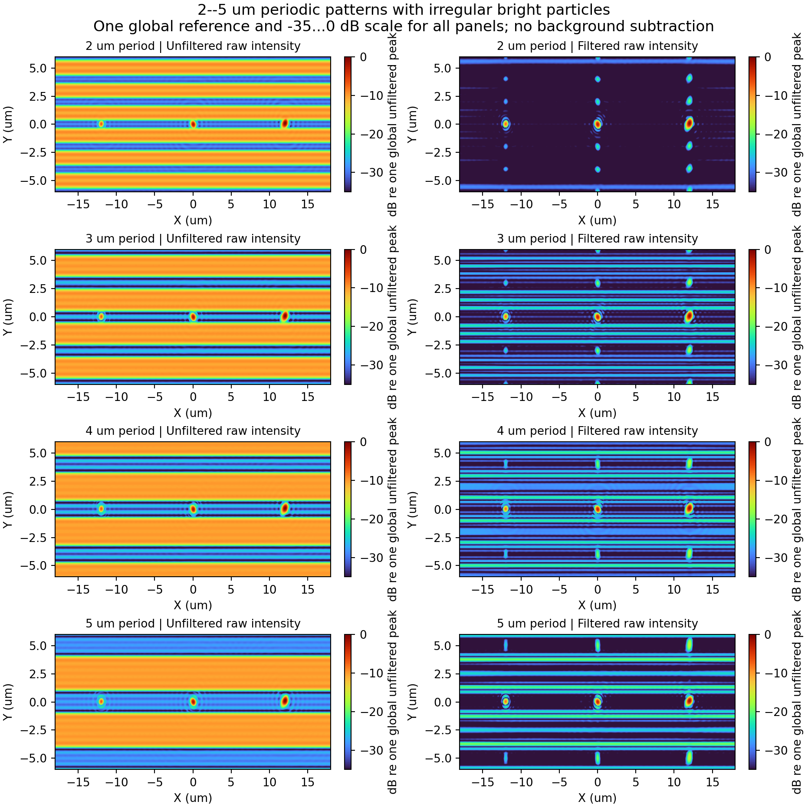

7杆模式的原始图评价结果为：

| 周期 | 峰间距 | 背景抑制 | particle峰值保留 | 滤波后particle/pattern |
|---:|---:|---:|---:|---:|
| 2 µm | 15.0 mm | 22.62 dB | 81.66% | 28.47 dB |
| 3 µm | 10.0 mm | 17.55 dB | 75.11% | 22.89 dB |
| 4 µm | 7.5 mm | 16.10 dB | 71.21% | 21.85 dB |
| 5 µm | 6.0 mm | 15.49 dB | 68.81% | 20.69 dB |

2 µm周期在NA=0.6内只有 $m=-3\ldots+3$ 传播，因此7杆覆盖全部X向传播级次。3–5 µm仍存在更高传播级次，背景抑制略低；若需要进一步抑制，可启用备用杆，但必须重新评价particle保留率和X向振铃。

## 8. Zemax验证和设计操作

### 8.1 最终目标系统的优化约束

在Zemax中，不能仅依靠近轴焦距或一个名为“SINE”的数学操作数证明阿贝正弦条件。应同时约束真实光线方向余弦、傅里叶面截点、物像正弦关系和波前。

对滤杆面使用真实光线坐标：

$$
X'_F-M_{FX}f_{FF}s_x=0,
\qquad
Y'_F-M_{FY}f_{FF}s_y=0.
$$

有限共轭阿贝条件写为

$$
n_o\sin u_o-Mn_i\sin u_i=0.
$$

推荐操作数组合：

| 目的 | Zemax操作数 |
|---|---|
| 取得物方真实方向余弦 | `REAA`、`REAB` |
| 取得滤杆面真实坐标 | `REAX`、`REAY` |
| 建立 $f\sin u$ 目标 | `PROB`、`DIFF` |
| 控制多视场波前 | `OPDX`，多瞳半径、多方位 |
| 控制像高和倍率 | `REAX`、`REAY` |
| 控制口径和渐晕 | 实光线网格、Footprint、Clear Semi-Diameter |

优化和验收必须覆盖轴上及离轴视场、多个瞳半径和方位。最终验收建议：正弦映射RMS残差不超过10 µm、最大残差不超过25 µm，并且该残差计入档杆对准式中的 $\varepsilon_{\mathrm{pos}}$。

X向2.8169倍中继的目标约束为

$$
X'_F-2.8169X_F=0,
\qquad
Y'_F-Y_F=0.
$$

同时必须验证101.4 mm × 36 mm展开瞳不被中继镜片或机械孔径截断。

### 8.2 当前目标参数的理想透镜原生POP基准

本机OpticStudio 2022 R2.02已按当前最终参数建立原生POP理想4f基准：355 nm、$f_1=30$ mm、NA=0.6、36 mm真实光瞳、$f_2=600$ mm和20×。缺陷案例为2 µm周期亮暗pattern暗区中的一个约0.6 µm不规则高亮particle；七根杆覆盖 $m=-3\ldots+3$。

1024²网格、0.15 mm局部物面窗下，Zemax实际傅里叶面范围72.633 mm，完整覆盖36 mm瞳和七根杆。滤波前后使用同一W/mm²绝对强度，不作背景相减，结果为：

| 项目 | 理想透镜原生POP |
|---|---:|
| 周期背景抑制 | 15.59 dB |
| particle峰值保留 | 79.93% |
| 滤波后particle/周期残余 | 13.93 dB |
| POP警告 | 无 |

完整建模、采样核对和可复现文件见：[Zemax理想透镜2 µm周期particle原生POP](Zemax_理想透镜_2um周期particle原生POP.md)。该模型是无像差理想上限；A/B层暂作共面等效，不能代替355 nm真实处方验收。

### 8.3 当前355 nm Corning 7980真实物镜与阿贝验证

已在本机OpticStudio 2022 R2.02中完成当前目标参数的真实物镜初始设计。物镜为6片Corning HPFS 7980等效熔融石英元件，Zemax有效材料名为`F_SILICA`，355 nm折射率1.4760718798；12个实际折射曲面均使用真实曲率，tube lens按本轮要求保留为600 mm理想透镜，不包含镀膜。

| 项目 | 最终真实物镜 |
|---|---:|
| 实际倍率 | −20.0042× |
| 反算物镜焦距 | 29.9937 mm |
| 物方NA | 0.600 |
| 正弦瞳直径 | 35.9924 mm |
| 实体光阑直径 | 36.0000 mm |
| 六片玻璃最小实体厚度 | 8.0578 mm |
| 镜片—镜片最小物理空气隙 | 0.6724 mm |
| 最大有效口径边缘斜率 | 47.59°（S9） |
| 镜片/曲面几何干涉 | 无 |
| 三视场有效光线 | 均3209/3209 |
| 三视场OPD RMS | 0.0060 / 0.0264 / 0.0642波 |
| 阿贝 $f\sin\theta$ RMS残差 | 2.20 µm |
| 阿贝 $f\sin\theta$ 最大残差 | 11.64 µm |

完整曲率、厚度、有效口径、材料等效依据和401点阿贝光线数据见：[Zemax 355 nm Corning 7980真实物镜与阿贝验证](Zemax_355nm_Corning7980真实物镜_阿贝验证.md)。该处方已满足本项目建议的阿贝RMS≤10 µm、最大≤25 µm约束，可作为下一步真实物镜POP傅里叶滤波的起点。

实体矢高审查确认六片镜片在各自共同有效口径内均不相交，最薄玻璃为8.0578 mm，三处镜片—镜片最小空气隙均为0.6724 mm。最陡的S9边缘斜率为47.59°，未到半球/圆锥定义域极限，但需要加工工艺评审。当前S11光阑按零厚度薄片建模，前后各0.3362 mm只适合薄片或沉积式光阑；刚性光阑座应把两侧净空提高到至少1.0 mm并重新优化。

随后使用同一六片模型完成了阿贝—频谱线性—滤波闭环复核。真实光线给出的物理频谱映射为 $Y_{\mathrm{BFP}}=29.10232883\sin u$ mm，线性 $R^2=0.999998763$；2 µm周期的实际相邻级次间距为5.165663 mm。采用该模型导出的3209点二维OPD瞳进行相干滤波，在不减周期背景、前后同一强度尺度下，2048网格背景抑制48.72 dB、particle峰值保留50.18%、对比提升35.72 dB。当前最强相邻梳状副像仍为−9.12 dB，是后续需要降低的档杆振铃串扰。

完整验证见：[Zemax 355 nm真实物镜：阿贝条件、频谱线性和傅里叶滤波验证](Zemax_355nm真实物镜_阿贝频谱线性与滤波验证.md)。

### 8.4 本机临时真实物镜验证结果

用户提供的 `10X_OBJ_0.5na-2.zmx` 已在本机OpticStudio 2022 R2.02中建立真实曲率、真实玻璃的反向采集—瞳中继—滤波面—再成像系统。

该临时系统使用原处方的584.601 nm、约20 mm焦距、NA=0.4998和约10×倍率，不是355 nm、30 mm、NA=0.6、20×的最终处方。它验证的是实现方法和正弦映射约束。

有效结果：

| 项目 | 本机Zemax结果 |
|---|---:|
| 三个物高实际光线 | 每场3209/3209通过 |
| 轴上波前RMS | 0.0378波 |
| 0.25 mm物高波前RMS | 0.1394波 |
| 物像正弦比最大偏差 | 0.0828% |
| 外置傅里叶面轴上映射最大残差 | 2.90 µm |
| 原生POP中心ROI背景抑制 | 约17.36 dB |
| 2048²与4096²抑制差 | 0.45 dB |

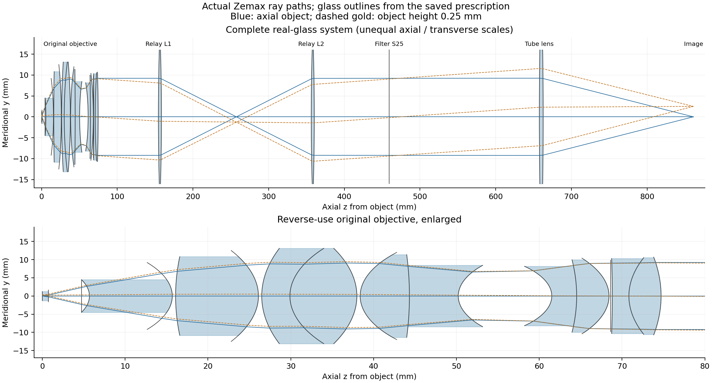

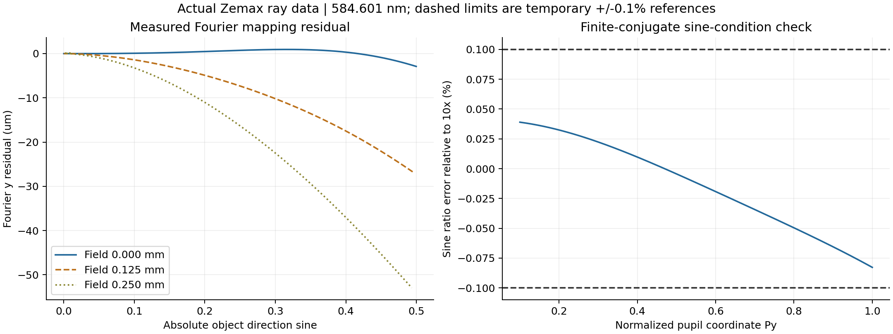

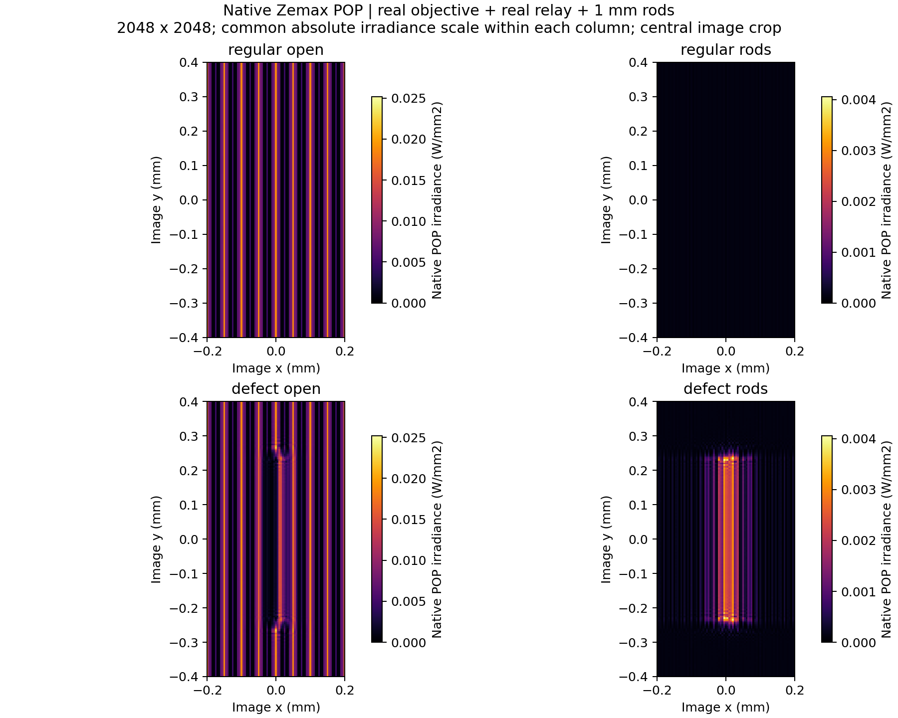

原生POP绝对通量仍有约10%的采样变化，因此约17.36 dB只作为临时光学验证值，不作为最终355 nm系统加工验收值。355 nm目标系统需要使用紫外材料重新优化并按本节约束验收。

## 9. 最终工程接口与验收

### 9.1 机械和光学接口

| 接口 | 最终要求 |
|---|---:|
| 每通道安装档杆 | 9根 |
| 默认启用 | 7根 |
| A/B层 | 5/4根，层间4 mm |
| 滤杆面净开口 | ≥110 mm × 40 mm（X×Y） |
| 档杆Y向有效长度 | ≥40 mm |
| 档杆X向定位行程 | ≥±45 mm |
| 档杆退出 | 沿Y完全退出光瞳 |
| 傅里叶面倍率 | $M_{FX}=2.8169$，$M_{FY}=1$ |
| TDI | 25级、5 µm行距 |

### 9.2 验收项目

1. 物镜真实光学瞳为36 mm，NA=0.6，无非预期渐晕；
2. X向展开瞳101.4 mm、Y向36 mm均不被截断；
3. 各通道频谱峰按实测位置逐杆对准，并满足对准不等式；
4. 25级TDI满足锯齿±1级排除条件，256级不得沿用该结论；
5. 滤波前后使用同一原始强度标尺，不作背景相减；
6. 2–5 µm周期背景抑制不低于15 dB；
7. 不规则高亮particle峰值保留率不低于60%；
8. X向最强档杆副峰按−19 dB量级检查，并评价相邻缺陷串扰；
9. Zemax正弦映射、波前、级次位置和POP结果分别保存，不能用理想FFT替代真实处方验收。

## 10. 最终交付文件

- 理论和三通道波矢：[三通道傅里叶滤波_原理思路.md](三通道傅里叶滤波_原理思路.md)
- TDI严格判据：[TDI与面阵_挡杆衍射级次选择.md](TDI与面阵_挡杆衍射级次选择.md)
- 当前坐标下的仿真：[更新相机坐标_Ch3倾斜照明仿真.md](更新相机坐标_Ch3倾斜照明仿真.md)
- 真实物镜Zemax验证：[真实物镜傅里叶滤波_建模与验证.md](真实物镜傅里叶滤波_建模与验证.md)
- 当前目标参数理想Zemax POP：[Zemax_理想透镜_2um周期particle原生POP.md](Zemax_理想透镜_2um周期particle原生POP.md)
- 当前理想Zemax运行脚本：[zemax/run_current_ideal_particle_pop.py](zemax/run_current_ideal_particle_pop.py)
- 355 nm Corning 7980真实物镜：[Zemax_355nm_Corning7980真实物镜_阿贝验证.md](Zemax_355nm_Corning7980真实物镜_阿贝验证.md)
- 最终六片真实物镜模型：[results/uv_real_objective/models/uv355_corning7980_6element_ideal_tube.zos](results/uv_real_objective/models/uv355_corning7980_6element_ideal_tube.zos)
- Python主程序：[src/ch3_confirmed_geometry_rod_tradeoff.py](src/ch3_confirmed_geometry_rod_tradeoff.py)
- A/B齿深联合优化：[src/ab_depth_optimization.py](src/ab_depth_optimization.py)
