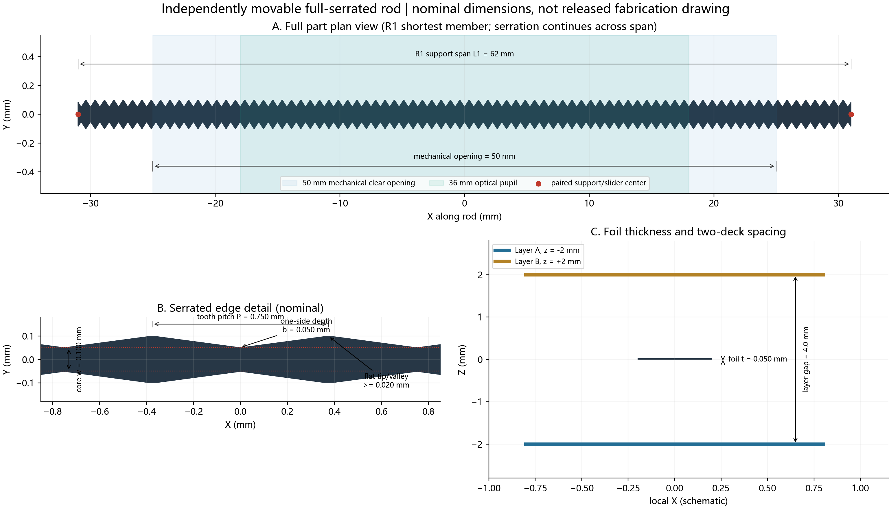
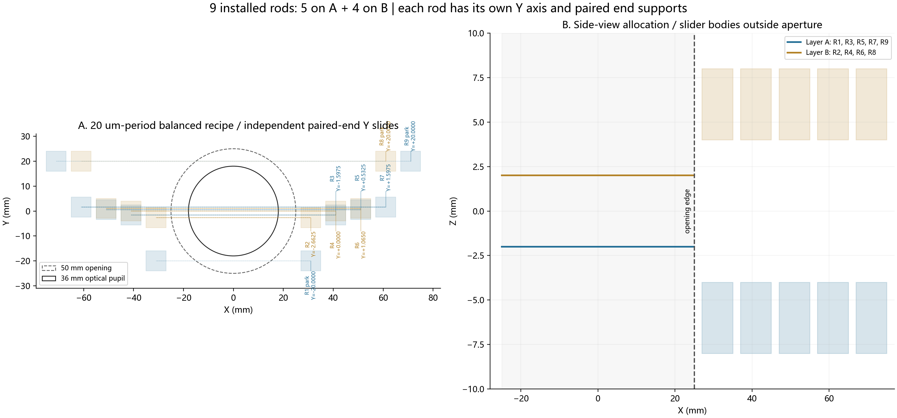

# 独立可调锯齿挡杆二维结构图

本图对应联合优化报告的推荐硬件：9根装机、A/B双层5+4，每根挡杆独立Y向移动且两端同步支承。零件名义截面为核心全宽0.100 mm、单侧齿深0.050 mm、理论最大包络0.200 mm、三角齿周期0.750 mm、平顶/谷不小于0.020 mm、薄片厚度0.050 mm。

## 输出文件

- [零件尺寸矢量图](results/joint_adjustable/rod_2d/serrated_rod_dimensioned.svg)；[PDF](results/joint_adjustable/rod_2d/serrated_rod_dimensioned.pdf)
- [九杆机构矢量图](results/joint_adjustable/rod_2d/nine_rod_adjustable_assembly.svg)；[PDF](results/joint_adjustable/rod_2d/nine_rod_adjustable_assembly.pdf)
- [5种长度挡杆DXF](results/joint_adjustable/rod_2d/serrated_rod_length_variants.dxf)：支承跨距62、82、102、122、142 mm，对应数量2、2、2、2、1。
- [20 µm折中配方九杆DXF](results/joint_adjustable/rod_2d/nine_rod_20um_balanced_layout.dxf)
- [挡杆尺寸和数量CSV](results/joint_adjustable/rod_2d/serrated_rod_dimensions.csv)

## 使用边界

DXF单位为mm。圆形光瞳和机械开口图层只是辅助线，不是加工轮廓。当前图是与光学、制造和机械包络模型一致的二维概念图，不是放行图；夹持孔、张紧端、实际电机/导轨、圆角补偿、公差基准、材料牌号及表面处理仍需完成DFM与正式机械设计。不同周期只改变每根杆的Y坐标，不改变上述齿形尺寸。
