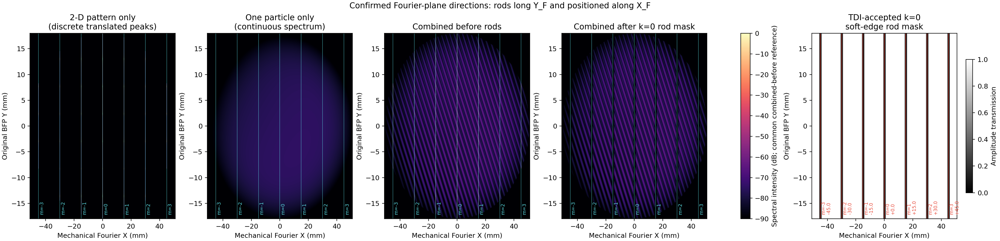
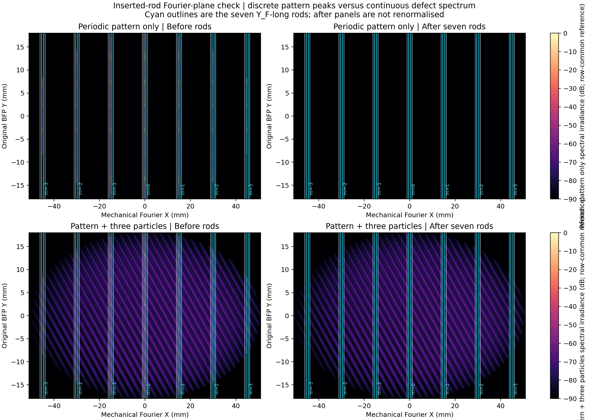
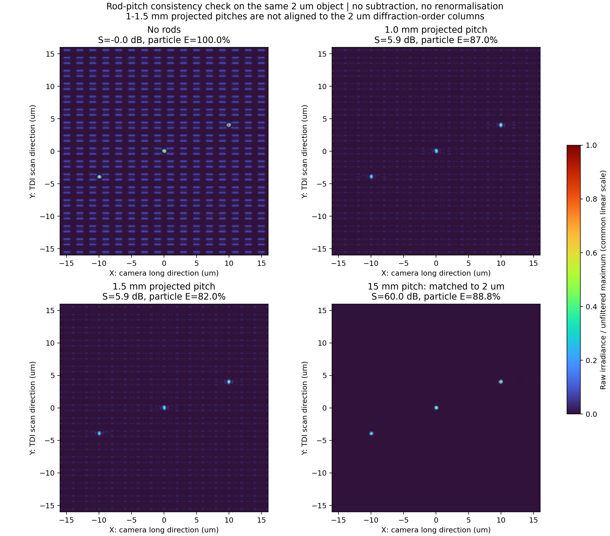
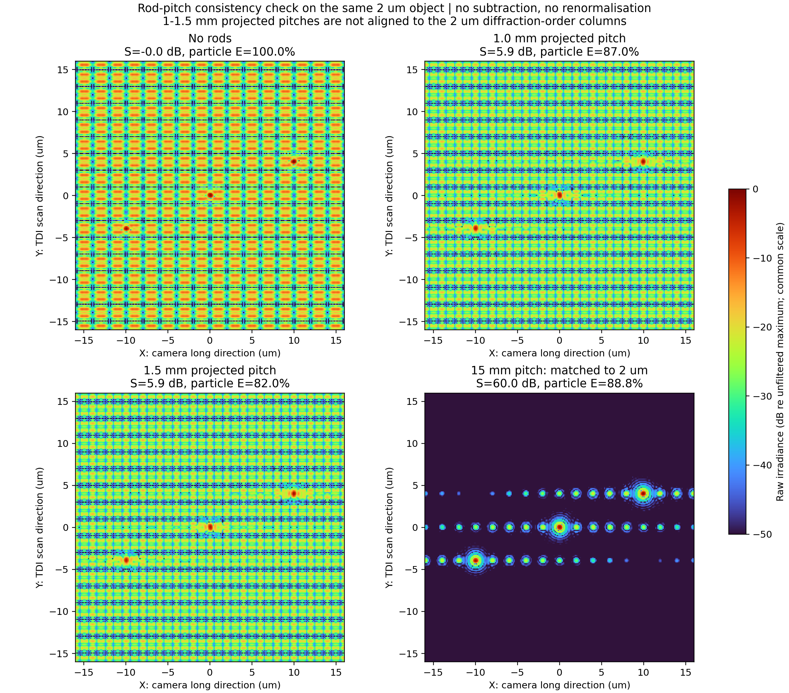
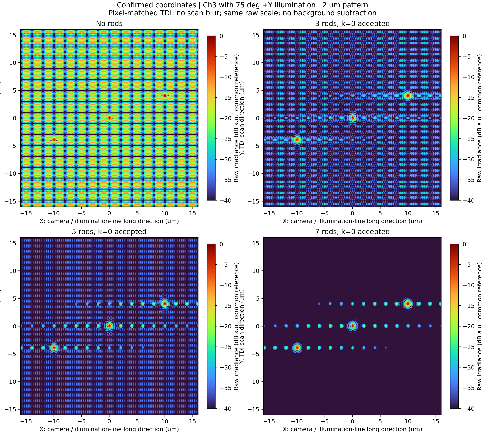
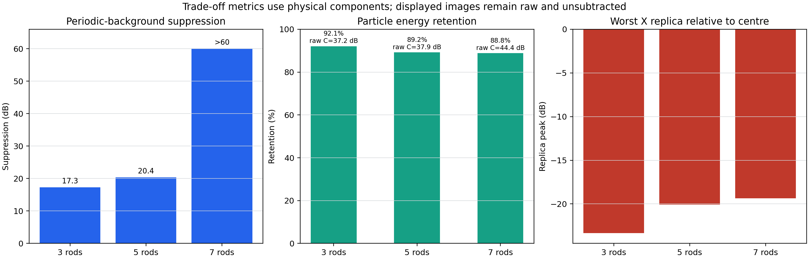
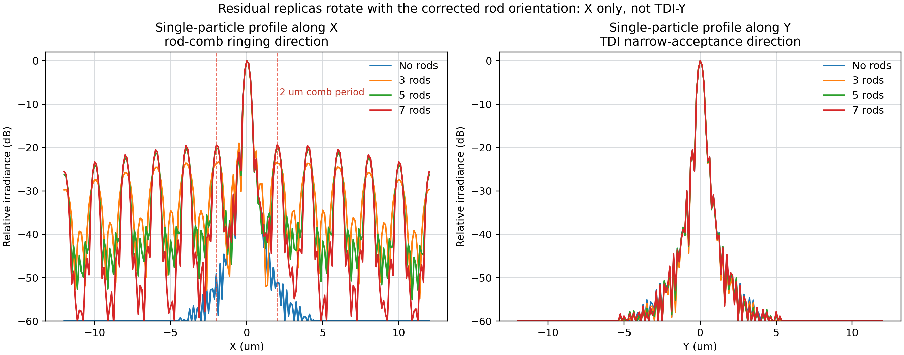

# 更新相机坐标后的 Ch3 倾斜照明傅里叶滤波仿真

> 本文件是 2026-09-02 的坐标修订结果。凡旧报告中出现“相机长边为 Y、TDI 扫描为 X、档杆长轴为 X”的描述，均由本文件的坐标定义取代。

## 1. 最终采用的坐标关系

| 项目 | 方向 |
|---|---|
| 相机长边 | X |
| 线照明光斑长轴 | X |
| TDI 扫描与电荷转移 | Y |
| 25 级 TDI 的有效窄接收方向 | Y |
| 傅里叶档杆长轴 | $Y_F$ |
| 三角锯齿重复方向 | $Y_F$ |
| 各档杆的独立定位方向 | $X_F$ |
| 75°照明在样品面的投影 | $+Y$，光源位于 $-Y$ 侧 |

这组方向的直接后果是：锯齿自身的非零级沿像面 Y 分开，可由窄 Y 的 TDI 接收窗口排除；多根档杆沿傅里叶 X 排列所造成的滤波器振铃则沿像面 X 展开，TDI 不能自动排除。

## 2. 倾斜照明下的频谱位置

采用 355 nm、焦距 30 mm、NA=0.6、Ch3 沿样品法线收集。光源从 $-Y$ 侧以相对法线 75°入射，入射波在样品面的方向余弦为

$$
\boldsymbol{s}_i=(0,\sin75^\circ).
$$

二维周期为 $p=2\ \mu\mathrm{m}$ 时，样品的 $(m,n)$ 级出射方向余弦为

$$
s_{o,x}=m\frac{\lambda}{p},
\qquad
s_{o,y}=\sin75^\circ+n\frac{\lambda}{p}.
$$

只有满足

$$
s_{o,x}^2+s_{o,y}^2\le \mathrm{NA}^2
$$

的级次进入 Ch3。75°入射首先沿 Y 平移整个频谱；物体的 X 周期仍使不同 $m$ 级沿傅里叶 X 分列。因此本模型将档杆做成长轴沿 $Y_F$ 的竖直结构，并把档杆分别放到各个 $m$ 列的 $X_F$ 坐标上。

采用 2.8169 倍的 X 向傅里叶面中继后，相邻 $m$ 列的机械间距为

$$
\Delta X_F
=M_{FX}\frac{f\lambda}{p}
=2.8169\times\frac{30\times0.000355}{0.002}
=15.0\ \mathrm{mm}.
$$

7 根档杆对应 $m=-3,-2,-1,0,1,2,3$，机械中心坐标为

$$
X_F=(-45,-30,-15,0,15,30,45)\ \mathrm{mm}.
$$

档杆不能只按理论中心放置，还必须覆盖有限视野造成的峰宽。若物方X向有效视野为 $W_x$，谱峰第一零点宽度量级为

$$
W_{\mathrm{peak},F}\approx M_{FX}\frac{f\lambda}{W_x}.
$$

逐杆对准的验收条件为

$$
\boxed{
|X_{F,\mathrm{rod},m}-X_{F,m}|
+\frac{W_{\mathrm{peak},F}}{2}
+\varepsilon_{\mathrm{pos}}
<\frac{w_{\mathrm{core}}}{2}
}.
$$

其中 $\varepsilon_{\mathrm{pos}}$ 包含物镜正弦映射残差、档杆定位误差和样品周期漂移。对 $W_x=0.5$ mm、$w_{\mathrm{core}}=1.0$ mm，$W_{\mathrm{peak},F}\approx0.060$ mm，因此允许的中心误差为 $0.470\ \mathrm{mm}-\varepsilon_{\mathrm{pos}}$。实际调节应以傅里叶面实测峰中心闭环对准，而不是只依赖名义周期。

2 µm 周期时 2.0 mm 的档杆最大包络远小于 15 mm 中心距，不存在档杆之间无法分开的机械问题。双层交错机构可以继续保留，但本周期下不是为了避免相邻杆碰撞。

## 3. 25 级 TDI 为什么只接收锯齿零级

档杆核心宽度 1.0 mm，单侧锯齿深度 0.5 mm，最大包络 2.0 mm，锯齿周期 0.75 mm。锯齿沿傅里叶 Y 重复，所以其像面相邻级次沿 Y 的物方间距为

$$
\Delta y_{\mathrm{serr,obj}}
=\frac{\lambda f}{p_s}
=\frac{0.000355\times30}{0.75}
=14.2\ \mu\mathrm{m}.
$$

20×像方对应

$$
\Delta y_{\mathrm{serr,img}}=20\times14.2=284\ \mu\mathrm{m}.
$$

25 级、5 µm 行距的 TDI 像方积分宽度为125 µm，对应物方6.25 µm。仅比较中心距 $125<284\ \mu\mathrm m$ 还不够；还必须计入照明线/单级像的有限宽度。设 $H_Y=Np_Y$ 为TDI像方有效全宽，$W_{P,Y}$ 为单个级次按中央能量比例 $P$ 定义的像方有效全宽，$\varepsilon_Y$ 为单侧余量，则只接收锯齿 $k=0$ 的条件是

$$
\boxed{
\Delta y_{\mathrm{serr,img}}
>\frac{H_Y+W_{P,Y}}{2}+\varepsilon_Y
}.
$$

若125 µm是像方高斯照明的强度FWHM，取99.99%中央能量，则 $W_{P,Y}=413.05\ \mu\mathrm m$。再取10 µm单侧余量，允许的最大TDI积分全宽为

$$
H_{Y,\max}=2(284-10)-413.05=134.95\ \mu\mathrm m.
$$

因此25级的125 µm通过，5 µm行距下最多允许26级；256级的1280 µm明显不通过。高斯和Airy尾部没有严格有限支持，所以“只有0级进入”在工程上必须同时给出能量泄漏阈值。

速度完全匹配时，TDI 对相邻物方像素逐像素同步积分，不再把 6.25 µm 照明宽度作为卷积核。因此本仿真没有扫描拖尾，也没有通过重叠条带进行加权拼接。

上述Y向判据只负责拒绝锯齿 $k\ne0$。多根档杆沿 $X_F$ 对准频谱峰后形成的X向阵列因子与TDI窄宽方向正交，25级或更窄的Y窗口都不能把这部分X向副峰滤掉。

## 4. 仿真链路

计算严格按复振幅傅里叶光学完成：

$$
U_F(f_x,f_y)=\mathcal F\{U_o(x,y)\}\,P(f_x,f_y),
$$

$$
U_i(x,y)=\mathcal F^{-1}\{U_F(f_x,f_y)T(f_x,f_y)\},
\qquad
I_i(x,y)=|U_i(x,y)|^2.
$$

其中 $P$ 是 NA=0.6 的圆瞳，$T$ 是档杆的复振幅透过率。75°入射通过物面相位载频加入；particle 使用连续宽带散射频谱；周期 pattern 使用离散二维频谱。所有像面图均显示原始强度，滤波前后使用同一个未滤波峰值和同一个色标，不减周期参考图。

下面把插杆前、档杆透过率和插杆后的频谱单独展开。青色轮廓为 7 根沿 $Y_F$ 延伸的档杆；插杆后频谱未重新归一化。

为区分离散周期峰与连续缺陷频谱，下一张图上行只含周期 pattern，下行包含 pattern 和三个 particle。右列均为插入档杆后的实际频谱；每一行的前后图共用同一参考。

## 5. 3、5、7 根档杆的原始图比较

### 5.1 同一亮度尺度下的完整滤波效果

下图上排采用共同的线性强度范围 $0\ldots I_{\mathrm{open,max}}$，下排采用共同的 $-50\ldots0$ dB范围。滤波后没有单独归一化，没有背景相减，也没有改变色标。线性图说明档杆后的X向副峰只是未滤波主峰的约1%量级；对数图用于观察这些弱残余。

这张2 µm匹配演示要求7根档杆的中心间距为15 mm。若实际投影间距只有1.0或1.5 mm，它们不会落在2 µm周期的相邻频谱列上。下图对同一个物体、同一个未滤波参考进行了直接比较。

| 投影档杆间距 | 2 µm pattern背景抑制 | particle能量保留 | 说明 |
|---:|---:|---:|---|
| 1.0 mm | 5.89 dB | 86.97% | 未对准2 µm相邻级次 |
| 1.5 mm | 5.89 dB | 82.00% | 未对准2 µm相邻级次 |
| 15 mm | 理想模型中大于60 dB | 88.85% | 与2 µm相邻级次匹配 |

1.0/1.5 mm结果是两层结构在同一傅里叶面的 $k=0$ 投影近似，用于检查位置尺度，不代替4 mm层间距的完整Fresnel双层传播；但“它们没有对准2 µm级次”的结论不受该近似影响。

| 配置 | 周期背景抑制 | particle 能量保留 | 原始图局部粒子对比度 | 最强 X 副峰/主峰 | 核外振铃能量 |
|---|---:|---:|---:|---:|---:|
| 无档杆 | 0 dB | 100.0% | 23.18 dB | -40.31 dB | 1.21% |
| 3 根，$m=-1\ldots1$ | 17.30 dB | 92.09% | 37.24 dB | -23.36 dB | 6.99% |
| 5 根，$m=-2\ldots2$ | 20.38 dB | 89.18% | 37.92 dB | -20.08 dB | 9.11% |
| 7 根，$m=-3\ldots3$ | 理想规则网格下残余低于 -60 dB | 88.85% | 44.41 dB | -19.36 dB | 9.35% |

7 根配置的周期峰在当前完全理想、整周期采样模型中被全部精确遮挡，直接能量比落到浮点数值零附近。它只能写成“理想模型中抑制大于 60 dB”，不能把 300 dB 当作实物预测。实际有限视场、周期误差、照明非均匀、档杆定位误差和像差都会把抑制度降到有限值。

## 6. 图中 X 向多余点列的来源

结论：点列是档杆组造成的滤波器副峰，但不是锯齿非零级漏入 TDI。

仅考虑锯齿 $k=0$ 后，7 根档杆在傅里叶 X 上形成等间距陷波。用一维示意写成

$$
T(f_x)=1-\sum_{m=-3}^{3}A(f_x-f_m),
\qquad
f_m=\frac{m}{p}.
$$

其像面脉冲响应为

$$
h(x)=\delta(x)-a(x)\sum_{m=-3}^{3}
\exp\left(i2\pi\frac{m}{p}x\right),
$$

其中 $a(x)=\mathcal F^{-1}\{A(f_x)\}$ 是单根档杆产生的连续 sinc 型尾迹。有限指数和是 Dirichlet 核：

$$
\sum_{m=-3}^{3}\exp\left(i2\pi\frac{m}{p}x\right)
=\frac{\sin(7\pi x/p)}{\sin(\pi x/p)}.
$$

它在 $x=lp$ 处相干增强，所以 $p=2\ \mu\mathrm{m}$ 时会出现 2 µm 间隔的 X 向副峰。

受控仿真只放一个 particle，不放周期 pattern，并且传递函数中完全不存在锯齿 $k\ne0$：无杆时没有点列；单杆只有连续 X 向尾迹；7 根等间距杆才形成 2 µm 点列。这直接证明了来源。

因此：

- TDI 已正确排除了沿 Y 分开的锯齿 $k\ne0$；
- 当前剩余点列沿 X，与更新后的相机长边一致；
- 它是多档杆共同改变系统 PSF 的结果，不能作为新的真实缺陷计数；
- 如果两个真实 particle 的 X 间距接近 2 µm，副峰会发生串扰，必须纳入检测阈值评价。

## 7. 当前推荐

### 7.1 三角锯齿已经减轻振铃，但不能消除多杆梳状副峰

当前仿真并不是直边档杆。锯齿的 $k\ne0$ 被 TDI 排除后，保留的 $k=0$ 等效透过率为：中央 1.0 mm 完全不透明，两侧各 0.5 mm 从不透明线性过渡到全透。相对于相同 2.0 mm 最大包络的直边档杆，线性过渡把硬边的幅度 $1/x$ 型远场衰减改善为更快的软边衰减。

直接对比结果为：

| 七杆边缘 | particle能量保留 | 最强2–10 µm X副峰 | 核外振铃能量 |
|---|---:|---:|---:|
| 2.0 mm直边全遮挡 | 85.94% | -16.11 dB | 13.76% |
| 1.0 mm核心＋两侧0.5 mm锯齿零级 | 88.85% | -19.36 dB | 9.35% |

因此锯齿把最强副峰降低约 3.25 dB，并把核外振铃能量由 13.76% 降到 9.35%，同时提高约 2.91 个百分点的particle能量保留。1.0 mm直边杆虽然副峰为 -21.62 dB，但它的总遮挡包络只有1.0 mm，不能作为同包络结构的公平对照。

锯齿没有消除2 µm点列，是因为点列峰恰好位于多杆Dirichlet核的相干增强位置。锯齿负责降低外层包络 $a(x)$，而等间距中心位置仍决定增强位置 $x=lp$。因此当前看到的 -19.36 dB 点列已经是加入锯齿零级软边后的残余，不是程序漏掉了锯齿。

- 若首要目标是完全压住理想 2 µm 周期峰，且粒子较稀疏，采用 7 根模式。它保留约 88.85% 粒子能量，但最强 X 副峰约为主峰的 -19.36 dB。
- 若首要目标是降低相邻小缺陷串扰，采用 3 根模式。它把最强副峰降到 -23.36 dB，同时保留约 92.09% 粒子能量，但周期背景抑制只有 17.30 dB。
- 5 根模式是中间配置，保留它主要用于实际周期误差和噪声下的实验调节。
- 可移动档杆应支持 3/5/7 根模式切换。不能依靠 TDI 去消除 X 向档杆梳状副峰；若 -19 dB 仍不可接受，需要改变滤波器幅度加权或相干照明条件，而不是继续增加等间距档杆。

## 8. 文件

- 主仿真：`src/ch3_oblique75_confirmed_geometry.py`
- 档杆数量与来源核查：`src/ch3_confirmed_geometry_rod_tradeoff.py`
- 数值表：`results/ch3_confirmed_geometry_rod_tradeoff/rod_count_tradeoff_metrics.csv`
- 参数摘要：`results/ch3_confirmed_geometry_rod_tradeoff/rod_count_tradeoff_summary.json`
