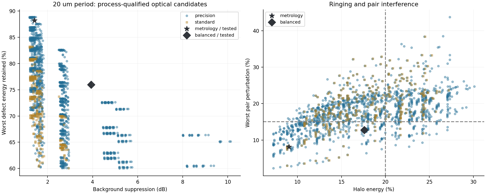
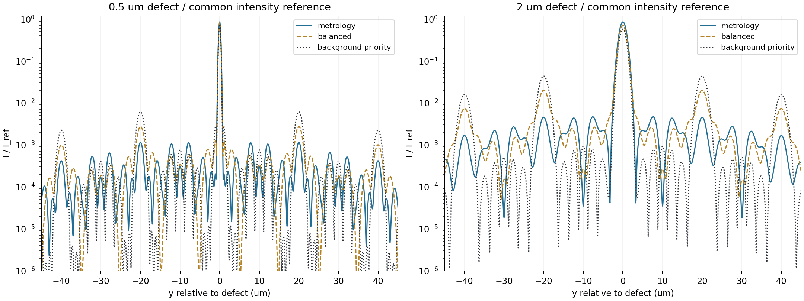
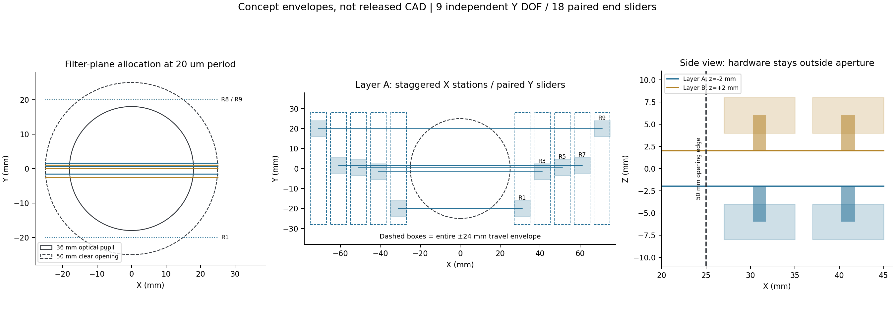

# 独立可调全锯齿滤杆：光学、加工、机械三维联合方案

## 技术结论：推荐一种硬件、两种经误差抽查的工作配方

**推荐的硬件路线是：9根同规格薄片锯齿杆、双层布置、每根独立Y向移动、两端联动导向和张紧，宽滑台在50 mm通光孔外沿X错位排列。** 同一套硬件固定使用0.100 mm名义核心全宽、0.050 mm单侧齿深、0.200 mm名义全包络、0.750 mm齿周期、0.050 mm薄片厚度；两层位于傅里叶面±2 mm。不是上一版B层0.0375 mm齿深，也不是固定梳形片。

但**不存在本轮已证实的“高背景抑制、低振铃、不损失小缺陷、容易加工、机械动态零串扰”同时最优点**。推荐的是有条件的工程折中路线，不是加工放行或全局最优证明。尤其不能用主峰FWHM不变来代替缺陷尺寸保真；本轮把EE90能量宽度单列，并对计量配方要求不超过无滤波的2倍。

以20 µm物体周期为例，保守折中配方在35组指定误差/偏场检查中最差抑制3.931 dB，即背景积分能量减少59.5%；目标最差积分保留76.0%，晕圈17.6%，双缺陷扰动上界12.7%。这个配方适合折中检出，**不保证尺寸计量**。

若首要任务是防止缺陷能量轮廓变大，应切换同硬件的低振铃配方：20 µm条件下最差背景抑制仅1.422 dB，但最差能量保留88.2%，EE90最大1.50倍。不能同时把强抑制配方约10 dB的效果算到这个低振铃配方上。

## 1. 三个维度如何进入决策

| 维度 | 评价量 | 本轮决策方式 |
|---|---|---|
| 光学 | 背景积分抑制S、最小缺陷积分保留R、保护区外能量H、双缺陷最坏相位扰动C、FWHM及EE90 | 保留原始指标；设置公开阈值与误差裕量，再比较背景收益，不只最大化目标亮度 |
| 可加工性 | 薄片厚度、误差后最窄核心、齿深/轮廓误差比、尖谷平台、圆角及材料强度 | 不满足规则先淘汰；同硬件所有杆相同截面，换周期不换杆宽/齿深 |
| 机械 | 杆与连接指净空、滑台全行程包络、瞳外停放、切换路径、张紧挠度 | 几何及行程作硬约束；力学仅为明确假设下的初估，动态实测单列为未完成 |

本轮真实计算17,923组对称候选，加1,280组允许非对称/偶数活动杆的补充候选。两个候选族有重复，**不能相加声称是去重后的总数**。30组初选经过4 mm实体层距传播及每组35个误差状态复核；保守配方又单独复核。新增计算均为Python，不冒充新Zemax结果。

图中圆点/方点分别表示高精度与标准工艺档；叠加的实心标记为经过误差检查的最终配方。图说明可行候选之间存在明显取舍，不是一个指标领先就代表三维都最优。



## 2. 固定光学系统与评价基准

355 nm、NA=0.6、f=30 mm、20×、Ch3中路法向照明及收集；**实际光学瞳36 mm，机械通光孔50 mm**，没有引入瞳放大。主线扫照明强度FWHM为物方1 µm，像元/有效线高物方0.25 µm。孔径有限，即使无像差也仍有衍射。

$$
\alpha=\lambda f=0.01065\ \mathrm{mm}^2,\qquad
Y_n=\frac{\lambda f}{p_{\rm object}}n.
$$

用户尚未给出最终周期上下限，暂验证10、15、20、30、40 µm。各周期用两种条宽占空比0.35和0.245取较差背景；20 µm时就是原来的7/4.9 µm条宽。缺陷是0.5、0.75、1、1.5、2、3 µm高斯强度FWHM，R取6种尺寸的最小积分比；这不是只挑0.5 µm小点，也不是峰值保留率。不同占空比、反射率或真实周期范围需要重新算配方。

$$
S=-10\log_{10}(E_{B,\rm filtered}/E_{B,0}),\qquad
\eta_{\rm suppression}=1-10^{-S/10}.
$$

H统计半径max(0.75 µm,1.5倍缺陷尺寸)外的能量；C在正负1～25 µm、0.05 µm间距上取0.5 µm双缺陷的最坏相位扰动上界。EE90是以原目标位置为中心、包含90%目标能量的全宽。所有轮廓图共用I/I_ref，其中I_ref=0.985745190802，不逐图或逐缺陷归一化，不能直接解释成W/mm²或DN。

双层复场传播保留−k、+k重新回到总零级的通道，不把两层各自零级简单相乘。初筛8192点、复核16384点、窗口1.024 mm；复核至±24层间谐波。沿杆方向假定只接收主线扫总零级；有限TDI接收仍见第8节限制。

## 3. 同一硬件的三种光学取舍，不能混用成绩

下面“最差”指本次指定的35个状态中取最坏，不是所有可能误差的数学证明：名义状态、8个共同核心/齿尖/位置误差角点、2个±0.20 mm偏场状态、24个逐杆独立随机误差状态（种子355）。制造误差为边缘±10 µm、位置总预算每杆±25 µm；形状误差保持核心边和齿尖边各自受限。

| 20 µm周期配方 | 抑制dB：名义→抽查最差 | 最差背景抑制率 | 最差目标保留R | 最大晕圈H | 最大串扰C | 最大EE90倍率 |
|---|---:|---:|---:|---:|---:|---:|
| 低振铃/计量 | 1.445 → 1.422 | 27.9% | 88.2% | 9.0% | 8.1% | 1.50× |
| 保守折中 | 4.016 → 3.931 | 59.5% | 76.0% | 17.6% | 12.7% | 21.67× |
| 强背景抑制对照 | 10.467 → 9.925 | 89.8% | 65.2% | 28.0% | 20.1% | 39.50× |

低振铃档使用H≤10%、C≤10%、R≥60%、EE90≤2倍；折中档使用H≤20%、C≤15%、R≥60%，没有EE90硬上限；强抑制档只是对照。上述数值是本轮公开的工程评价假设，不是用户已经确认的验收规格。最终配方先保留名义裕量，再通过35状态检查；**失败的原初选没有被写成合格结果**。

例如对称初选的“背景优先”方案名义约10.467 dB，误差后H可到28.0%、C约20.1%；名义“折中”方案误差后H约22.2%，也不能按20%门槛放行。补查非对称布置后，才得到本表的保守折中配方。对于计量，连H/C通过也不够，还要看EE90。

图中统一强度画出0.5和2 µm目标的外围能量。强背景抑制的副像更明显；这些是滤波器光学响应，不是TDI电荷转移把原像拉长。



## 4. 工艺：50 µm张紧薄片，比直接照搬毫米级杆更匹配本系统

| 项目 | 推荐条件 | 说明 |
|---|---:|---|
| 名义核心全宽 / 单侧齿深 / 全包络 | 0.100 / 0.050 / 0.200 mm | 所有杆同规格，避免更换周期时偷偷改尺寸 |
| 薄片厚度 / 三角齿周期 | 0.050 / 0.750 mm | 齿周期满足≥0.5 mm；厚度不是核心宽度 |
| 轮廓误差目标 | ±0.010 mm | 必须由加工供应商对这张图确认，非已取得承诺 |
| 误差后最窄核心 | 0.080 mm | 与制造允许的最小连筋50 µm比较 |
| 单侧齿深 / 单边误差 | 5 | 本项目要求至少4；上一版37.5 µm齿深在本档下低于这个裕量 |
| 尖谷平台 / 圆角评估半径 | 0.020 / 0.050 mm | 浅角度三角齿可放入圆角；圆角不能凭“齿深小于半径”判失败 |
| 工作张应力 / 材料证明应力条件 | 100 / ≥300 MPa | 指误差后最窄核心；必须取得具体材料及热处理状态数据 |

公开工艺能力不能互相混用：[Precision Micro](https://www.precisionmicro.com/chemical-etching/technical-guidelines/)给出的薄片标准公差档约±25 µm；[micrometal](https://www.micrometal.de/en/service-portfolio/our-technologies/)公开了更细的薄片特征和约±7 µm级最低公差指导值。由此本轮设置“±10 µm高精度”与“±25 µm标准”两档；这只是建模依据，不是询价、交期或质量保证。

若只能保证±25 µm，按同一4倍齿深裕量，齿深至少0.10 mm、平台至少0.05 mm，不能继续拿±10 µm硬件的光学成绩作为预期。标准工艺档的跨周期折中硬件在20 µm条件下名义抑制仅2.552 dB。PPT毫米级外包络还会进一步损失缺陷频谱，原尺寸对照已在[上一轮报告](全锯齿双层傅里叶滤波_优化结果.md)保留。

## 5. 机械：每杆独立移动，但不能任意穿过邻杆

采用9个独立Y自由度、18个两端滑台。每根两端Y位置同步，其中一端允许X向弹性张紧；不采用长细杆单端悬臂。A层5根、B层4根，层距4 mm。未使用的杆停在Y≈±20/±21 mm，仍计入装机9根。

### 5.1 宽滑台在光瞳外错位，不挤在频谱峰间距上

暂分配每层5个X工位：±31、±41、±51、±61、±71 mm。每工位滑台X宽8 mm、相邻节距10 mm；宽滑台退到滤杆层外侧，窄连接指宽Y=0.25 mm到达滤杆面。最大跨距142 mm，建议预留机构概念包络约156×76×20 mm，不含线缆和未选定电机端部。

**这里的8 mm是允许的滑台/导向包络，不是已找到的商用电机型号尺寸。** 实际电机、螺钉和线缆加入后必须重跑碰撞检查。如果把8 mm宽滑台直接装在约1 mm杆间距的同一个X位置上，会干涉；只画细杆并不能证明机构成立。

图左包含工作杆和瞳外停放杆；中图展示A层两端滑台的整个移动包络；右图显示两层及支承在通光孔外的Z向退让。图是可检查的概念包络，不是正式装配CAD。



### 5.2 已检查的几何净空

| 检查对象 | 本轮结果 | 覆盖范围 |
|---|---:|---|
| 最终配方之间的连续切换路径 | 45条 | 每条101点，并用中心距凸组合给出解析下界 |
| 路径最小同层杆/连接指净空 | 0.4100 mm | 已计每杆±25 µm位置及轮廓误差包络，要求≥0.10 mm |
| 滑台全行程包络 | 18个，153对 | Y全行程±24 mm |
| 滑台包络碰撞数 / 最小分离量 | 0 / 1.800 mm | 所定义包围盒含0.10 mm安装误差，不含未建模零件 |
| 滑台对50 mm开口最小净空 | 1.900 mm | 不仅避开36 mm光学瞳，也避开50 mm开口 |
| 两层滤杆轴向净空预算 | 3.730 mm | 4 mm层距减板厚、轴向误差和挠曲预算 |

同层杆号始终保持Y顺序，位置切换采用共同进度s：

$$
Y_i(s)=(1-s)Y_i^{(A)}+sY_i^{(B)},\quad 0\le s\le1.
$$

相邻中心距同样是端点距离的凸组合，因此两个端点均满足净空时，全程不小于较小端点净空。**这不保证任意异步单杆动作安全**：单杆调节必须实时检查左右邻杆；配方切换要联动规划，不能让一根杆穿越同层另一根。

### 5.3 动态串扰不是0，张紧方案还需实测

锯齿增加质量，必须用平均宽度与最窄核心之比修正张紧弦估计：

$$
\beta=\frac{w+b}{w-2\epsilon_{\rm edge}}=1.875,\quad
\delta_{\max}=\frac{\rho\beta aL^2}{8\sigma},\quad
f_1=\frac1{2L}\sqrt{\frac{\sigma}{\rho\beta}}.
$$

暂取ρ=8000 kg/m³、工作应力100 MPa、最长L=142 mm。每杆预张力约0.400 N；最长杆2g等效静载挠度约7.42 µm，张紧弦最低频率约287 Hz。10g估计挠度再乘5，**不能满足10 µm预算**。这些不是共振附近的动态上界，必须核实滤杆实际振动输入和支承模态。

两端Y位置差若控制在4 µm内，按最短62 mm跨距，18 mm瞳边缘的偏航误差约1.16 µm。共架反力若按1 N、允许邻杆移动2 µm估算，所需交叉方向等效刚度至少500 N/mm；目前尚未完成FEA或实测确认。一端张紧弹簧还需验证热漂移和行程。因此结论是**几何包络无干涉已检查；机械动态零串扰未证明**。

## 6. 20 µm保守折中配方：逐根位置

| 杆号 | 层 | z mm | Y mm | 状态 | 两端支承X mm |
|---|---|---:|---:|---|---:|
| R1 | A | -2.0 | -20.0000 | 瞳外停放 | ±31 |
| R2 | B | +2.0 | -2.6625 | 工作 | ±31 |
| R3 | A | -2.0 | -1.5975 | 工作 | ±41 |
| R4 | B | +2.0 | +0.0000 | 工作 | ±41 |
| R5 | A | -2.0 | +0.5325 | 工作 | ±51 |
| R6 | B | +2.0 | +1.0650 | 工作 | ±51 |
| R7 | A | -2.0 | +1.5975 | 工作 | ±61 |
| R8 | B | +2.0 | +20.0000 | 瞳外停放 | ±61 |
| R9 | A | -2.0 | +20.0000 | 瞳外停放 | ±71 |

该配方可使用非对称/偶数活动杆，但物理总数始终9。停放杆在瞳外，不等于从机械系统移除了。

## 7. 同一硬件适配不同周期的结果

下表全部为35状态抽查最差；只改变位置，不改变硬件截面。计量配方对EE90有2倍限制，折中配方没有，因此两者用途不同。所有最终入选配方均通过各自声明的抽查门槛，但这不是连续全参数误差保证。

| 周期µm | 用途 | 工作/装机杆数 | 工作衍射级次 | 抑制dB | R | H | C | EE90倍率 |
|---:|---|---|---|---:|---:|---:|---:|---:|
| 10 | 计量 | 4/9 | -2, 0, 2, 5 | 2.556 | 88.8% | 8.4% | 8.5% | 1.38× |
| 10 | 折中 | 5/9 | -2, -1, 0, 1, 2 | 8.197 | 82.5% | 14.1% | 12.1% | 12.67× |
| 15 | 计量 | 4/9 | -3, 0, 2, 3 | 2.158 | 87.5% | 9.7% | 8.9% | 1.88× |
| 15 | 折中 | 5/9 | -3, -1, 0, 1, 3 | 5.041 | 76.1% | 18.8% | 11.4% | 14.75× |
| 20 | 计量 | 4/9 | -5, 0, 3, 5 | 1.422 | 88.2% | 9.0% | 8.1% | 1.50× |
| 20 | 折中 | 6/9 | -5, -3, 0, 1, 2, 3 | 3.931 | 76.0% | 17.6% | 12.7% | 21.67× |
| 30 | 计量 | 3/9 | -6, 0, 6 | 1.327 | 88.8% | 8.4% | 7.1% | 1.38× |
| 30 | 折中 | 4/9 | -5, -2, -1, 0 | 3.429 | 72.1% | 19.0% | 9.1% | 16.91× |
| 40 | 计量 | 3/9 | -7, 0, 7 | 1.257 | 88.4% | 8.8% | 7.2% | 1.50× |
| 40 | 折中 | 3/9 | 0, 1, 3 | 2.698 | 72.8% | 18.6% | 7.4% | 11.65× |

完整可执行位置表见[全部配方CSV](results/joint_adjustable/all_position_recipes.csv)，包括每根停放杆的位置。周期增大时谱峰更密，同样杆宽占用的目标频谱比例变大，制造宽度和同层净空同时变得更紧；**可移动不等于任意周期下都能保持10 dB抑制**。

## 8. 结果边界与下一步

1. 本轮回答的是固定355 nm、36 mm瞳、≤10根、全锯齿、独立可调条件下的工程取舍。候选范围、光学门槛、10～40 µm验证范围和制造/载荷假设均公开；不能称为任意结构的全局最优。本轮固定装机9根、齿距0.75 mm、层距4 mm，并未穷举10根装机结构或连续齿距/层距；齿距与较大尺寸的前轮扫描结果另见上一轮报告。
2. 低振铃和强去背景存在固有取舍：挡掉周期频谱也会损失目标在相同频率的分量。20 µm的对称候选中，同时R≥60%、H/C≤10%、EE90≤2倍的最高预筛抑制约1.583 dB，远非10 dB；补查非对称后也没有得到同时满足强抑制与计量门槛的已验证解。
3. 0.75 mm齿距的一级像移为14.2 µm。256级TDI可能接收非零总级；本轮最终配方仍按主线扫条件优化，**没有把它宣称为256级TDI全级次最优**。TDI严格同步不拉长原像，接收光学副像是另一个问题。
4. 50 µm薄片的实际材料、边缘轮廓、355 nm吸收/温升、真实马达/导轨尺寸、位移反馈、FEA、机械耦合及实机模态都需要后续确认。没有这些，不能作机械零串扰或加工放行承诺。

建议先用本报告的同规格9杆独立可调路线制作**结构与工艺验证件**：先确认供应商能否保证±10 µm轮廓和≥300 MPa材料证明应力，再把实际滑台、电机与走线包络代入防撞模型。若任务确实以缺陷尺寸计量为优先，用低振铃配方；若背景残留仍不够低，不应直接切到10 dB配方并仍声称尺寸保真。

待确认问题：实际物体周期/线宽范围、可接受的R/H/C及EE90门槛、材料和加工供应商、允许的机构尺寸、滤杆实际振动/温升，以及最终25或256级TDI收集条件。

## 9. 文件、复现与验证

模型先行文档：[三维约束与模型](三维联合优化_约束与模型.md)。环境仍为本机Anaconda `E:\anconda\envs\fourier-filter\python.exe`。代码：[联合搜索](src/joint_adjustable.py)、[逐杆误差检查](src/joint_robustness.py)、[非对称和保守配方](src/joint_asymmetric.py)、[报告及机械包络检查](src/joint_report.py)。完整原始结果在`results/joint_adjustable`，失败的初选及标准工艺对照未删除。

```powershell
$py = 'E:\anconda\envs\fourier-filter\python.exe'
& $py src/joint_adjustable.py scan
& $py src/joint_adjustable.py qualify
& $py src/joint_adjustable.py refine
& $py src/joint_robustness.py
& $py src/joint_asymmetric.py
& $py src/joint_report.py
& $py -m pytest -q --junitxml=results/joint_adjustable/pytest.xml
& $py src/validate_joint_artifacts.py
```

验收记录见[数值与交付验证](results/joint_adjustable/artifact_validation.json)。单元测试、几何包络和误差抽查通过，不替代供应商制造确认、实机FEA/模态或整机计量验收。
